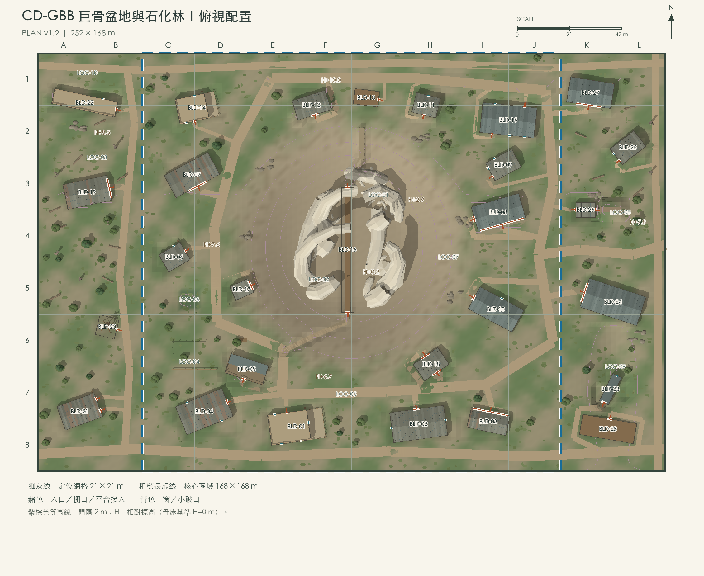
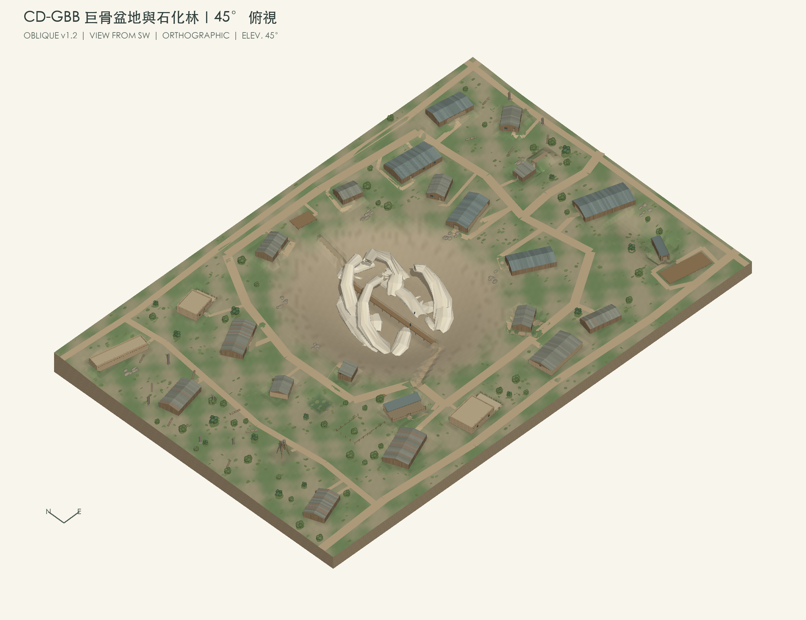
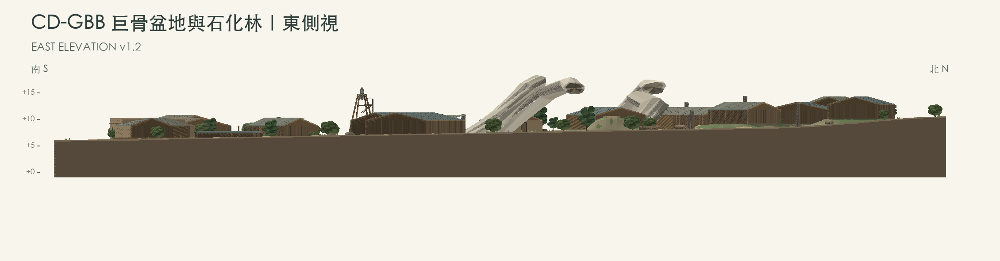
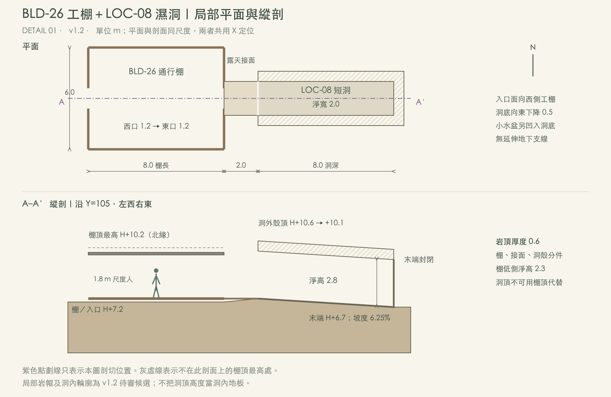
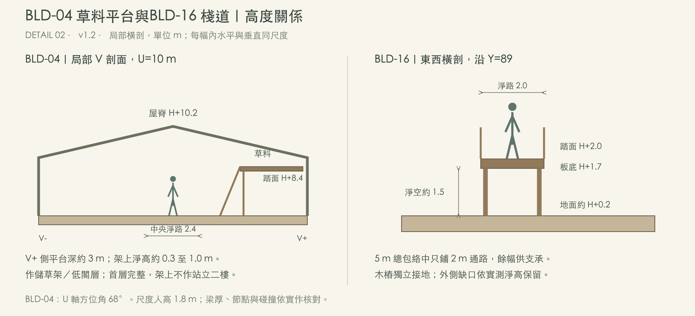
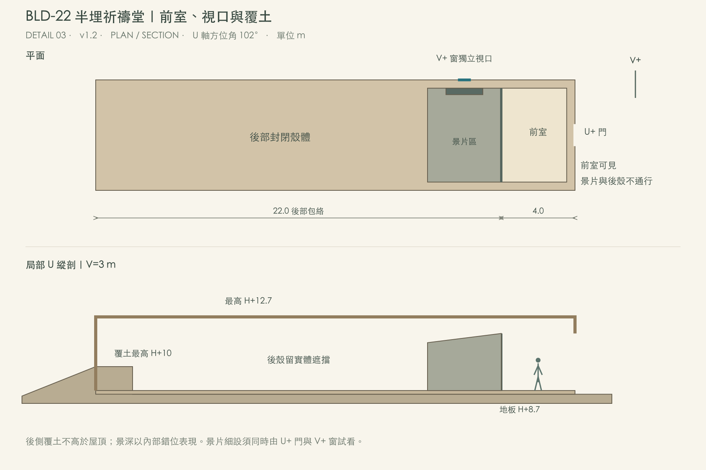

# CD-GBB 巨骨盆地與石化林｜基礎版 v1.2

<!-- Page 1 -->

## 1. Map 地圖

CD-GBB · Great Bone Basin · Map Brief & Production Specifications v1.2 · October 19, 2026 · Base Edition（基礎版）

模型與環境製作的共通定義、準則及文件導引，請見[附件 A：共通建構綱領](#common-guidelines)。

高起的破碎巨骨從下陷採掘盆地露出，木棧道穿過厚重骨床；南緣的農莊、糧庫與畜舍連著採集工務帶。雨季綠意沿坡腳、院界與石化林生長，中央清挖面仍開闊。西側留下舊路與半埋祈禱堂，東側接濕洞、化石作坊及滑落車廂的裂溝。

<!-- Page 2 -->

## 1.1 Overall Views 整體視圖

<!-- Page 3 -->

## 2. Map Guide 範圍與讀圖

Table 1. 範圍與定位

| 項目 | 規格 |
|---|---|
| 地圖 | CD-GBB；Cowboys & Dinosaurs／Great Bone Basin。 |
| 核心區域 | 168 × 168 m；28,224 m²；C1 至 J8。 |
| 全圖 | 252 × 168 m；42,336 m²；A1 至 L8。延伸格位：A1 至 B8、K1 至 L8。 |
| 定位網格 | 21 × 21 m；欄 A 至 L 由西向東，列 1 至 8 由北向南。格位如 C4；跨圖寫 CD-GBB／C4。 |
| 座標與標高 | 西南角為 (0,0)，X 向東、Y 向北。H 為相對標高，骨床基準 H=0 m；不是海拔。 |
| 建物朝向 | 旋轉中心、U 軸方位角及門窗側別見附件 B；圖中開口記號已隨屋體旋轉。 |
| 格位引用 | 清單採中心格；跨格範圍與中心座標見附件 B。格位只表示位置，物件移位不改 ID。 |

Table 2. 圖例與視圖

| 記號／視圖 | 判讀 |
|---|---|
| 細灰實線 | 定位網格 21 × 21 m。 |
| 粗藍長虛線 | 核心區域邊界 168 × 168 m；其外為延伸區域。 |
| 紫棕細線 | 等高線間隔 2 m：相鄰線的高度差 2 m；線越密，坡越陡。骨骸與屋頂不算地面等高線。 |
| 赭色／青色短線 | 赭色：入口、棚口或平台接入；青色：窗、通風口或非通行小破口。圖記不表示門片展開，實際尺寸及開法見附件 B。 |
| 方向 | 俯視圖以北箭頭表示方向；斜視以 SW 視點及 N/E 軸標示；東側視兩端 S/N。 |
| 投影與圖面層次 | 三視圖共用同一組地形與量體，正投影、水平／垂直等比例，保留實際遮擋。屋面拼板、土坯屋緣、開放棚架、分枝樹冠與地表草叢以簡化外觀表現；物件位置與規格以清單為準，洞內另見局部圖。 |

Table 3. 物件編號與引用

| 項目 | 規則 |
|---|---|
| 建築／設施 BLD | 核心區域建築：BLD-01 至 BLD-18；延伸區域建築：BLD-19 至 BLD-28。 |
| 戶外場所 LOC | LOC 代表景點及戶外場所。核心區域：LOC-01、LOC-02、LOC-04 至 LOC-07；延伸區域：LOC-03、LOC-08 至 LOC-10。 |
| 環境分區 ZON | ZON-01 至 ZON-08；地表、植被及密度的配置範圍。 |
| 連接段 RTE | RTE-01 至 RTE-04；坡道、階道、棧道及環路的接面與高度控制。 |
| 編號原則 | BLD、LOC、ZON、RTE 各自起編；既有號碼固定，移位或範圍調整不換號，作廢不回收。項目拆分或合併成新項目時另編新號；已發布項目的變更記入獨立修訂紀錄。 |
| 完整碼與短碼 | 主題－地圖－類型－流水號，如 CD-GBB-BLD-06、CD-GBB-ZON-01、CD-GBB-RTE-01。本文及圖內共用 CD-GBB 前綴，可寫 BLD-06；跨圖引用保留完整碼。 |
| 共用資產 PRP／MOD／NAT／VEG／MAT／DEC／ASM | 可重用物件、構件、自然物、植被、材質、表面細節及組合使用獨立資產 ID，如 PRP-0001、MAT-0001；場所 BLD／LOC 記錄本圖落點與配置。共用分類與組成規則見附件 A。 |

<!-- Page 4 -->

## 3. Environment Overview 環境概述

地圖以中央採掘盆地、南緣農莊與四周工務帶為骨架；石化林、舊路和東側裂溝向外銜接。先依以下季相、地勢與分區建立整體外觀，再由第 4、5 節辨識各個場所。

### 3.1 Shared Appearance 共通外觀

雨季已有生長的草葉與雨後地表共同形成有限度的濕綠；裸露採掘面、道路及工作院保留暖灰土色。低草和灰綠灌叢形成大面，須配置能遮蔽尼諾拉的 2 至 3 m 低枝葉植被，並穿插較低草灌及較高樹木；2 至 3 m 不是全圖樹高上限。遮蔽由枝葉下緣、寬度、密度和落點共同形成。現生植物、普通枯木、石化木與巨骨各自有不同形態與表面。<a href="#fn-1">1</a>

建築依原有農舍、後來修補與開採新設施交錯：老屋可有新修金屬屋頂，新棚也可使用回收木料。風化隨曝露、維護與部位改變，主要結構維持事件前仍在使用的模樣；新破口只在指定位置。

### 3.2 Terrain Character 地勢與地景

中央骨床約 H+0.2 m，周圍作業臺地約 H+6 至 H+10 m；北緣局部約 H+10.5 m。巨骨採集中倒臥、破碎的非人型動物殘骸；目前量體最高點約 H+18.27 m，從約 10 m 深的開挖落差中升起。高處突出坑緣，厚根與低段提供掩體候選；通行與遮蔽效果仍須實際角色試位。

井旁濕地與東側濕洞保留小水盆，坡腳可見濕土；坡面水痕向局部低處連續。採掘區以排水後的裸土為主，少數淺窪積水，不把雨後外觀等同全圖水面。

Table 4. 地景配置概覽

| 分區 | 位置 | 構成與視覺重點 |
|---|---|---|
| ZON-01 南緣農莊與集貨院 | C7 至 J8 | 院中央與入口保持土面；草在院界、牆外和低埂連續，2 至 3 m 檜叢放屋側而非門前。 |
| ZON-02 育幼圈與西側坡腳 | C5 至 E7 | 巢與飼槽工作帶維持裸土；濕綠草叢在圈外不規則集聚，草巢不可被草叢遮掉。 |
| ZON-03 中央骨床與採掘坡 | D3 至 I6 中央 | 開採地保持開闊；用厚骨、棄土、器具與局部坡階增加空間層次，草僅在未清挖的邊縫。 |
| ZON-04 北緣與東側工務帶 | C1 至 J3、I4 至 J6 | 工棚前和滑橇路低草；房後及北側外緣配置低冠叢，保留高臺隱燈棚（BLD-11）與測繪觀察臺（BLD-13）朝骨床的主要視口。 |
| ZON-05 西側石化林 | A2 至 B5 | 石化倒幹、樁與活綠叢穿插；不得一根石木配一株活樹。保留朝核心的 4 m 群間空隙。 |
| ZON-06 西側舊路與堂前 | A1 至 B2、A6 至 B8 | 老路中心仍可辨；堂前與東門短徑留空，舊路外側可被綠草侵入，避免完整新鋪道路。 |
| ZON-07 東側外緣與裂溝 | K1 至 L8 | 高邊較疏、坡腳較綠；裂溝與車廂開口不塞樹，濕洞入口光照區另依 ZON-08。 |
| ZON-08 井旁與洞口濕邊 | C5 井旁、K4 至 L4 洞口局部 | 井旁包絡 8 × 6 m、水盆 3 × 2 m／深 0.2 m；洞口僅有光濕面少量薄苔，洞深不鋪綠草。 |

[詳細設計規格：附件 D，環境與配置](#environment-specs) · [附件 E，特殊空間](#special-spaces)

<aside class="footnote" id="fn-1">1. National Weather Service, “North American Monsoon Highlights,” accessed October 19, 2026, <a href="https://www.weather.gov/abq/northamericanmonsoon-intro">NWS</a>; National Park Service, “Plants,” El Morro National Monument, accessed October 19, 2026, <a href="https://www.nps.gov/elmo/learn/nature/plants.htm">NPS</a>. 季風降雨與當地植被作自然參照；架空盆地的密度與混植為場景設計。</aside>

<!-- Page 5 -->

## 4. Building Register 建築與細節物件｜01 至 07

編號連至附件 B 的逐棟規格；各列「詳述」連至附件 F 的場所描述。

Table 5. 建築概述：BLD-01 至 BLD-07

| 編號／主要格位 | 名稱 | 占地與空間描述 | 製作範圍 | 細節物件 | 故事與異常呈現 |
|---|---|---|---|---|---|
| [BLD-01](#spec-bld-01) E8 [詳述](#place-bld-01) | 南緣農宅 <small>South Farmhouse</small> | 22 × 12 m。老農宅與一側生活院，朝向盆地入口 | 完整室內 | 起居桌、床、衣櫃、灶、借據、門廊、洗盆 | 北側窗外由巨骨遮住一部分天際；室內保留一般農具與未收走的家用品。 |
| [BLD-02](#spec-bld-02) H8 [詳述](#place-bld-02) | 南倉糧庫 <small>South Granary</small> | 22 × 12 m。土坯倉與木屋架，乾存區連外運院 | 完整室內 | 糧袋、留種小袋、托木、抵押漆、家庭袋記、手車 | 同一糧袋的家庭袋記上覆有新抵押漆；保留兩層邊緣及不同墨色。 |
| [BLD-03](#spec-bld-03) I8 [詳述](#place-bld-03) | 生皮與馬具棚 <small>Hide and Tack Shed</small> | 16 × 8 m。高通風棚，生皮與乾燥馬具分架 | 開放棚／作業區 | 皮貨架、寄存牌、粗鹽槽、馬具、掛鉤、繩 | 舊寄存牌仍掛在皮貨架上，新封條跨過牌繩；文字不要互相蓋死。 |
| [BLD-04](#spec-bld-04) D7 [詳述](#place-bld-04) | 農莊馬廄 <small>Farm Stable</small> | 20 × 12 m。木畜舍、局部草樓，接南偏東側生活區 | 完整首層＋低草料平台 | 隔欄、飼槽、乾草、梯、馬具、釘蹄工具 | 大型三趾泥印由盆地方向接近，止在東偏北門外；槽間內仍只有舊蹄痕。 |
| [BLD-05](#spec-bld-05) E7 [詳述](#place-bld-05) | 育幼圈遮棚 <small>Nursery Pen Shelter</small> | 16 × 8 m。在盆地低緣加建的小牛棚，西接外圈 | 開放棚／作業區 | 新欄、舊飼槽、巢、完整卵、倒柱、骨片 | U-／V+ 角一座草巢、三顆完整卵；東欄倒落 2 m，碎卵殼只放巢旁。 |
| [BLD-06](#spec-bld-06) C4 [詳述](#place-bld-06) | 石林邊泵房 <small>Petrified Grove Pump House</small> | 10 × 8 m。井旁的小泵屋，接向農莊與公司工作臺 | 完整室內 | 泵組、三銼痕閥、管線、資產牌、修理工具、木桶 | 舊供水管保留使用磨痕；新公司管以另一漆色與固定件接出；銅閥正面有三道銼痕。 |
| [BLD-07](#spec-bld-07) C3 [詳述](#place-bld-07) | 木工與修理棚 <small>Carpentry and Repair Shed</small> | 20 × 10 m。石化木旁仍用普通木材的作業棚 | 開放棚／作業區 | 鋸架、木料、手鑽、刨檯、欄件、車輪、五金 | 普通木料有整齊鋸口和新木屑；棚外石化木有不規則石質斷口，兩種屑分堆。 |

[詳細設計規格：附件 B](#building-specs) · [全部場所詳述：附件 F](#place-descriptions)

<!-- Page 6 -->

## 4. Building Register 建築與細節物件｜08 至 14

Table 6. 建築概述：BLD-08 至 BLD-14

| 編號／主要格位 | 名稱 | 占地與空間描述 | 製作範圍 | 細節物件 | 故事與異常呈現 |
|---|---|---|---|---|---|
| [BLD-08](#spec-bld-08) I4 [詳述](#place-bld-08) | 大標本包裝棚 <small>Specimen Packing Shed</small> | 20 × 10 m。靠骨盆地東緣的開放棚，接滑橇路 | 開放棚／作業區 | 十四號箱、包覆殼、標籤、岩樣、吊架、繩布 | 中央木箱側面可讀「14」，搭配包覆殼缺口與對應標籤；留出裝卸空間。 |
| [BLD-09](#spec-bld-09) I3 [詳述](#place-bld-09) | 層位記錄屋 <small>Strata Records Office</small> | 12 × 8 m。乾燥記錄間，窗正對盆地採集層面 | 完整室內 | 層位圖、編號木牌、記錄桌、鎖櫃、測量繩、照片 | 桌上層位圖有一段與西偏南窗所見骨床不一致的輪廓；沿同一觀察方向校對兩者。 |
| [BLD-10](#spec-bld-10) I5 [詳述](#place-bld-10) | 岩芯與鑽具庫 <small>Core and Drill Store</small> | 20 × 10 m。公司租用木庫，靠盆地測試鑽位 | 完整室內 | 32 至 39號槽、鑽深表、鑽頭、壓力表、備用閥、管架 | 32 至 39 號岩芯槽可辨；其中一段完整岩芯包含白色夾層，外殼不畫成拼接。 |
| [BLD-11](#spec-bld-11) H2 [詳述](#place-bld-11) | 高臺隱燈棚 <small>Veiled Lamp Hut</small> | 10 × 8 m。舊測量棚被封窗借用，面對巨骨頂端 | 完整室內 | 銅燈、礦片匣、粉末盤、遮光布、工具、包裹 | 遮光布後只留一盞低亮銅燈，光色落在近旁礦片；棚外仍是普通測量小屋。 |
| [BLD-12](#spec-bld-12) F2 [詳述](#place-bld-12) | 北緣絞盤屋 <small>North Rim Winch House</small> | 14 × 8 m。岩臺上的木架棚，纜索垂向骨床 | 開放棚／作業區 | 絞盤、索、吊鉤、錨樁、滑道、空貨籃 | 一根繃緊纜索終止於完整岩面，交界無孔洞、裂縫或地錨；其餘索正常接絞盤。 |
| [BLD-13](#spec-bld-13) G1 [詳述](#place-bld-13) | 測繪觀察臺 <small>Survey Platform</small> | 10 × 6 m。露天木臺，可看骨架與異色地層 | 露天平台／棧道 | 三腳架、測繪板、標樁、雨布、儀器箱、木凳 | 兩個分離的測量樁重複同一號碼；樁身舊漆與新筆記有差別。 |
| [BLD-14](#spec-bld-14) D2 [詳述](#place-bld-14) | 貝爾借住屋 <small>Bell’s Lodging</small> | 16 × 10 m。石林與田地交界的矮屋，帶小外院 | 完整室內 | 床、衣箱、款箱、匯票、炊具、柴、修補欄木 | 款箱、匯票和借住行李放在後半屋角；門閂曾修補，無新增暗門。 |

[詳細設計規格：附件 B](#building-specs) · [全部場所詳述：附件 F](#place-descriptions)

<!-- Page 7 -->

## 4. Building Register 建築與細節物件｜15 至 21

Table 7. 建築概述：BLD-15 至 BLD-21

| 編號／主要格位 | 名稱 | 占地與空間描述 | 製作範圍 | 細節物件 | 故事與異常呈現 |
|---|---|---|---|---|---|
| [BLD-15](#spec-bld-15) J2 [詳述](#place-bld-15) | 採集工宿舍 <small>Collectors’ Bunkhouse</small> | 22 × 12 m。長木屋分成共餐與休息兩段 | 完整室內 | 床卷、餐桌、衣物、私人物品箱、油燈、工資記錄 | 不同記號的箱袋混放，餐桌、床卷及工資單留下採集營地的日常尺度。 |
| [BLD-16](#spec-bld-16) F4 [詳述](#place-bld-16) | 骨床棧道 <small>Bonebed Walkway</small> | 5 × 50 m 包絡；實際踏面寬 2 m，以獨立木樁跨過骨床低處，兩端接採集坡。 | 露天平台／棧道 | 踏板、束索、支撐架、補木、缺口、固定釘、工具袋 | 補板與束索沿木架可辨；主通路完整，缺板限邊緣；高起殘骨從兩側越過視線。 |
| [BLD-17](#spec-bld-17) D5 [詳述](#place-bld-17) | 坑邊工具棚 <small>Pit Tool Shed</small> | 8 × 6 m。低矮斜棚，供進出骨床換工具 | 開放棚／作業區 | 刷、鑿、撬槓、骨片盤、木桶、標籤、磨石 | 一組刷、鑿及撬具的完整輪廓嵌在實岩表面，柄可辨；旁邊另放正常工具作對照。 |
| [BLD-18](#spec-bld-18) H6 [詳述](#place-bld-18) | 滑橇吊運棚 <small>Sled Hoist Shed</small> | 12 × 8 m。連接南倉與採集坑的轉運架棚 | 開放棚／作業區 | 滑橇、木滾、繩、吊鉤、車架、綑帶 | 滑橇留下寬拖痕，附近沒有連續輪轍；吊鉤收向側邊，木滾軌分件可辨。 |
| [BLD-19](#spec-bld-19) A3 [詳述](#place-bld-19) | 石化木材料棚 <small>Petrified Timber Store</small> | 18 × 10 m。疏林間的整理棚，保留普通木料和石木兩類料堆 | 開放棚／作業區 | 石木段、普通木板、鋸架占位、料牌、屑盤、撬槓 | 一段石化木斷面有琥珀色樹脂狀痕，長 0.12 至 0.25 m；其他石木保持普通礦化外觀。 |
| [BLD-20](#spec-bld-20) B6 [詳述](#place-bld-20) | 舊風車井架 <small>Old Windmill Well</small> | 8 × 8 m。高架風車井與小水槽，位於乾濕突變帶 | 井口＋可到達檢修平台 | 塔架、風輪、傳動桿、井蓋、水槽、固定梯、檢修平台 | 乾井內壁留有彼此矛盾的水位記號；風輪一葉片為後換料，井口小槽仍有濕痕。 |
| [BLD-21](#spec-bld-21) A7 [詳述](#place-bld-21) | 荒地修車棚 <small>Badlands Repair Shed</small> | 16 × 10 m。被新運輸路繞過的舊路服務棚 | 開放棚／作業區 | 破車、備輪、爐、工具、路牌、馬具、木桶 | 屋角約 1 m² 缺口下方有集中滴水痕；爐、備輪及修車工作帶仍可分辨。 |

[詳細設計規格：附件 B](#building-specs) · [全部場所詳述：附件 F](#place-descriptions)

<!-- Page 8 -->

## 4. Building Register 建築與細節物件｜22 至 28

Table 8. 建築概述：BLD-22 至 BLD-28

| 編號／主要格位 | 名稱 | 占地與空間描述 | 製作範圍 | 細節物件 | 故事與異常呈現 |
|---|---|---|---|---|---|
| [BLD-22](#spec-bld-22) A1 [詳述](#place-bld-22) | 半埋祈禱堂 <small>Half-Buried Chapel</small> | 26 × 6 m。後側下牆半埋於石坡，上牆與屋頂露出；東偏南門接約 4 m 前室 | 4 m 前室＋不可進入後景 | 殘門、鐘、長凳一角、屋梁、碎玻璃、土堆 | 外牆露出覆土上方；東偏南門內 4 m 前室後接錯位暗景片，窗後視深與外牆長度不合。 |
| [BLD-23](#spec-bld-23) K7 [詳述](#place-bld-23) | 滑落貨車廂 <small>Fallen Boxcar</small> | 12 × 4 m。脫離原軌位、陷在乾裂低地的木車殼 | 完整室內 | 輪組、斷軸、貨架、散箱、破口、綑繩、泥層 | 車頂完整處下方也留水珠與地板濕斑；保留門軌、斷輪與缺少連續鐵路的場景矛盾。 |
| [BLD-24](#spec-bld-24) L5 [詳述](#place-bld-24) | 外緣化石作坊 <small>Outer Fossil Workshop</small> | 24 × 12 m。骨與石木混雜的分揀加工場，大開口木棚 | 開放棚／作業區 | 工作檯、骨片、篩、分類盤、包材、廢料坑、箱 | 分揀桌放骨粉、石屑和批次牌；一組包覆凹模的輪廓與旁邊標本不相合。 |
| [BLD-25](#spec-bld-25) L2 [詳述](#place-bld-25) | 石林瞭望屋 <small>Petrified Grove Lookout</small> | 12 × 8 m。石柱頂緣的小棚，下方接短踏步 | 完整室內 | 望遠器材占位、木凳、繩梯、信號布、儀器箱 | 觀察窗正對石化林；褪色記錄上同一殘幹出現兩個不同方位註記。 |
| [BLD-26](#spec-bld-26) K4 [詳述](#place-bld-26) | 濕洞口工棚 <small>Cave Entrance Shelter</small> | 8 × 6 m。乾荒地邊忽然出現的濕岩入口，外搭簡棚 | 通行棚＋8 m 短洞 | 木支柱、滴水、桶、苔色斑、封板、濕繩 | 洞側柱腳濕黑、外路側較乾；桶與封板靠牆，不堵住西口至東口。 |
| [BLD-27](#spec-bld-27) K1 [詳述](#place-bld-27) | 高地補給棚 <small>Upland Supply Shed</small> | 18 × 10 m。石林外緣的臨時補給點，供外來隊伍存貨 | 開放棚／作業區 | 糧箱、油布、桶、捲毯、箱牌、簡易灶、牽馬樁 | 補給箱的不同運輸記號並存；油布有新補片，棚外爐灶與木柱保持距離。 |
| [BLD-28](#spec-bld-28) K8 [詳述](#place-bld-28) | 拆料平台 <small>Salvage Platform</small> | 22 × 8 m。車廂旁整理散件的露天空地及低木臺 | 露天平台／棧道 | 鋸馬、木板、車皮零件、道釘、軸承占位、推車 | 木板、道釘與輪架部件分堆；部分舊孔與目前接點對不上，留下拆料再用痕跡。 |

[詳細設計規格：附件 B](#building-specs) · [全部場所詳述：附件 F](#place-descriptions)

<!-- Page 9 -->

## 5. Outdoor Register 戶外場所與細節｜01 至 05

編號連至附件 C 的逐處規格；各列「詳述」連至附件 F 的場所描述。

Table 9. 戶外概述：LOC-01 至 LOC-05

| 編號／主要格位 | 名稱 | 空間描述 | 細節物件 | 故事與異常呈現 |
|---|---|---|---|---|
| [LOC-01](#spec-loc-01) G3 [詳述](#place-loc-01) | 巨骨地標 <small>Giant Bonebed</small> | 集中倒臥的非人型巨獸殘骸；高起殘骨和厚根構成中央地標。 | 高起破骨、厚骨根、低骨板、裂紋、沉積物、包覆痕 | 厚骨根部半埋、斷端露出，較高彎段錯位越過坑緣；沒有完整頭顱或可循的連續脊柱。 |
| [LOC-02](#spec-loc-02) F5 [詳述](#place-loc-02) | 環形採集盆地 <small>Excavation Basin</small> | 乾坡下陷為分層採集坑，沿邊保留工作路。 | 岩層、排土、採集面、工具、繩具、標樁、局部積水 | 刷理清面、掘出溝、棄土和未挖坡面有清楚差別；主要工作路保留，坑底不鋪整片草。 |
| [LOC-03](#spec-loc-03) B3 [詳述](#place-loc-03) | 石化林 <small>Petrified Grove</small> | 西側以倒幹、斷樁及少量高立殘幹形成疏林，穿插綠叢並保留朝中心視口。 | 石木幹、礦物斷面、倒木、落石、普通枯枝與活植被 | 倒幹多、斷樁次之、少量高立殘幹；綠叢穿插，普通枯枝與石質斷口可區辨。 |
| [LOC-04](#spec-loc-04) C6 [詳述](#place-loc-04) | 南緣育幼圈 <small>Outer Nursery Pen</small> | 在巨骨旁仍維持普通農牧設施的尺度。 | 舊飼槽、空巢壓痕、草料、門欄、泥印、破水桶 | 外圈保留草料、泥印、空巢壓痕；有卵的唯一主巢在 BLD-05。 |
| [LOC-05](#spec-loc-05) F7 [詳述](#place-loc-05) | 農莊集貨院 <small>Farm Loading Yard</small> | 連生活宅、南倉、畜舍與吊運棚。 | 馬車、糧袋、家庭袋記、抵押漆、木托、吊繩、散落帳紙 | 車與貨堆靠邊，中央留搬運帶；同件貨有新封記和舊寄存記，散紙只集中破包旁。 |

[詳細設計規格：附件 C](#outdoor-specs)

<!-- Page 10 -->

## 5. Outdoor Register 戶外場所與細節｜06 至 10

Table 10. 戶外概述：LOC-06 至 LOC-10

| 編號／主要格位 | 名稱 | 空間描述 | 細節物件 | 故事與異常呈現 |
|---|---|---|---|---|
| [LOC-06](#spec-loc-06) C5 [詳述](#place-loc-06) | 井旁濕地 <small>Wellside Wet Patch</small> | 井旁持續較濕的小尺度地面，接共用泵房。 | 水槽、濕腳印、水生附著物、桶、廢管、修補石 | 小水盆與泥濕岸界明確；濕腳印由水邊到路面逐漸變淡，管架腳落在實地。 |
| [LOC-07](#spec-loc-07) H4 [詳述](#place-loc-07) | 東側採集面 <small>Eastern Collection Face</small> | 供小型標本採集，讓十四號箱仍有具體來處。 | 小骨床、空包覆、岩樣盤、繩布、木樁、細鑿 | 約 4 × 3 m 清面與包覆凹模對應 BLD-08；一處白夾層露頭與 BLD-10 岩芯同色同厚。 |
| [LOC-08](#spec-loc-08) L4 [詳述](#place-loc-08) | 異色濕洞 <small>Discolored Wet Cave</small> | 坡面接一段異色濕岩，入口後為 8 m 封閉短洞。 | 滴水、濕繩、桶、苔色斑、木支柱、封板、濕冷岩面 | 入口附近少量薄苔、向內濕岩漸暗；洞底小水盆反光；不以大面積發光物作辨識。 |
| [LOC-09](#spec-loc-09) L7 [詳述](#place-loc-09) | 滑落裂溝 <small>Derailment Gully</small> | 車廂殼陷在地形裂溝邊，沒有完整鐵路站場。 | 斷軸、散貨、木殘片、裂土、滑落痕、混入石面的枕木 | 車體、斷輪、少量枕木和滑落痕集中一側；遠處沒有完整鐵路可追接。 |
| [LOC-10](#spec-loc-10) A1 [詳述](#place-loc-10) | 半埋堂前 <small>Buried Chapel Forecourt</small> | 土坡包住舊堂的後側下牆；保留露出屋頂與可到達東門的前場。 | 門廊、鐘繩、碎玻璃、屋梁、土堆、可看見卻不合外部深度的室內 | 土堆只包住下牆，屋頂仍露；北側空地的小徑繞至東門，異常室內景深見 BLD-22。 |

[詳細設計規格：附件 C](#outdoor-specs)

<!-- Page 11 -->

## 6. Assembly and Interfaces 建構與接面

### 6.1 Assembly Order 建構順序

1. 建立全圖、核心線與相對 H 基準；完成盆地、周邊臺地、坡路、濕洞岩帽及淺水盆。
2. 放入圖示的破碎巨骨配置 和 28 處設施量體，核對高起骨段、屋脊、風車與低樹叢的視線。
3. 接通門前階坡、RTE-01 至 RTE-04、工棚、濕洞與風車檢修梯臺；地面／樓板／棧道／洞殼分層處理。
4. 試作土坯房、木棚、泵房接管、石化木與低枝檜等代表單元，確認接縫、材料與相對年代，再展開變體。
5. 依 ZON 分區配置植被與地表，補唯一標的及組織物件；最後加使用磨耗、局部水痕與採集碎屑。

### 6.2 Map Interfaces 地圖接面檢核

Table 11. 跨項目接面

| 接面 | 要一起核對的資料 |
|---|---|
| 建築／地面 | 包絡中心、U 軸方位角、院落與附屬構件、屋基、入口踏面、階坡、排水及植被留空；同一開口的尺寸與家具淨空。 |
| 巨骨／土層／棧道 | 根部埋入、斜骨支承、木樁接地、踏面上下淨空；不能只看俯視輪廓。 |
| 洞殼／工棚／地形 | 外岩帽厚度、洞頂內面、2 m 接面與相鄰坡面連續，水盆不穿洞底。 |
| 石木／活植被 | 石質斷面與普通木質區別；低枝葉的實際遮蔽與 4 m 群間空隙。 |
| 委託標的／通用物件 | 箱號、岩芯、寄存記號跨場所一致；唯一目標不在散布時複製。 |

<!-- Page 12 -->

## Appendix A. Common Construction Guidelines 共通建構綱領

本圖的場所、配置與製作條件，以本文及其規格附件為準；可重用模型、構件、材質與組合的身分、製作和交付方式，依下列共通文件辦理。

### A.1 Scope and Definitions 適用範圍與定義

**場所**記錄一張地圖中的位置、空間用途及現況；**資產**是可供場所引用、跨圖重用的製作單位。場所代碼不取代資產代碼，同一資產也不因放入另一個場所而自動成為新資產。形體、材質搭配與配置應分別辨識。

### A.2 Document Guide 文件導引

1. **[編碼與組成規則 v0.4](../../shared/Environment_Asset_Coding_Guide_v0.4.html)**：先確認類別、基底資產、形體與外觀變體，以及組織、地域客製的表示方式。新建或重用項目時，以此查核身分及依賴關係。
2. **[環境資產製作目錄 v0.3](../../shared/Environment_Asset_Catalog_v0.3.html)**：查找已有的製作單位、外形關鍵字、材料搭配和配置定義。目錄列製作需求及選用配置；模型完成狀態另依製作紀錄確認。
3. **[環境資產製作與交接準則 v0.3](../../shared/Environment_Asset_Production_Guide_v0.3.html)**：開始製作前確認尺寸、接口、來源與驗收要求；交付時依其整理可編輯來源、輸出、材質依賴及實際檢查結果。

### A.3 Application 使用方式

先由地圖概述理解場所，再到相應製作規格確認空間、物件與接面。遇到資產代碼時查製作目錄；需要拆件、新編碼或建立變體時查編碼與組成規則，製作及交付則查製作與交接準則。

共用文件說明可以重用的規則，本圖規格說明在這裡如何配置與呈現。物件用量、入口、高程、材料狀態和唯一標的以本圖記錄為準；尚未決定或須實作驗證的事項集中在文件末尾。配套文件的修訂分別管理，不因單張地圖進版而自動換版。

[返回地圖](#map) · [建築概述](#building-register) · [戶外概述](#outdoor-register)

<!-- Page 13 -->

## Appendix B. Building Specifications 建築製作規格

尺寸以 m 計；X 向東、Y 向北，H 為相對標高。每棟以包絡中心配置，地板保持水平。

**坐落方位**：U 沿表列第一個尺寸，V 沿第二個尺寸。U 軸方位角由圖北順時針量測：北 0°、東 90°、南 180°、西 270°；V 為 U 逆時針 90°。例如 U=68° 表示局部 U 正向指向東北（68°）；門向另列，不能把 U 軸方向當入口方向。此為本圖局部座標約定；不使用磁北或海拔。<a href="#fn-2">2</a>

**開口定位**：牆面用 U+、U-、V+、V-。V 牆的中心偏移沿 +U 從 U=0 起算，U 牆沿 +V 從 V=0 起算；寬 × 高為淨開口。BLD-01、BLD-14 的院在 U+ 側，開口仍以屋體計。門、窗、庭院及附屬構件隨屋體一起轉；正文方位詞為概略方向，製作採表列角度與世界座標。

屋基外約 1 m 留整平排水帶，再以約 1.5 m 接坡；門前約 2 m 留踏面，接至圖示支路。靠崖時縮小整平帶，不切穿洞殼。地基向下、牆厚向內，普通屋簷約地板上 2.6 m。接道及門口高差必須同時檢查，不能只轉屋頂。

Table 12. 連接段與高度控制

| 連接段 | 控制點 X, Y, H | 淨寬／水平長 | 建構條件 |
|---|---|---|---|
| RTE-01 南緣進骨床坡道 | (98, 48, 6) → (110, 54, 4) → (124, 60, 2) → (124, 64, 2) | 2／32.65 | 最大段高差／水平距離 14.91%；最大分段約 15%；坡腳接棧道 +2。普通人可行性仍需灰盒測試，載貨可用滑橇。 |
| RTE-02 骨床北側階道 | (124, 114, 2) → (130, 126, 5.5) → (130, 138, 9) | 2／25.42 | 最大段高差／水平距離 29.17%；最大分段坡度約 29%；明確使用分段階梯，不畫成可平走的泥路。 |
| RTE-03 骨床棧道 | (124.5, 64, 2) → (124.5, 114, 2) | 2／50 | 最大段高差／水平距離 0%；木面 +2，下緣 +1.7，中心地面約 +0.2，中央淨空約 1.5 m；不作下層常態人行道。 |
| RTE-04 北側環路 | (94, 158, 10) → (150, 158, 10) → (204, 153, 10) | 4／110.23 | 最大段高差／水平距離 0%；沿北高臺略轉，路面 H+10。 |

坡度為高差除以水平距離。路面、棧道、地面與洞底分開建構；等高線不直接變成一道道牆。

**可達層級**：各屋首層與開放工作帶依清單接通；觀察臺、棧道及低拆料臺可行走。設有檢修用途的高處須有連續梯／階和落腳面。一般屋面未設作業面或接入者不另加通路；有使用需求才補相應結構。巨骨本體暫不攀登，附設鷹架與棧道依各自踏面判定。

<aside class="footnote" id="fn-2">2. Esri, “Direction Units for Editing,” ArcGIS Pro 3.4, “North Azimuth,” accessed October 19, 2026, <a href="https://pro.arcgis.com/en/pro-app/3.4/help/editing/direction-formats-for-editing.htm">官方方向定義</a>。本文採其由北順時針的方位角慣例，局部 U/V、轉軸及配置值為本圖設計。</aside>

<!-- Page 14 -->

## Appendix B. Building Specifications 建築製作規格｜01 至 02

### B.1 BLD-01 南緣農宅 / South Farmhouse

[場所詳述](#place-bld-01)

Table 13. BLD-01 製作規格

| 項目 | 規格 |
|---|---|
| 位置與包絡 | 中心 (104, 18)；主要格位 E8；占用格位 E7、F7、E8、F8。局部 U × V：22 × 12 m。 |
| 坐落與朝向 | U 軸方位角 82°；主接入朝 352°。農宅與糧庫沿既有集貨院基線，門前保留步行廊帶。 |
| 標高與接地 | 地板 H+6.2；頂 H+10.2；門前留 2 m 深接地空間；石基／短坡道銜接外地面。 |
| 歷程與範圍 | 原農宅；屋頂與北門曾局部翻修。 完整室內。 |
| 外殼與組成 | 土坯牆 MOD-0001 厚牆＋石基 MOD-0002 石基＋土屋屋緣 MOD-0008 低女兒牆；室內夯土，門廊石板。 |
| 室內與工作帶 | 主門朝北。22 × 12 m 包絡中西側約 16 × 12 m 為屋體、東側 6 × 12 m 為院；屋內前半起居灶間、後半分兩睡房，以中門相通。 |
| 入口與接入 | V+ 牆（352°）中心 8；1 × 2.1；單扇內開 |
| 窗與其他開口 | V+ 牆（352°）中心 3；0.9 × 1；臺高 1.1；固定窗／木框 V- 牆（172°）中心 4；0.9 × 1；臺高 1.1；固定窗／木框 V- 牆（172°）中心 12；0.9 × 1；臺高 1.1；固定窗／木框 U+ 牆（82°）中心 7；0.9 × 1；臺高 1.1；固定窗／木框 |
| 必要物件 | 起居桌、床、衣櫃、灶、借據、門廊、洗盆 |
| 細節與處理 | 維護中舊件；北門框補木、灶口煙痕、外牆一塊不同色泥抹補丁。灶上煙道最高亦控制在 H+10.2，不另加高煙囪。 |
| 可見異常與痕跡 | 北側窗外由巨骨遮住一部分天際；室內保留一般農具與未收走的家用品。 |

### B.2 BLD-02 南倉糧庫 / South Granary

[場所詳述](#place-bld-02)

Table 14. BLD-02 製作規格

| 項目 | 規格 |
|---|---|
| 位置與包絡 | 中心 (153, 19)；主要格位 H8；占用格位 G7、H7、G8、H8。局部 U × V：22 × 12 m。 |
| 坐落與朝向 | U 軸方位角 82°；主接入朝 352°。與農宅共用集貨院方向，雙門前留搬袋及手車空間。 |
| 標高與接地 | 地板 H+6.2；頂 H+10.2；門前留 2 m 深接地空間；石基／短坡道銜接外地面。 |
| 歷程與範圍 | 舊糧庫；近期改用新抵押標記。 完整室內。 |
| 外殼與組成 | 土坯牆 MOD-0001 下部厚牆、木構件 MOD-0003 至 MOD-0006 木屋架、金屬屋面 MOD-0007 屋面；夯土地面加架高 0.12 m 的可移托木。 |
| 室內與工作帶 | 主雙門朝北，2.4 × 2.4 m；單一倉間，中央 2.4 m 搬貨帶、兩側分袋堆，兩端高位通風口。 |
| 入口與接入 | V+ 牆（352°）中心 11；2.4 × 2.4；雙扇外開 |
| 窗與其他開口 | U+ 牆（82°）中心 6；0.8 × 0.45；臺高 2.05；固定百葉通風口 U- 牆（262°）中心 6；0.8 × 0.45；臺高 2.05；固定百葉通風口 |
| 必要物件 | 糧袋、留種小袋、托木、抵押漆、家庭袋記、手車 |
| 細節與處理 | 維護中舊件；門內泥痕、托木下乾土。家庭袋記與新抵押漆做獨立圖層，不混成一個組織標誌。 |
| 可見異常與痕跡 | 同一糧袋的家庭袋記上覆有新抵押漆；保留兩層邊緣及不同墨色。 |
| 組織標的 | 牧業聯盟／水土同盟：同一批抵押糧袋與家庭寄存袋；兩組記號共存，不複製成兩份貨。 |

[返回建築概述](#building-register)

<!-- Page 15 -->

## Appendix B. Building Specifications 建築製作規格｜03 至 04

### B.3 BLD-03 生皮與馬具棚 / Hide and Tack Shed

[場所詳述](#place-bld-03)

Table 15. BLD-03 製作規格

| 項目 | 規格 |
|---|---|
| 位置與包絡 | 中心 (181, 20)；主要格位 I8；占用格位 I7、J7、I8、J8。局部 U × V：16 × 8 m。 |
| 坐落與朝向 | U 軸方位角 102°；主接入朝 12°。沿集貨院東端轉折收邊，棚口朝院，與糧庫錯開晾皮工作面。 |
| 標高與接地 | 地板 H+6.2；頂 H+10.2；門前留 2 m 深接地空間；石基／短坡道銜接外地面。 |
| 歷程與範圍 | 舊皮貨棚；收購後補封條與掛架。 開放棚／作業區。 |
| 外殼與組成 | 木柱梁及疏板牆（MOD-0003 至 MOD-0006）＋金屬屋面 MOD-0007；北偏東牆留 14 m 開口，兩端各約 1 m；其餘三面下部疏板，夯土地。 |
| 室內與工作帶 | 北偏東向，兩組掛架之間 1.4 m 淨道；西偏北半生皮、東偏南半乾馬具，不加臥室。 |
| 入口與接入 | V+ 牆（12°）中心 8；14 × 2.4；無門片 |
| 窗與其他開口 | — |
| 必要物件 | 皮貨架、寄存牌、粗鹽槽、馬具、掛鉤、繩 |
| 細節與處理 | 維護中舊件；粗鹽槽下局部淺色灑落，皮架暗污；寄存牌與新封條同件可辨。 |
| 可見異常與痕跡 | 舊寄存牌仍掛在皮貨架上，新封條跨過牌繩；文字不要互相蓋死。 |
| 組織標的 | 牧業聯盟／水土同盟：皮貨與馬具寄存牌、新封條；兩方爭的是同件存貨。 |

### B.4 BLD-04 農莊馬廄 / Farm Stable

[場所詳述](#place-bld-04)

Table 16. BLD-04 製作規格

| 項目 | 規格 |
|---|---|
| 位置與包絡 | 中心 (67, 24)；主要格位 D7；占用格位 C7、D7、C8、D8。局部 U × V：20 × 12 m。 |
| 坐落與朝向 | U 軸方位角 68°；主接入朝 68°。馬廄端門斜對集貨院入口，東北側留牽馬轉身空地。 |
| 標高與接地 | 地板 H+6.2；頂 H+10.2；門前留 2 m 深接地空間；石基／短坡道銜接外地面。 |
| 歷程與範圍 | 原農莊馬廄；草料架與門框多次修補。 完整首層＋低草料平台。 |
| 外殼與組成 | 木構件 MOD-0003 至 MOD-0006 木畜舍＋金屬屋面 MOD-0007；夯土地、局部草料；中央柱列支承寬屋面。 |
| 室內與工作帶 | 主門朝東偏北，2.4 × 2.4 m；中央 2.4 m 通道、兩側各 3 槽間；北偏西端局部草料平台。 |
| 入口與接入 | U+ 牆（68°）中心 6；2.4 × 2.4；雙扇外開 |
| 窗與其他開口 | V+ 牆（338°）中心 5；0.8 × 0.5；臺高 2；固定窗／木框 V- 牆（158°）中心 15；0.8 × 0.5；臺高 2；固定窗／木框 |
| 必要物件 | 隔欄、飼槽、乾草、梯、馬具、釘蹄工具 |
| 細節與處理 | 維護中舊件；槽沿擦痕、地面蹄印。草平台高＋2.2 m，北偏西側約 3 m 深；架上淨高約 0.3 至 1.0 m，維持低儲草架。取草梯固定在平台內緣，下端不侵入中央通道；人由首層或梯上取料，不在架上站立。 |
| 可見異常與痕跡 | 大型三趾泥印由盆地方向接近，止在東偏北門外；槽間內仍只有舊蹄痕。 |

[返回建築概述](#building-register)

<!-- Page 16 -->

## Appendix B. Building Specifications 建築製作規格｜05 至 06

### B.5 BLD-05 育幼圈遮棚 / Nursery Pen Shelter

[場所詳述](#place-bld-05)

Table 17. BLD-05 製作規格

| 項目 | 規格 |
|---|---|
| 位置與包絡 | 中心 (84, 41)；主要格位 E7；占用格位 D6、E6、D7、E7。局部 U × V：16 × 8 m。 |
| 坐落與朝向 | U 軸方位角 108°；主接入朝 198°。沿舊圈欄斜線，圈門面向農莊一側，避免直接開向採集坡。 |
| 標高與接地 | 地板 H+6.2；頂 H+10.2；門前留 2 m 深接地空間；石基／短坡道銜接外地面。 |
| 歷程與範圍 | 舊圈地後加遮棚；事件中局部倒欄。 開放棚／作業區。 |
| 外殼與組成 | 木構件 MOD-0003 至 MOD-0006 棚柱、金屬屋面 MOD-0007 單坡覆棚；木欄與土面。覆棚占北偏東半，南偏西半為露天圈。 |
| 室內與工作帶 | 圈門朝南偏西，寬 1.8 m；巢在U-／V+ 角，保留進門至飼槽 1.2 m 淨帶。 |
| 入口與接入 | V- 牆（198°）中心 8；1.8 × 1.4；無門片 |
| 窗與其他開口 | — |
| 必要物件 | 新欄、舊飼槽、巢、完整卵、倒柱、骨片 |
| 細節與處理 | 維護中舊件＋本次破壞；東欄一段 2 m 被頂倒，斷口較亮；草料和巢材分開，不把整圈鋪石化木。 |
| 可見異常與痕跡 | U-／V+ 角唯一草巢直徑約 1.4 m、高 0.25 m，內放三顆長 0.25 至 0.35 m 的完整卵；尺寸待與生物設計對齊。東欄倒落 2 m，碎卵殼只放主巢旁。 |
| 組織標的 | 自然史院：三顆完整卵；牧業聯盟：清除同一主巢。唯一主巢位於此棚，LOC-04 不再複製。 |

### B.6 BLD-06 石林邊泵房 / Petrified Grove Pump House

[場所詳述](#place-bld-06)

Table 18. BLD-06 製作規格

| 項目 | 規格 |
|---|---|
| 位置與包絡 | 中心 (55, 86)；主要格位 C4；占用格位 C4、C5。局部 U × V：10 × 8 m。 |
| 坐落與朝向 | U 軸方位角 60°；主接入朝 60°。泵房位於濕地上緣，入口朝東北乾燥維修路，外管另轉向南側濕地。 |
| 標高與接地 | 地板 H+7.2；頂 H+11.2；門前留 2 m 深接地空間；石基／短坡道銜接外地面。 |
| 歷程與範圍 | 舊共用泵房；公司近期增接管線。 完整室內。 |
| 外殼與組成 | 石基 MOD-0002 石基、土坯牆 MOD-0001 矮厚牆、木構件 MOD-0003 至 MOD-0006 架、金屬屋面 MOD-0007 屋面；泵腳石墩，室內石板。 |
| 室內與工作帶 | 主門朝東偏北 1.2 m 寬；單間，泵組靠西偏南、東偏北側工作帶 1.2 m；管線向南及東分出。 |
| 入口與接入 | U+ 牆（60°）中心 4；1.2 × 2.1；單扇內開 |
| 窗與其他開口 | V+ 牆（330°）中心 7；0.8 × 0.7；臺高 1.3；固定窗／木框 |
| 必要物件 | 泵組、三銼痕閥、管線、資產牌、修理工具、木桶 |
| 細節與處理 | 維護中舊件＋近期加裝＋局部潮濕；舊共用管與新公司管有漆色／固定件差別；三銼痕閥距地約 1.0 m、正面可看清。 |
| 可見異常與痕跡 | 舊供水管保留使用磨痕；新公司管以另一漆色與固定件接出；銅閥正面有三道銼痕。 |
| 組織標的 | 水土同盟：三銼痕銅閥；考爾德公司：泵組及新管。閥位約地板上 1 m，記號須朝工作帶。 |
| 場所敘述 | [石林邊泵房詳述](#place-bld-06) |

[返回建築概述](#building-register)

<!-- Page 17 -->

## Appendix B. Building Specifications 建築製作規格｜07 至 08

### B.7 BLD-07 木工與修理棚 / Carpentry and Repair Shed

[場所詳述](#place-bld-07)

Table 19. BLD-07 製作規格

| 項目 | 規格 |
|---|---|
| 位置與包絡 | 中心 (62, 119)；主要格位 C3；占用格位 D2、C3、D3。局部 U × V：20 × 10 m。 |
| 坐落與朝向 | U 軸方位角 62°；主接入朝 152°。棚口朝東南接環路彎段，長料在棚後、修輪在前院，避免橫穿搬運帶。 |
| 標高與接地 | 地板 H+8.2；頂 H+12.2；門前留 2 m 深接地空間；石基／短坡道銜接外地面。 |
| 歷程與範圍 | 原修理棚；採集後增加長料與欄件。 開放棚／作業區。 |
| 外殼與組成 | 木構件 MOD-0003 至 MOD-0006 柱架、後側板牆、金屬屋面 MOD-0007 屋面；刨檯下局部板地，其餘土面。 |
| 室內與工作帶 | 朝南偏東半開；西偏南側長料、北偏西牆工具、東偏北側修輪，中間 2 m 作業帶。 |
| 入口與接入 | V- 牆（152°）中心 10；8 × 2.4；無門片 |
| 窗與其他開口 | — |
| 必要物件 | 鋸架、木料、手鑽、刨檯、欄件、車輪、五金 |
| 細節與處理 | 維護中舊件；新木屑只在鋸架與刨檯周圍；石化木放棚外，鋸口與石質斷口要有差別。 |
| 可見異常與痕跡 | 普通木料有整齊鋸口和新木屑；棚外石化木有不規則石質斷口，兩種屑分堆。 |

### B.8 BLD-08 大標本包裝棚 / Specimen Packing Shed

[場所詳述](#place-bld-08)

Table 20. BLD-08 製作規格

| 項目 | 規格 |
|---|---|
| 位置與包絡 | 中心 (185, 104)；主要格位 I4；占用格位 I3、J3、I4、J4。局部 U × V：20 × 10 m。 |
| 坐落與朝向 | U 軸方位角 74°；主接入朝 254°。沿東側採集面切向設棚，西南滑橇口接卸料前坪，東南長開口供整理。 |
| 標高與接地 | 地板 H+8.2；頂 H+12.2；門前留 2 m 深接地空間；石基／短坡道銜接外地面。 |
| 歷程與範圍 | 本次開採新設；使用回收木柱與新包材。 開放棚／作業區。 |
| 外殼與組成 | 木構件 MOD-0003 至 MOD-0006 開放棚、金屬屋面 MOD-0007；柱腳石墩，中央乾硬土地。 |
| 室內與工作帶 | 朝西偏南及南開放；北偏西側包材架、中央十四號箱，西偏南側留 2.4 m 滑橇入口。 |
| 入口與接入 | U- 牆（254°）中心 5；2.4 × 2.4；無門片 V- 牆（164°）中心 10；18 × 2.4；無門片 |
| 窗與其他開口 | — |
| 必要物件 | 十四號箱、包覆殼、標籤、岩樣、吊架、繩布 |
| 細節與處理 | 近期加裝；包覆殼破邊、繩結與編號牌。吊架不穿過屋脊；箱上方留至少 0.5 m 操作空隙。 |
| 可見異常與痕跡 | 中央木箱側面可讀「14」，搭配包覆殼缺口與對應標籤；留出裝卸空間。 |
| 組織標的 | 自然史院：十四號箱；側面 14 號、包覆殼與 LOC-07 採集凹模互相對應。 |

[返回建築概述](#building-register)

<!-- Page 18 -->

## Appendix B. Building Specifications 建築製作規格｜09 至 10

### B.9 BLD-09 層位記錄屋 / Strata Records Office

[場所詳述](#place-bld-09)

Table 21. BLD-09 製作規格

| 項目 | 規格 |
|---|---|
| 位置與包絡 | 中心 (187, 123)；主要格位 I3；占用格位 I2、J2、I3、J3。局部 U × V：12 × 8 m。 |
| 坐落與朝向 | U 軸方位角 62°；主接入朝 242°。西南觀察窗面向採集面，入口避開宿舍後勤路，落在獨立短石臺。 |
| 標高與接地 | 地板 H+8.2；頂 H+12.2；門前留 2 m 深接地空間；石基／短坡道銜接外地面。 |
| 歷程與範圍 | 採集後新設記錄間；板牆完整而屋面已有雨痕。 完整室內。 |
| 外殼與組成 | 木構件 MOD-0003 至 MOD-0006 較密板牆、金屬屋面 MOD-0007；架高於地面的木板室內，外門接石階。 |
| 室內與工作帶 | 主門朝西偏南 1.0 m；西偏南窗對骨床。前 2/3 為桌間、東後 1/3 以板牆分鎖櫃儲存間。 |
| 入口與接入 | U- 牆（242°）中心 2；1 × 2.1；單扇內開 |
| 窗與其他開口 | U- 牆（242°）中心 5.7；1.2 × 1；臺高 1.1；固定窗／木框 V+ 牆（332°）中心 4；0.9 × 1；臺高 1.1；固定窗／木框 |
| 必要物件 | 層位圖、編號木牌、記錄桌、鎖櫃、測量繩、照片 |
| 細節與處理 | 維護中舊件；窗框、桌上層位圖與窗外視角對應；紙張乾燥，無故不做整屋霉濕。 |
| 可見異常與痕跡 | 桌上層位圖有一段與西偏南窗所見骨床不一致的輪廓；沿同一觀察方向校對兩者。 |
| 組織標的 | 黑爾與默瑟偵探社：箱件記錄；放在東偏北側鎖櫃，頁面用與 BLD-08 一致的箱號。 |

### B.10 BLD-10 岩芯與鑽具庫 / Core and Drill Store

[場所詳述](#place-bld-10)

Table 22. BLD-10 製作規格

| 項目 | 規格 |
|---|---|
| 位置與包絡 | 中心 (184, 65)；主要格位 I5；占用格位 I5、J5、I6、J6。局部 U × V：20 × 10 m。 |
| 坐落與朝向 | U 軸方位角 118°；主接入朝 298°。西北雙門正對盆地東南搬運來向，庫後退讓外環路。 |
| 標高與接地 | 地板 H+7.2；頂 H+11.2；門前留 2 m 深接地空間；石基／短坡道銜接外地面。 |
| 歷程與範圍 | 公司近期租改木庫；新增岩芯架與設備基腳。 完整室內。 |
| 外殼與組成 | 木構件 MOD-0003 至 MOD-0006 木庫、金屬屋面 MOD-0007、石基 MOD-0002 柱腳；土面加岩芯架下板墊。 |
| 室內與工作帶 | 主雙門朝西偏北 2.4 m；北偏東側岩芯架、東偏南側鑽具、南偏西側備件，中央寬 2 m。 |
| 入口與接入 | U- 牆（298°）中心 5；2.4 × 2.4；雙扇外開 |
| 窗與其他開口 | V+ 牆（28°）中心 10；1.2 × 0.6；臺高 1.8；固定窗／木框 |
| 必要物件 | 32 至 39號槽、鑽深表、鑽頭、壓力表、備用閥、管架 |
| 細節與處理 | 近期加裝；32 至 39 槽可讀，白色夾層 DEC-0008 只在指定岩芯；管架端部有止擋，不讓重管懸空。 |
| 可見異常與痕跡 | 32 至 39 號岩芯槽可辨；其中一段完整岩芯包含白色夾層，外殼不畫成拼接。 |
| 組織標的 | 考爾德公司：岩芯與機件；隱燈會：白色夾層。兩者共用同一指定岩芯，夾層露頭僅在 LOC-07 指定一處。 |

[返回建築概述](#building-register)

<!-- Page 19 -->

## Appendix B. Building Specifications 建築製作規格｜11 至 12

### B.11 BLD-11 高臺隱燈棚 / Veiled Lamp Hut

[場所詳述](#place-bld-11)

Table 23. BLD-11 製作規格

| 項目 | 規格 |
|---|---|
| 位置與包絡 | 中心 (156, 147)；主要格位 H2；占用格位 H1、H2。局部 U × V：10 × 8 m。 |
| 坐落與朝向 | U 軸方位角 104°；主接入朝 194°。沿高臺局部邊緣設舊測量棚，南偏西入口朝盆地，北側保持封窗。 |
| 標高與接地 | 地板 H+10.2；頂 H+14.2；門前留 2 m 深接地空間；石基／短坡道銜接外地面。 |
| 歷程與範圍 | 較早測量棚；近期封窗借用。 完整室內。 |
| 外殼與組成 | 木構件 MOD-0003 至 MOD-0006 舊測量棚、金屬屋面 MOD-0007；木板地、封窗板與遮光布。 |
| 室內與工作帶 | 主門朝南偏西；單間，北偏東半工作桌、東偏南側匣架，銅燈在中央偏北偏東桌上，高約 0.85 m。 |
| 入口與接入 | V- 牆（194°）中心 5；1 × 2.1；單扇內開 |
| 窗與其他開口 | V+ 牆（14°）中心 5；0.9 × 1；臺高 1.1；木板封窗＋內側遮光布 |
| 必要物件 | 銅燈、礦片匣、粉末盤、遮光布、工具、包裹 |
| 細節與處理 | 維護中舊件；外部普通舊棚，異常只集中小銅燈；不加教堂尖頂、滿牆符文或奇幻祭壇。 |
| 可見異常與痕跡 | 遮光布後只留一盞低亮銅燈，光色落在近旁礦片；棚外仍是普通測量小屋。 |
| 組織標的 | 隱燈會：桌上銅燈；附近普通匣、布、礦片不另增大範圍祭壇。 |

### B.12 BLD-12 北緣絞盤屋 / North Rim Winch House

[場所詳述](#place-bld-12)

Table 24. BLD-12 製作規格

| 項目 | 規格 |
|---|---|
| 位置與包絡 | 中心 (110, 147)；主要格位 F2；占用格位 E1、F1、E2、F2。局部 U × V：14 × 8 m。 |
| 坐落與朝向 | U 軸方位角 72°；主接入朝 162°。出索口朝南偏東對準採集盆地，前坪與後側環路分開。 |
| 標高與接地 | 地板 H+10.2；頂 H+14.2；門前留 2 m 深接地空間；石基／短坡道銜接外地面。 |
| 歷程與範圍 | 開採時增設；絞盤石墩較新。 開放棚／作業區。 |
| 外殼與組成 | 木構件 MOD-0003 至 MOD-0006 柱架、金屬屋面 MOD-0007；絞盤下獨立石墩，南偏東側出索口。 |
| 室內與工作帶 | 南偏東面朝骨床大開口 3 m；絞盤置後半，前半 2 m 工作帶，地錨不與通路重疊。 |
| 入口與接入 | V- 牆（162°）中心 7；3 × 2.4；無門片 |
| 窗與其他開口 | — |
| 必要物件 | 絞盤、索、吊鉤、錨樁、滑道、空貨籃 |
| 細節與處理 | 維護中舊件；繩與輪槽接觸處明確；入岩異常索限定一條，接點在實岩而非畫出裂孔。 |
| 可見異常與痕跡 | 一根繃緊纜索終止於完整岩面，交界無孔洞、裂縫或地錨；其餘索正常接絞盤。 |

[返回建築概述](#building-register)

<!-- Page 20 -->

## Appendix B. Building Specifications 建築製作規格｜13 至 14

### B.13 BLD-13 測繪觀察臺 / Survey Platform

[場所詳述](#place-bld-13)

Table 25. BLD-13 製作規格

| 項目 | 規格 |
|---|---|
| 位置與包絡 | 中心 (132, 150)；主要格位 G1；占用格位 G1、G2。局部 U × V：10 × 6 m。 |
| 坐落與朝向 | U 軸方位角 98°；主接入朝 98°。觀測臺沿高臺邊緣略轉，接入在東偏南側，南側保留觀測視域。 |
| 標高與接地 | 地板 H+10；露天；通行面與下方地面分開製作；端部補平台與欄杆，支柱位置避開下層通路。 |
| 歷程與範圍 | 開採時架設；踏板已有短期磨耗。 露天平台／棧道。 |
| 外殼與組成 | 露天 木構件 MOD-0003 至 MOD-0006 木臺；原 H+10 踏面，石墩／短柱補落差；無頂。 |
| 室內與工作帶 | 南側面向骨床，東側接北環路短踏步；儀器在北半，南側留 2 m 觀測帶。 |
| 入口與接入 | U+ 牆（98°）中心 3；1.2 × 2.2；無門片 |
| 窗與其他開口 | — |
| 必要物件 | 三腳架、測繪板、標樁、雨布、儀器箱、木凳 |
| 細節與處理 | 維護中舊件；欄杆及折疊雨布架低於人胸至頭部範圍，不加永久觀景高塔。 |
| 可見異常與痕跡 | 兩個分離的測量樁重複同一號碼；樁身舊漆與新筆記有差別。 |

### B.14 BLD-14 貝爾借住屋 / Bell’s Lodging

[場所詳述](#place-bld-14)

Table 26. BLD-14 製作規格

| 項目 | 規格 |
|---|---|
| 位置與包絡 | 中心 (64, 146)；主要格位 D2；占用格位 C1、D1、C2、D2。局部 U × V：16 × 10 m。 |
| 坐落與朝向 | U 軸方位角 78°；主接入朝 168°。延續舊農舍院落基線；門廊朝南偏東接曲折支路，院落保留在 U+ 側。 |
| 標高與接地 | 地板 H+9.2；頂 H+13.2；門前留 2 m 深接地空間；石基／短坡道銜接外地面。 |
| 歷程與範圍 | 原農舍；借住期間維修門閂。 完整室內。 |
| 外殼與組成 | 土坯牆 MOD-0001＋石基 MOD-0002＋土屋屋緣 MOD-0008；室內夯土，南偏東側小門廊。 |
| 室內與工作帶 | 主門朝南偏東；包絡西偏南側 12 × 10 m 屋體、東偏北側 4 × 10 m 小院；前半灶與桌、後半睡處及款箱角。 |
| 入口與接入 | V- 牆（168°）中心 6；1 × 2.1；單扇內開 |
| 窗與其他開口 | V- 牆（168°）中心 2.5；0.9 × 1；臺高 1.1；固定窗／木框 V+ 牆（348°）中心 8；0.9 × 1；臺高 1.1；固定窗／木框 |
| 必要物件 | 床、衣箱、款箱、匯票、炊具、柴、修補欄木 |
| 細節與處理 | 維護中舊件；修過的門閂、借住行李與牆面使用痕跡；款箱不藏成需要新密道的地下庫。 |
| 可見異常與痕跡 | 款箱、匯票和借住行李放在後半屋角；門閂曾修補，無新增暗門。 |
| 組織標的 | 黑爾與默瑟偵探社：後半屋角的款箱與匯票；箱外記號與文件相符。 |

[返回建築概述](#building-register)

<!-- Page 21 -->

## Appendix B. Building Specifications 建築製作規格｜15 至 16

### B.15 BLD-15 採集工宿舍 / Collectors’ Bunkhouse

[場所詳述](#place-bld-15)

Table 27. BLD-15 製作規格

| 項目 | 規格 |
|---|---|
| 位置與包絡 | 中心 (189, 141)；主要格位 J2；占用格位 I1、J1、I2、J2。局部 U × V：22 × 12 m。 |
| 坐落與朝向 | U 軸方位角 96°；主接入朝 186°。長宿舍順北東高臺邊緣，後門接環路、前門面向營地空地。 |
| 標高與接地 | 地板 H+9.2；頂 H+13.2；門前留 2 m 深接地空間；石基／短坡道銜接外地面。 |
| 歷程與範圍 | 採集擴張時新設；舊家具與新床架混用。 完整室內。 |
| 外殼與組成 | 木構件 MOD-0003 至 MOD-0006 長板屋、金屬屋面 MOD-0007、短石基；木板地。 |
| 室內與工作帶 | 主門朝南；西半共餐、東半床位，中隔牆開 1.2 m 門；北側留一扇 1 m 副門。 |
| 入口與接入 | V- 牆（186°）中心 5；1 × 2.1；單扇內開 V+ 牆（6°）中心 17；1 × 2.1；單扇內開 |
| 窗與其他開口 | V- 牆（186°）中心 12；0.9 × 1；臺高 1.1；固定窗／木框 V- 牆（186°）中心 18；0.9 × 1；臺高 1.1；固定窗／木框 V+ 牆（6°）中心 5；0.9 × 1；臺高 1.1；固定窗／木框 |
| 必要物件 | 床卷、餐桌、衣物、私人物品箱、油燈、工資記錄 |
| 細節與處理 | 維護中舊件；窗下床卷、餐桌腳磨損。屋面承重有中間柱／屋架，不做兩層旅館。 |
| 可見異常與痕跡 | 不同記號的箱袋混放，餐桌、床卷及工資單留下採集營地的日常尺度。 |

### B.16 BLD-16 骨床棧道 / Bonebed Walkway

[場所詳述](#place-bld-16)

Table 28. BLD-16 製作規格

| 項目 | 規格 |
|---|---|
| 位置與包絡 | 中心 (124.5, 89)；主要格位 F4；占用格位 F3、G3、F4、G4、F5、G5。局部 U × V：5 × 50 m。 |
| 坐落與朝向 | U 軸方位角 90°；主接入朝 180°。棧道依既有南北接點及骨床支柱排列，維持直線工程構造。 |
| 標高與接地 | 地板 H+2；露天；支柱落在骨床地面；骨件接觸處不當作結構支點。南北端接面與骨面淨空待量體驗證。 |
| 歷程與範圍 | 開採後架設；局部踏板再次補強。 露天平台／棧道。 |
| 外殼與組成 | 木構件 MOD-0003 至 MOD-0006 踏板、側梁、短斜撐及束索；踏面 H+2、下緣 H+1.7。 |
| 室內與工作帶 | 原 5 × 50 m 總包絡內，保持 2 m 連續淨路；其餘給支承、欄及局部工具，不把 5 m 全做平臺。 |
| 入口與接入 | V- 牆（180°）中心 2.5；2 × 2.2；無門片 V+ 牆（0°）中心 2.5；2 × 2.2；無門片 |
| 窗與其他開口 | — |
| 必要物件 | 踏板、束索、支撐架、補木、缺口、固定釘、工具袋 |
| 細節與處理 | 主路連續，缺板只放邊緣。兩側木樁獨立接地，骨面接觸加緩衝墊木但不作承重支點；束索繫木架。 |
| 可見異常與痕跡 | 補板與束索沿木架可辨；主通路完整，缺板限邊緣；高起殘骨從兩側越過視線。 |

[返回建築概述](#building-register)

<!-- Page 22 -->

## Appendix B. Building Specifications 建築製作規格｜17 至 18

### B.17 BLD-17 坑邊工具棚 / Pit Tool Shed

[場所詳述](#place-bld-17)

Table 29. BLD-17 製作規格

| 項目 | 規格 |
|---|---|
| 位置與包絡 | 中心 (82, 73)；主要格位 D5；占用格位 D5、E5。局部 U × V：8 × 6 m。 |
| 坐落與朝向 | U 軸方位角 66°；主接入朝 66°。後牆靠西南岩臺，東北棚口對準坑側工作面。 |
| 標高與接地 | 地板 H+6.7；頂 H+10.7；門前留 2 m 深接地空間；石基／短坡道銜接外地面。 |
| 歷程與範圍 | 開採時搭建；靠岩的一側仍保留天然石面。 開放棚／作業區。 |
| 外殼與組成 | 木構件 MOD-0003 至 MOD-0006 低斜棚、金屬屋面 MOD-0007；後方靠岩但梁不直接穿石，夯土地。 |
| 室內與工作帶 | 朝東偏北開放，工具架靠西偏南後牆；中間 1.2 m 操作空間。 |
| 入口與接入 | U+ 牆（66°）中心 3；4 × 2.3；無門片 |
| 窗與其他開口 | — |
| 必要物件 | 刷、鑿、撬槓、骨片盤、木桶、標籤、磨石 |
| 細節與處理 | 維護中舊件；嵌石工具作獨立異常面板，保留完整握柄與輪廓，普通工具仍可與其並排辨識。 |
| 可見異常與痕跡 | 一組刷、鑿及撬具的完整輪廓嵌在實岩表面，柄可辨；旁邊另放正常工具作對照。 |

### B.18 BLD-18 滑橇吊運棚 / Sled Hoist Shed

[場所詳述](#place-bld-18)

Table 30. BLD-18 製作規格

| 項目 | 規格 |
|---|---|
| 位置與包絡 | 中心 (158, 43)；主要格位 H6；占用格位 H6、H7。局部 U × V：12 × 8 m。 |
| 坐落與朝向 | U 軸方位角 56°；主接入朝 326°。南北穿棚軸轉向西北採集面，另一端接集貨院搬運帶。 |
| 標高與接地 | 地板 H+6.2；頂 H+10.2；門前留 2 m 深接地空間；石基／短坡道銜接外地面。 |
| 歷程與範圍 | 原農莊工作點增建吊運棚。 開放棚／作業區。 |
| 外殼與組成 | 木構件 MOD-0003 至 MOD-0006 吊運架棚、金屬屋面 MOD-0007；中央土面，滑橇下兩道可拆木滾軌。 |
| 室內與工作帶 | 朝西北接坡道，北南兩端開；吊鉤最低作候選 H+8.6，未載貨時收在側邊。 |
| 入口與接入 | V+ 牆（326°）中心 6；4 × 2.4；無門片 V- 牆（146°）中心 6；4 × 2.4；無門片 |
| 窗與其他開口 | — |
| 必要物件 | 滑橇、木滾、繩、吊鉤、車架、綑帶 |
| 細節與處理 | 維護中舊件；沉重貨痕與無車轍保留；屋頂＋4 m 包絡內只作低吊程，不加起重機塔。 |
| 可見異常與痕跡 | 滑橇留下寬拖痕，附近沒有連續輪轍；吊鉤收向側邊，木滾軌分件可辨。 |

[返回建築概述](#building-register)

<!-- Page 23 -->

## Appendix B. Building Specifications 建築製作規格｜19 至 20

### B.19 BLD-19 石化木材料棚 / Petrified Timber Store

[場所詳述](#place-bld-19)

Table 31. BLD-19 製作規格

| 項目 | 規格 |
|---|---|
| 位置與包絡 | 中心 (20, 112)；主要格位 A3；占用格位 A3、B3。局部 U × V：18 × 10 m。 |
| 坐落與朝向 | U 軸方位角 78°；主接入朝 78°。棚口朝東偏北的舊路，長石木在側院裝卸，保留棚後林緣。 |
| 標高與接地 | 地板 H+8.2；頂 H+12.2；門前留 2 m 深接地空間；石基／短坡道銜接外地面。 |
| 歷程與範圍 | 舊材料棚改作石木儲放；新舊料架共存。 開放棚／作業區。 |
| 外殼與組成 | 木構件 MOD-0003 至 MOD-0006 柱棚、金屬屋面 MOD-0007；土面與整理石塊，長料在外側。 |
| 室內與工作帶 | 朝東偏北開放；北偏西側石木段、南偏東側普通木板，中央 1.5 m 帶。 |
| 入口與接入 | U+ 牆（78°）中心 5；8 × 2.4；無門片 |
| 窗與其他開口 | — |
| 必要物件 | 石木段、普通木板、鋸架占位、料牌、屑盤、撬槓 |
| 細節與處理 | 維護中舊件；樹脂狀異常搭配 MAT-0020 只用一件標的石木，屑盤中石屑和木屑分開；不要做現代電鋸工廠。 |
| 可見異常與痕跡 | 一段石化木斷面有琥珀色樹脂狀痕，長 0.12 至 0.25 m；其他石木保持普通礦化外觀。 |

### B.20 BLD-20 舊風車井架 / Old Windmill Well

[場所詳述](#place-bld-20)

Table 32. BLD-20 製作規格

| 項目 | 規格 |
|---|---|
| 位置與包絡 | 中心 (28, 58)；主要格位 B6；占用格位 B6。局部 U × V：8 × 8 m。 |
| 坐落與朝向 | U 軸方位角 104°；主接入朝 104°。井位固定，塔架與檢修平台整體轉向舊路工作面，保持井口中心。 |
| 標高與接地 | 地板 H+7.2；頂 H+16；門前留 2 m 深接地空間；石基／短坡道銜接外地面。 |
| 歷程與範圍 | 原風車井；一葉片與拉件曾換新。 井口作業區＋可到達檢修平台。 |
| 外殼與組成 | 木構件 MOD-0003 至 MOD-0006 四腳木塔、鐵件／MAT-0002 拉件與風輪；石墩接地，頂部依 H+16。 |
| 室內與工作帶 | 井口作業區接北偏東側固定檢修梯，通往 H+12.8 的 1.4 × 1.4 m 平台；平台在風輪北偏東側，與南偏西側輪面至少留 0.55 m 水平退距。東偏南側水槽與井口保留首層工作帶。 |
| 入口與接入 | U+ 牆（104°）中心 4；1 × 2.2；無門片 |
| 檢修接入 | V+ 側固定梯淨寬 0.6 m，接 H+12.8 的 1.4 × 1.4 m 平台；梯頂缺口 0.8 m，其餘設 1 m 護欄。 |
| 窗與其他開口 | — |
| 必要物件 | 塔架、風輪、傳動桿、井蓋、水槽、繩桶、固定梯、檢修平台、護欄 |
| 細節與處理 | 長期暴露＋局部潮濕；輪徑候選 2.5 m，轉軸中心 H+14.75，輪頂 H+16；一葉片修補。可行走面止於檢修平台，塔架斜撐與風輪不作踏面；維持靜態風輪，之後若加入轉動，另驗掃掠範圍與操作區。 |
| 可見異常與痕跡 | 乾井內壁留有彼此矛盾的水位記號；風輪一葉片為後換料，井口小槽仍有濕痕。 |

[返回建築概述](#building-register)

<!-- Page 24 -->

## Appendix B. Building Specifications 建築製作規格｜21 至 22

### B.21 BLD-21 荒地修車棚 / Badlands Repair Shed

[場所詳述](#place-bld-21)

Table 33. BLD-21 製作規格

| 項目 | 規格 |
|---|---|
| 位置與包絡 | 中心 (17, 24)；主要格位 A7；占用格位 A7、B7、A8、B8。局部 U × V：16 × 10 m。 |
| 坐落與朝向 | U 軸方位角 70°；主接入朝 70°。兩個修車口朝東北舊路，前坪接路彎，爐後保留獨立空地。 |
| 標高與接地 | 地板 H+6.7；頂 H+10.7；門前留 2 m 深接地空間；石基／短坡道銜接外地面。 |
| 歷程與範圍 | 舊路修車棚；長期暴露，局部仍有維修痕。 開放棚／作業區。 |
| 外殼與組成 | 木構件 MOD-0003 至 MOD-0006 疏板舊棚、金屬屋面 MOD-0007；泥土地、鍛爐石墩。 |
| 室內與工作帶 | 朝東偏北雙開口共寬 3 m；西偏南側爐與工具，北偏西側備輪，中央修車。 |
| 入口與接入 | U+ 牆（70°）中心 2.5；1.5 × 2.4；無門片 U+ 牆（70°）中心 7.5；1.5 × 2.4；無門片 |
| 窗與其他開口 | — |
| 必要物件 | 破車、備輪、爐、工具、路牌、馬具、木桶 |
| 細節與處理 | 長期暴露；一角屋面有約 1 m² 破洞，下面有定點滴水舊痕；斷路的終點可辨，不新建完整鎮街。 |
| 可見異常與痕跡 | 屋角約 1 m² 缺口下方有集中滴水痕；爐、備輪及修車工作帶仍可分辨。 |

### B.22 BLD-22 半埋祈禱堂 / Half-Buried Chapel

[場所詳述](#place-bld-22)

Table 34. BLD-22 製作規格

| 項目 | 規格 |
|---|---|
| 位置與包絡 | 中心 (19, 148)；主要格位 A1；占用格位 A1、B1、A2、B2。局部 U × V：26 × 6 m。 |
| 坐落與朝向 | U 軸方位角 102°；主接入朝 102°。窄長堂體順西北覆土坡，東偏南端門接堂前小徑。 |
| 標高與接地 | 地板 H+8.7；頂 H+12.7；外地坪 +8.5 m；前緣保留入口，後側覆土 +10 m；僅作半埋可見凹室。 |
| 歷程與範圍 | 早期土坯祈禱堂；後側覆土與本次異常疊加。 可見前段。 |
| 外殼與組成 | 土坯牆 MOD-0001＋石基 MOD-0002＋土屋屋緣 MOD-0008；窄長量體，後側土坡包住牆腳。 |
| 室內與工作帶 | 朝東偏南入口；先建可見前段深約 4 m 的室內及門廊，後續以偏暗封閉景片／錯位內殼呈現，非可走通房間。 |
| 入口與接入 | U+ 牆（102°）中心 3；1.2 × 2.1；殘門片固定貼內牆 |
| 窗與其他開口 | V+ 牆（12°）中心 20；0.7 × 1；臺高 1.1；可看入的舊窗，後方為景片 |
| 必要物件 | 殘門、鐘、長凳一角、屋梁、碎玻璃、土堆 |
| 細節與處理 | 局部潮濕＋本次破壞；後側覆土 H+10 不足以吞掉整棟屋頂，保留露出的上牆／屋頂。異常深度靠室內錯位，不擅自抬高整座坡。鐘設低門廊梁下，不加高塔。 |
| 可見異常與痕跡 | 外牆露出覆土上方；東偏南門內 4 m 前室後接錯位暗景片，窗後視深與外牆長度不合。 |

[返回建築概述](#building-register)

<!-- Page 25 -->

## Appendix B. Building Specifications 建築製作規格｜23 至 24

### B.23 BLD-23 滑落貨車廂 / Fallen Boxcar

[場所詳述](#place-bld-23)

Table 35. BLD-23 製作規格

| 項目 | 規格 |
|---|---|
| 位置與包絡 | 中心 (230, 33)；主要格位 K7；占用格位 K7、L7。局部 U × V：12 × 4 m。 |
| 坐落與朝向 | U 軸方位角 26°；主接入朝 206°。車廂長軸斜落裂溝，與拆料臺及一般屋舍明顯錯向；地板保持水平。 |
| 標高與接地 | 地板 H+4.8；頂 H+7.8；輪組或傾倒支點另做；車體地板高度不當作地形高程。 |
| 歷程與範圍 | 外來貨車廂；此次移位損壞，車體本身非新製。 完整室內。 |
| 外殼與組成 | 木構件 MOD-0003 至 MOD-0006 車體板殼、鐵件／MAT-0002 輪架、低拱金屬屋面；車地板沿 H+4.8，頂 H+7.8。 |
| 門前踏階 | U- 門外以 4 級、每級高 0.20 m、踏深 0.35 m 接 H+4 地面至 H+4.8 地板；階寬 2.2 m，門前留 2 m 平臺。 |
| 室內與工作帶 | 南偏西側 2.2 m 滑門開口保留殘軌，門片缺失；內部一間，車內長向留 1.2 m 帶，北偏東端一小破口。 |
| 入口與接入 | U- 牆（206°）中心 2；2.2 × 2.3；門片缺失，殘留滑軌 |
| 窗與其他開口 | U+ 牆（26°）中心 2；0.7 × 0.9；臺高 0.6；不作通行 |
| 必要物件 | 輪組、斷軸、貨架、散箱、破口、綑繩、泥層 |
| 細節與處理 | 本次破壞；一組車輪下埋、另一側有石塊支點。傾斜需另算頂高，目前先用近水平車殼加錯位輪架，不把既有數值直接套斜車。 |
| 可見異常與痕跡 | 車頂完整處下方也留水珠與地板濕斑；保留門軌、斷輪與缺少連續鐵路的場景矛盾。 |

### B.24 BLD-24 外緣化石作坊 / Outer Fossil Workshop

[場所詳述](#place-bld-24)

Table 36. BLD-24 製作規格

| 項目 | 規格 |
|---|---|
| 位置與包絡 | 中心 (231, 68)；主要格位 L5；占用格位 K5、L5、K6、L6。局部 U × V：24 × 12 m。 |
| 坐落與朝向 | U 軸方位角 108°；主接入朝 288°。大棚口面向西北來料支路，背部順東外緣坡帶，側邊留廢料區。 |
| 標高與接地 | 地板 H+7.2；頂 H+11.2；門前留 2 m 深接地空間；石基／短坡道銜接外地面。 |
| 歷程與範圍 | 本次採集增加的作坊；部分桌架使用舊料。 開放棚／作業區。 |
| 外殼與組成 | 木構件 MOD-0003 至 MOD-0006 大開口木棚＋金屬屋面 MOD-0007，中央柱列；土面加桌下板墊。 |
| 室內與工作帶 | 朝西偏北開口；北偏東側分揀桌、東偏南側箱、南偏西側廢料堆，中央 2.4 m 搬運帶。 |
| 入口與接入 | U- 牆（288°）中心 6；8 × 2.4；無門片 |
| 窗與其他開口 | — |
| 必要物件 | 工作檯、骨片、篩、分類盤、包材、廢料坑、箱 |
| 細節與處理 | 近期加裝＋維護中舊件；骨粉／石屑局部、分類盤與批次牌；不加現代機械切割線。 |
| 可見異常與痕跡 | 分揀桌放骨粉、石屑和批次牌；一組包覆凹模的輪廓與旁邊標本不相合。 |

[返回建築概述](#building-register)

<!-- Page 26 -->

## Appendix B. Building Specifications 建築製作規格｜25 至 26

### B.25 BLD-25 石林瞭望屋 / Petrified Grove Lookout

[場所詳述](#place-bld-25)

Table 37. BLD-25 製作規格

| 項目 | 規格 |
|---|---|
| 位置與包絡 | 中心 (237, 130)；主要格位 L2；占用格位 K2、L2、L3。局部 U × V：12 × 8 m。 |
| 坐落與朝向 | U 軸方位角 52°；主接入朝 232°。門窗朝西南石化林視域，短階貼岩臺，避免正對東側外路。 |
| 標高與接地 | 地板 H+9.2；頂 H+13.2；門前留 2 m 深接地空間；石基／短坡道銜接外地面。 |
| 歷程與範圍 | 舊瞭望屋再次啟用；門階有小修補。 完整室內。 |
| 外殼與組成 | 木構件 MOD-0003 至 MOD-0006 小板棚、金屬屋面 MOD-0007、石基 MOD-0002 岩臺基；木地板。 |
| 室內與工作帶 | 朝西南門及觀察窗；西南側 1 m 淨寬短階，室內單間。 |
| 入口與接入 | U- 牆（232°）中心 2；1 × 2.1；單扇內開 |
| 窗與其他開口 | U- 牆（232°）中心 5.5；1.2 × 1；臺高 1.1；固定窗／木框 |
| 必要物件 | 望遠器材占位、木凳、繩梯、信號布、儀器箱 |
| 細節與處理 | 長期暴露；儀器箱與信號布，牆角有風送細塵。無額外二樓，視線從既有高臺取得。 |
| 可見異常與痕跡 | 觀察窗正對石化林；褪色記錄上同一殘幹出現兩個不同方位註記。 |

### B.26 BLD-26 濕洞口工棚 / Cave Entrance Shelter

[場所詳述](#place-bld-26)

Table 38. BLD-26 製作規格

| 項目 | 規格 |
|---|---|
| 位置與包絡 | 中心 (220, 105)；主要格位 K4；占用格位 K3、K4。局部 U × V：8 × 6 m。 |
| 坐落與朝向 | U 軸方位角 90°；主接入朝 270°。工棚服從既有濕洞東西接面，保留直通軸與 2 m 露天接段。 |
| 標高與接地 | 地板 H+7.2；頂 H+10.2；入口通行面 +7.2 m；短洞下降至 +6.7 m，約 8 m 深，淨高 2.8 m；局部水盆另做，不擴成地下地圖。 |
| 歷程與範圍 | 洞口近期搭建工棚；柱腳已有濕痕。 通行棚＋8 m 短洞。 |
| 外殼與組成 | 木構件 MOD-0003 至 MOD-0006 簡棚、金屬屋面 MOD-0007 單坡；地板 H+7.2、頂 H+10.2 的 3 m 包絡；石踏面。 |
| 室內與工作帶 | 西口進棚、東口面向濕洞，棚中淨通道 1.2 m；桶靠北、封板靠南。洞入口轉入短洞殼，見戶外表。 |
| 入口與接入 | U- 牆（270°）中心 3；1.2 × 2.3；無門片 U+ 牆（90°）中心 3；1.2 × 2.3；無門片 |
| 窗與其他開口 | — |
| 必要物件 | 木支柱、滴水、桶、苔色斑、封板、濕繩 |
| 細節與處理 | 局部潮濕；下段柱腳局部濕黑，上段仍乾；不要全棚爬滿藤。洞與工棚是兩件相接資產，不以棚頂代替洞頂。 |
| 可見異常與痕跡 | 洞側柱腳濕黑、外路側較乾；桶與封板靠牆，不堵住西口至東口。 |

[返回建築概述](#building-register)

<!-- Page 27 -->

## Appendix B. Building Specifications 建築製作規格｜27 至 28

### B.27 BLD-27 高地補給棚 / Upland Supply Shed

[場所詳述](#place-bld-27)

Table 39. BLD-27 製作規格

| 項目 | 規格 |
|---|---|
| 位置與包絡 | 中心 (222, 152)；主要格位 K1；占用格位 K1、L1、K2。局部 U × V：18 × 10 m。 |
| 坐落與朝向 | U 軸方位角 99°；主接入朝 189°。補給棚沿東北轉折高地，小幅偏轉並退離北路，南偏西開口接營地。 |
| 標高與接地 | 地板 H+10.2；頂 H+14.2；門前留 2 m 深接地空間；石基／短坡道銜接外地面。 |
| 歷程與範圍 | 近期補給點；箱袋與油布重複使用。 開放棚／作業區。 |
| 外殼與組成 | 木構件 MOD-0003 至 MOD-0006 開放棚＋金屬屋面 MOD-0007；壓實土地、少量木墊。 |
| 室內與工作帶 | 朝南；北側箱架、西側糧桶、東側捲毯及牽馬樁；火灶在棚外南側留空處。 |
| 入口與接入 | V- 牆（189°）中心 9；10 × 2.4；無門片 |
| 窗與其他開口 | — |
| 必要物件 | 糧箱、油布、桶、捲毯、箱牌、簡易灶、牽馬樁 |
| 細節與處理 | 近期加裝；不同箱牌、油布修補。火灶不緊貼木柱或把屋簷燻黑成火災遺址。 |
| 可見異常與痕跡 | 補給箱的不同運輸記號並存；油布有新補片，棚外爐灶與木柱保持距離。 |

### B.28 BLD-28 拆料平台 / Salvage Platform

[場所詳述](#place-bld-28)

Table 40. BLD-28 製作規格

| 項目 | 規格 |
|---|---|
| 位置與包絡 | 中心 (229, 17)；主要格位 K8；占用格位 K7、K8、L8。局部 U × V：22 × 8 m。 |
| 坐落與朝向 | U 軸方位角 100°；主接入朝 10°。低臺朝北偏東的車廂方向，與車體斜向錯開，保留拆料迴轉空地。 |
| 標高與接地 | 地板 H+6.5；露天；通行面與下方地面分開製作；端部補平台與欄杆，支柱位置避開下層通路。 |
| 歷程與範圍 | 事件後拆料整理處；由舊木搭成低臺。 露天平台／棧道。 |
| 外殼與組成 | 木構件 MOD-0003 至 MOD-0006 低木臺與土面，踏面 H+6.5；無屋頂。 |
| 室內與工作帶 | 北側接車廂方向，以短坡／踏步接實際地形；中間留 2 m 搬運帶。 |
| 入口與接入 | V+ 牆（10°）中心 11；2 × 2.2；無門片 |
| 窗與其他開口 | — |
| 必要物件 | 鋸馬、木板、車皮零件、道釘、軸承占位、推車 |
| 細節與處理 | 長期暴露；拆下的板材、道釘、軸承分堆；軸承先做十九世紀車具外觀占位，不直接採現代密封球軸承。 |
| 可見異常與痕跡 | 木板、道釘與輪架部件分堆；部分舊孔與目前接點對不上，留下拆料再用痕跡。 |

[返回建築概述](#building-register)

<!-- Page 28 -->

## Appendix C. Outdoor Specifications 戶外製作規格｜01 至 03

### C.1 LOC-01 巨骨地標 / Giant Bonebed

[場所詳述](#place-loc-01)

Table 41. LOC-01 製作規格

| 項目 | 規格 |
|---|---|
| 定位 | 參照點 (137, 111)；G3。ID 指一組場所，不表示所有物件堆在參照點上。 |
| 形態與材料 | 暖灰白、霧面骨皮、斷端孔隙，裂縫與根部沾同地層暗土。形體採高起彎段、厚骨根、低位破片及錯位殘拱，集中為一片倒臥遺存。 |
| 配置與接口 | 圖示的 40 段破碎巨骨配置，最高約 H+18.27；不放完整頭顱、規則成對胸腔或連續脊柱。非人型爬蟲類／巨大哺乳類方向，尚未定種。根部埋入與岩土支承要可讀，棧道獨立接地。 |
| 可見異常與痕跡 | 厚骨根部半埋、斷端露出，較高彎段錯位越過坑緣；沒有完整頭顱或可循的連續脊柱。 |
| 必要物件 | 高起破骨、厚骨根、低骨板、裂紋、沉積物、包覆痕 |
| 查找關鍵字 | large animal bone cortex porous fracture；只取骨皮、斷端及沉積附著，不依完整標本復原整具動物。 |

### C.2 LOC-02 環形採集盆地 / Excavation Basin

[場所詳述](#place-loc-02)

Table 42. LOC-02 製作規格

| 項目 | 規格 |
|---|---|
| 定位 | 參照點 (113, 77)；F5。ID 指一組場所，不表示所有物件堆在參照點上。 |
| 形態與材料 | 砂岩層塊 NAT-0005／泥岩坡片 NAT-0007 斷層面、採掘棄土 MAT-0016 棄土、乾縮泥面 MAT-0017 局部泥裂；採集面有平鑿／刷理小面，天然坡面保留沖溝。 |
| 配置與接口 | 坑緣工作帶候選淨寬 2 m；清挖面保留裸土和機具、厚骨，草僅在邊縫。1 至 2 處約 0.5 至 1 m 小淺窪可有雨後積水，位於局部低處且避開坡路。 |
| 可見異常與痕跡 | 刷理清面、掘出溝、棄土和未挖坡面有清楚差別；主要工作路保留，坑底不鋪整片草。 |
| 必要物件 | 岩層、排土、採集面、工具、繩具、標樁、局部積水 |
| 查找關鍵字 | fossil quarry excavation benches spoil pile；取工作面與棄土差別，排除現代大挖機與全場腳手架。 |

### C.3 LOC-03 石化林 / Petrified Grove

[場所詳述](#place-loc-03)

Table 43. LOC-03 製作規格

| 項目 | 規格 |
|---|---|
| 定位 | 參照點 (24, 126)；B3。ID 指一組場所，不表示所有物件堆在參照點上。 |
| 形態與材料 | 石化殘幹 NAT-0001 至 石木碎塊 NAT-0004 配 崩積礫 NAT-0009／採掘棄土 MAT-0016，活樹依 ZON-05 的數量與間距配置；石木色彩比一般砂岩略深。 |
| 配置與接口 | 倒幹與斷樁占多數，7 根高立殘幹作少量輪廓。活植被依 ZON-05 穿插；朝核心至少留 4 m 群間空隙。樹脂狀異常僅在 BLD-19。 |
| 可見異常與痕跡 | 倒幹多、斷樁次之、少量高立殘幹；綠叢穿插，普通枯枝與石質斷口可區辨。 |
| 必要物件 | 石木幹、礦物斷面、倒木、落石、普通枯枝與活植被 |
| 查找關鍵字 | petrified logs natural surface standing stump；形態取 NAT-0001 至 NAT-0004，配置見附件 D 的石木用量與形態。 |

[返回戶外概述](#outdoor-register)

<!-- Page 29 -->

## Appendix C. Outdoor Specifications 戶外製作規格｜04 至 06

### C.4 LOC-04 南緣育幼圈 / Outer Nursery Pen

[場所詳述](#place-loc-04)

Table 44. LOC-04 製作規格

| 項目 | 規格 |
|---|---|
| 定位 | 參照點 (61, 44)；C6。ID 指一組場所，不表示所有物件堆在參照點上。 |
| 形態與材料 | 舊欄柱高 1.2 至 1.4 m、橫桿 2 至 3 道；外圈為壓扁草料、淺泥印與空巢壓痕，不放完整卵。 |
| 配置與接口 | 唯一主巢、完整卵與碎卵殼集中於 BLD-05，尺寸見其製作規格。LOC-04 外圈保留草料、泥印與空巢痕，門側留出工作通道。地表不長出史前雨林。 |
| 可見異常與痕跡 | 外圈保留草料、泥印、空巢壓痕；有卵的唯一主巢在 BLD-05。 |
| 必要物件 | 舊飼槽、空巢壓痕、草料、門欄、泥印、破水桶 |
| 查找關鍵字 | cattle pen timber fence nest straw；欄與草料可查，恐龍巢和卵形屬後續生物設計須對齊部分。 |

### C.5 LOC-05 農莊集貨院 / Farm Loading Yard

[場所詳述](#place-loc-05)

Table 45. LOC-05 製作規格

| 項目 | 規格 |
|---|---|
| 定位 | 參照點 (124, 31)；F7。ID 指一組場所，不表示所有物件堆在參照點上。 |
| 形態與材料 | 工作道路 MAT-0015、木托、糧袋及一輛農用車；車輪與袋堆是生活尺度尺。 |
| 配置與接口 | BLD-01、BLD-02、BLD-04、BLD-18 入口之間保留約 3 m 工作帶，堆貨靠邊；不在所有道路鋪滿散紙。 |
| 可見異常與痕跡 | 車與貨堆靠邊，中央留搬運帶；同件貨有新封記和舊寄存記，散紙只集中破包旁。 |
| 必要物件 | 馬車、糧袋、家庭袋記、抵押漆、木托、吊繩、散落帳紙 |
| 查找關鍵字 | nineteenth century farm wagon grain sacks loading yard；取手工裝卸與包材，不取現代棧板貨櫃。 |

### C.6 LOC-06 井旁濕地 / Wellside Wet Patch

[場所詳述](#place-loc-06)

Table 46. LOC-06 製作規格

| 項目 | 規格 |
|---|---|
| 定位 | 參照點 (61, 69)；C5。ID 指一組場所，不表示所有物件堆在參照點上。 |
| 形態與材料 | 濕土／淺水 MAT-0018／MAT-0019 小水盆、濕緣葉叢 VEG-0006 根叢，泵房石板接土；濕潤附著只在井壁及近水物件。 |
| 配置與接口 | 8 × 6 m 濕地包絡內，水盆約 3 × 2 m、最深 0.2 m；岸以 0.5 至 1 m 低坡過渡。水面由盆底凹入，不能浮在原地面上；管架落在岸上實地。 |
| 可見異常與痕跡 | 小水盆與泥濕岸界明確；濕腳印由水邊到路面逐漸變淡，管架腳落在實地。 |
| 必要物件 | 水槽、濕腳印、水生附著物、桶、廢管、修補石 |
| 查找關鍵字 | stock watering trough seep muddy edge；只取小尺度水緣，不擴成沼澤湖。 |

[返回戶外概述](#outdoor-register)

<!-- Page 30 -->

## Appendix C. Outdoor Specifications 戶外製作規格｜07 至 09

### C.7 LOC-07 東側採集面 / Eastern Collection Face

[場所詳述](#place-loc-07)

Table 47. LOC-07 製作規格

| 項目 | 規格 |
|---|---|
| 定位 | 參照點 (165, 86)；H4。ID 指一組場所，不表示所有物件堆在參照點上。 |
| 形態與材料 | 約 4 × 3 m 可辨認的清理面，局部小骨塊、包覆凹模及工具；用 泥岩坡片 NAT-0007 基底。 |
| 配置與接口 | 約 4 × 3 m 清面與 BLD-08 十四號箱相應；白夾層只另露出 1 至 2 m 長一處，與 BLD-10 指定岩芯一致。不得新增第二處完整標本或第二個巨骨地標。 |
| 可見異常與痕跡 | 約 4 × 3 m 清面與包覆凹模對應 BLD-08；一處白夾層露頭與 BLD-10 岩芯同色同厚。 |
| 必要物件 | 小骨床、空包覆、岩樣盤、繩布、木樁、細鑿 |
| 查找關鍵字 | fossil field plaster jacket excavation tools；只取包覆及清理痕跡，排除現代設備標誌。 |

### C.8 LOC-08 異色濕洞 / Discolored Wet Cave

[場所詳述](#place-loc-08)

Table 48. LOC-08 製作規格

| 項目 | 規格 |
|---|---|
| 定位 | 參照點 (234, 104)；L4。ID 指一組場所，不表示所有物件堆在參照點上。 |
| 形態與材料 | 砂岩濕面 MAT-0005／MAT-0018；入口候選淨寬 2.0 m、淨高 2.8 m；內部最深約 8 m，前 3 m 有微弱自然光、後段主要是暗濕面。 |
| 配置與接口 | 入口地坪 H+7.2、內頂 H+10.0；向內降到洞底 H+6.7、內頂 H+9.5。另留岩頂厚度基準 0.6 m，入口外殼頂至少 H+10.6、內段至少 H+10.1。已在洞上小範圍補岩帽並作局部剖面；實作時仍須檢查接縫與洞殼厚度。 |
| 可見異常與痕跡 | 入口附近少量薄苔、向內濕岩漸暗；洞底小水盆反光；不以大面積發光物作辨識。 |
| 必要物件 | 滴水、濕繩、桶、苔色斑、木支柱、封板、濕冷岩面 |
| 查找關鍵字 | damp sandstone cave entrance bedding；看節理及濕面，禁用鐘乳石溶洞、發光菌林。 |

### C.9 LOC-09 滑落裂溝 / Derailment Gully

[場所詳述](#place-loc-09)

Table 49. LOC-09 製作規格

| 項目 | 規格 |
|---|---|
| 定位 | 參照點 (232, 42)；L7。ID 指一組場所，不表示所有物件堆在參照點上。 |
| 形態與材料 | 砂岩層塊 NAT-0005 斷壁、泥岩坡片 NAT-0007 碎屑、乾縮泥面 MAT-0017 細泥窪；車輪、枕木及車體碎片分件。 |
| 配置與接口 | 深處依約 H+4；滑落痕指向車體，但保留缺少連續軌道／車轍的矛盾。不憑空添車站與完整鐵路。 |
| 可見異常與痕跡 | 車體、斷輪、少量枕木和滑落痕集中一側；遠處沒有完整鐵路可追接。 |
| 必要物件 | 斷軸、散貨、木殘片、裂土、滑落痕、混入石面的枕木 |
| 查找關鍵字 | wooden boxcar underframe broken timber gully；取木車殼與輪架，精確車型待年代／交通細設，不從搜尋圖自行選現代貨車。 |

[返回戶外概述](#outdoor-register)

<!-- Page 31 -->

## Appendix C. Outdoor Specifications 戶外製作規格｜10

### C.10 LOC-10 半埋堂前 / Buried Chapel Forecourt

[場所詳述](#place-loc-10)

Table 50. LOC-10 製作規格

| 項目 | 規格 |
|---|---|
| 定位 | 參照點 (20, 160)；A1。ID 指一組場所，不表示所有物件堆在參照點上。 |
| 形態與材料 | 土坯上牆仍露、下緣堆土與砂岩塊；門框歪斜幅度小，不使門洞完全封死。 |
| 配置與接口 | LOC-10 標記位於北偏東側堂前空地，以約 1.5 m 寬短徑繞至東偏南門；東前段可見，後部按BLD-22 只做異常景深；不把 H+10 覆土誤作超過屋頂 H+12.7 的全埋坡。 |
| 可見異常與痕跡 | 土堆只包住下牆，屋頂仍露；北偏東側空地的小徑繞至東偏南門，異常室內景深見 BLD-22。 |
| 必要物件 | 門廊、鐘繩、碎玻璃、屋梁、土堆、可看見卻不合外部深度的室內 |
| 查找關鍵字 | New Mexico small adobe chapel historic doorway；取厚牆、低門廊與材料，不借特定教會徽章或完整宗教裝飾。 |

[返回戶外概述](#outdoor-register)

<!-- Page 32 -->

## Appendix D. Environment Specifications 環境製作規格

### D.1 Placement Zones 配置分區

分區格位是稱呼用包絡，重疊處依「入口與通路 → 指定濕邊 → 清挖面 → 工作院 → 一般坡地」判定。覆蓋率以扣掉建物、道路、平台及裸岩後的可配置地面計；草、灌木投影可能重疊，不相加作總面積。活樹以株數控制。

Table 51. 植被密度與過渡

| 分區 | 候選數量／密度 | 配置規則 |
|---|---|---|
| ZON-01 南緣農莊與集貨院 | 草 30 至 45%；灌木 8 至 12%；松 2／檜 7 | 院中央與入口保持土面；草在院界、牆外和低埂連續，2 至 3 m 檜叢放屋側而非門前。 |
| ZON-02 育幼圈與西側坡腳 | 草 40 至 55%；灌木 12 至 18%；松 1／檜 6 | 巢與飼槽工作帶維持裸土；濕綠草叢在圈外不規則集聚，草巢不可被草叢遮掉。 |
| ZON-03 中央骨床與採掘坡 | 草 0 至 5%；活樹 0；大灌木 0 | 開採地保持開闊；用厚骨、棄土、器具與局部坡階增加空間層次，草僅在未清挖的邊縫。 |
| ZON-04 北緣與東側工務帶 | 草 25 至 40%；灌木 8 至 15%；松 3／檜 9 | 工棚前和滑橇路低草；房後及北側外緣配置低冠叢，保留 BLD-11、BLD-13 朝骨床的主要視口。 |
| ZON-05 西側石化林 | 草 35 至 50%；灌木 12 至 20%；松 3／檜 9 | 石化倒幹、樁與活綠叢穿插；不得一根石木配一株活樹。保留朝核心的 4 m 群間空隙。 |
| ZON-06 西側舊路與堂前 | 草 30 至 45%；灌木 10 至 18%；松 2／檜 5 | 老路中心仍可辨；堂前與東門短徑留空，舊路外側可被綠草侵入，避免完整新鋪道路。 |
| ZON-07 東側外緣與裂溝 | 草 30 至 50%；灌木 10 至 18%；松 3／檜 10 | 高邊較疏、坡腳較綠；裂溝與車廂開口不塞樹，濕洞入口光照區另依 ZON-08。 |
| ZON-08 井旁與洞口濕邊 | 濕地草叢 45 至 65%；苔斑 5 至 15%；不新增大樹 | 井旁包絡 8 × 6 m、水盆 3 × 2 m／深 0.2 m；洞口僅有光濕面少量薄苔，洞深不鋪綠草。 |

全圖代表樹冠 60 株：矮松 14、低枝檜 46。樹冠位置已畫入三視圖；圖面補入代表草叢、碎石與工作物件，完整數量及分布仍依本表製作。樹冠不是實心遮蔽體，葉量與枝葉下緣仍須以尼諾拉試位。

草與裸土以約 1 至 3 m 不規則過渡；工作路中心少草，兩側逐漸回到分區密度。物件堆外緣留 0.3 至 0.8 m 使用痕跡，牆腳與排水口只在局部潮濕；木屑集中在刨檯／鋸架，泥印由濕處向外減弱，不以均勻散落小物製造生活感。

2 至 3 m 低枝葉遮蔽為必要配置，較高樹木可穿插，並非以 3 m 封頂。檜叢優先在坡腳、屋側與石木群邊形成 2 至 4 株小組；冠緣可交疊，群間留 2 至 4 m 斷口。高度、冠幅和下部枝葉共同決定遮蔽，不把樹高當成已達成遮蔽效果。

<!-- Page 33 -->

## Appendix D. Environment Specifications 環境製作規格｜自然物與地表

Table 52. 本圖自然物用量與形態

| 資產引用 | 本圖配置 | 製作控制 |
|---|---|---|
| VEG-0001／VEG-0002 | 低草為主；較高草占草叢件數約 15%，靠欄外、石後。 | 雨季綠葉夾枯葉，不做均勻剪草地；叢高、冠幅見共用目錄。 |
| VEG-0003／VEG-0004／VEG-0005 | 灰綠灌木＋14 松／46 檜；候選樹冠落點見定位資料。 | 必須有 2 至 3 m 低枝葉遮蔽；松可高於 3 m，混入低草灌。高樹冠不能替代近地葉量，濱藜高型僅作局部候選。 |
| VEG-0006／DEC-0001 | 井旁與有光濕洞入口；洞深不長草。 | 薄苔斑 0.15 至 0.6 m，貼岩不長成灌叢。 |
| VEG-0007 至 VEG-0009 | 普通枯枝／倒木少量；立枯 3 株，西側 2、東側 1。 | 木質纖維與縱裂；和石化木的礦物斷面區分。 |
| NAT-0001 | 高立石木 7 根：西側 5、東側 2。 | 高 3 至 6 m；底部 0.2 至 0.4 m 埋土，必要時做岩座；無完整樹冠。 |
| NAT-0002／ASM-0002 | 倒幹 12 組：西側 8、東側 4；其中 2 組可放 BLD-19／BLD-24 整理區。 | 每組 2 至 4 段，長 3／5／7 m 候選；自然橫裂與崩角，不作整齊鋸切。 |
| NAT-0003／NAT-0004 | 短樁 14 件（西 9、東 5）；碎塊 13 群（西 8、東 5），每群 3 至 7 件。 | 大件靠主幹，小件向坡腳或工作面集聚；不能散成滿地彩石。 |
| NAT-0002＋MAT-0020 | BLD-19 的單一石木異常搭配。 | 流痕長 0.12 至 0.25 m、厚 0.01 至 0.03 m；半凝固靜態，不複製到全林。 |

石化木採滅絕針葉樹型的形態參照，未定學名；現生矮松、檜叢的名稱不能套到化石上。直立殘幹及異常樹脂是本圖創作配置。<a href="#fn-3">3</a>

Table 53. 岩土、水與接地

| 資產引用 | 配置 | 表面與界線 |
|---|---|---|
| NAT-0005／NAT-0006；MAT-0005 | 北緣硬層、盆壁、洞口及散塊。 | 層厚 0.2 至 0.6 m，層理跨接縫連續；散塊可轉向。 |
| NAT-0007 至 NAT-0009；MAT-0006 | 採掘坡、層間和坡腳碎屑。 | 細沖溝與薄片碎屑；坡腳厚、上坡疏，不鋪等徑圓白石。 |
| MAT-0014 至 MAT-0018 | 草地土、工作路、棄土、局部乾縮及濕土各有使用位置。 | 雨後濕土暗而低反光；高處仍可留少量乾縮面，不再以乾秋草黃控制全圖。 |
| MAT-0019 | LOC-06 及 LOC-08 小水盆；LOC-02 小淺窪。 | 水面、盆底與岸界分件；沿實際局部低點放置，不在斜坡上貼水平水片。 |
| PRP-0010＋DEC-0008 | BLD-10 岩芯，以及 LOC-07 一處 1 至 2 m 長露頭。 | 夾層厚 0.01 至 0.05 m，霧白、不發光，未指定礦物或能源性質。 |

<aside class="footnote" id="fn-3">3. National Park Service, “Petrified Wood,” Petrified Forest National Park, accessed October 19, 2026, <a href="https://www.nps.gov/pefo/learn/nature/petrified-wood.htm">NPS</a>. 石化木採礦化外觀參照；直立配置與樹脂狀異常為創作設定。</aside>

<!-- Page 34 -->

## Appendix D. Environment Specifications 環境製作規格｜構件與風化

### D.2 Construction and Surfaces 構件與表面

建物以構件拼裝；材質另行引用。同一木柱模型可換新舊木面，同一木面可供柱、梁及板共用。形體變體、材質搭配、組織識別與地域處理遵照獨立編碼規則，並保留單件來源。<a href="#fn-4">4</a>

Table 54. 構件與材質對應

| 構件 | 表面 | 本圖控制 |
|---|---|---|
| MOD-0001 土坯牆 | MAT-0004 | 厚度基準 0.45 m；局部泥抹修補，普通牆面剝落約 5 至 15%，不全露磚。 |
| MOD-0002 石基 | MAT-0005 | 通常高 0.2 至 0.5 m，依地差補高；基石面約 0.2 至 0.45 m。 |
| MOD-0003 至 MOD-0006 柱梁撐板 | MAT-0001 | 接縫與斜撐可讀；曝曬面灰棕、簷下較暖。柱梁接口、開口尺寸優先於任意拉伸。 |
| MOD-0007 金屬屋面 | MAT-0007 | 普通屋脊沿長邊；低反光，鏽集中切邊／搭接。屋架與面板分件。 |
| MOD-0008 土屋屋緣 | MAT-0004／MAT-0001 | 屋頂主要面約地板上 3.2 至 3.4 m，女兒牆約 0.3 至 0.5 m；總高依逐棟。排水口與低坡連續。 |
| 泵／閥／燈／機件 | MAT-0002／MAT-0008／MAT-0021 | 鐵、黃銅、銅分開；三銼痕、銘牌與白夾層不被統一髒污遮掉。 |
| 布／馬具／玻璃／床卷 | MAT-0009／MAT-0010／MAT-0011／MAT-0022 | 布摺、皮革磨損與玻璃透光分別處理；不要用同一表面替代。 |

Table 55. 使用與風化處理

| 處理 | 可見狀態 | 配置限制 |
|---|---|---|
| 維護中舊件 | 門框補木、接觸磨耗、舊色與局部補丁。 | 保留完整主體；不全做廢墟。 |
| 近期加裝 | 較新材料、施工削痕、新支架與短期泥塵。 | 新棚可用回收木料，舊房也可有新屋頂。 |
| 局部潮濕 | 水痕向下、牆腳飛濺、漏點下集中濕斑。 | 依排水與日照，不做全圖同高黑霉帶。 |
| 本次破壞 | 新斷口、移位構件、翻土和倒欄。 | 只在逐棟指定處；方向需對得上受力或掩埋。 |
| 長期暴露 | 裸木灰化、邊緣缺損、積塵與少量散屑。 | 與修補區並存，不能因此推定可攀爬或結構安全。 |

<aside class="footnote" id="fn-4">4. 模型形體、材質搭配與地圖配置的分工，見 <a href="../../shared/Environment_Asset_Coding_Guide_v0.4.html#s2">環境資產編碼與組成規則</a>，第 2 節。</aside>

<!-- Page 35 -->

## Appendix D. Environment Specifications 環境製作規格｜組織物件

### D.3 Organization-Related Props 組織關聯物件

可重複出現的箱袋、文件與機具標記依下表配置；唯一委託標的已收在對應 BLD／LOC 規格。組織鍵是資產搭配用識別，徽章造形與正式英文全名另行設計。

Table 56. 可配置的組織物件

| 組織／識別鍵 | 物件品項 | 資產引用 | 表現方式 |
|---|---|---|---|
| 自然史院 / NHIS | 標本箱、包覆殼、標籤、採集記錄 | PRP-0001、PRP-0008、PRP-0041 | 箱側採集記號與紙頁批次號對應；只在採集、儲放、運輸關係成立處使用。 |
| 隱燈會 / VL | 礦片匣、遮光布、小銅燈、密封包裹 | PRP-0012、PRP-0036、PRP-0011 | 多數外表普通；識別置於匣內小記號，銅燈仍只出現於 BLD-11。 |
| 黑爾與默瑟偵探社 / HM | 文件盒、帳冊、款箱、借用工作車 | PRP-0006、PRP-0041、PRP-0007、PRP-0005 | 文件封套可有 HM 簡寫；車輛用可拆箱牌，不把每輛車永久烙滿徽章。 |
| 牧業聯盟 / RANC | 抵押貨袋、封條、牲畜用具、運貨箱 | PRP-0002、PRP-0029、PRP-0001 | 較新封條覆在舊袋記旁；允許與水土同盟的舊記號在同一物件共存。 |
| 水土同盟 / LAND | 家庭寄存袋、互助運輸箱、共用設備修理牌 | PRP-0002、PRP-0001、PRP-0013 | 各戶簡記可不同，互助記號較小；設備舊牌保留，不能被新公司牌完全蓋掉。 |
| 考爾德鐵路礦業公司 / CRMC | 機具銘牌、岩芯箱、新管支架、零件運輸箱 | PRP-0013、PRP-0009、PRP-0015、PRP-0001 | 銘牌、批次號和新漆色形成一套辨識；不需在每件小工具印大商標。 |

一般運輸物可沿集貨、儲存、維修關係散置，不必固定每件落點。具有證據或委託意義的文件、標本、銅燈與款箱只按逐棟指定配置。兩方記號可以疊在同件貨物上；兩層都要保留可讀區域。

[環境資產製作目錄](../../shared/Environment_Asset_Catalog_v0.3.html) 列製作單位、材質及變體範例；此處決定哪些物件適合出現在本圖。

<!-- Page 36 -->

## Appendix E. Special Spaces 特殊空間

### E.1 Cave Interface 濕洞與工棚接面

BLD-26 工棚、2 m 露天接面與 LOC-08 短洞為三個相接單元。洞底由 H+7.2 降至 H+6.7，內淨高 2.8 m，岩頂厚 0.6 m；不能用高度場填滿洞腔。小水盆另凹入洞底。

<!-- Page 37 -->

## Appendix E. Special Spaces 特殊空間｜層次與景深

BLD-04 剖面沿局部 V 軸、固定 U=10 m；BLD-22 沿局部 U 軸、固定 V=3 m。兩者整體依附件 B 的方位角置入地圖。

### E.2 Vertical Relationships 上下層關係

BLD-04 草料平台維持低儲草架，由首層或固定梯取料；淨高 0.3 至 1.0 m，不設架上站立區。BLD-16 以獨立木樁支承，踏面寬 2 m，總包絡 5 m 的餘幅供側梁、斜撐與欄杆；中心橋下淨高約 1.5 m，且有木樁、骨根，未形成連續站立通道；只在實測淨空足夠的外側缺口保留穿行。

BLD-13 觀察臺、BLD-16 棧道及 BLD-28 低臺依既有接入通行；BLD-20 由 V+ 側（14°）固定梯到 H+12.8 檢修平台，輪面與斜撐不作通路。各處踏面、支承和頭頂淨空須一併驗證。

### E.3 Chapel Depth 半埋祈禱堂景深

BLD-22 U+ 端（102°）保留深約 4 m 的可進入前室；後方以不通行的暗景片或錯位內殼形成深度差。U- 端覆土最高約 H+10，仍低於 H+12.7 屋頂，保留露出上牆。V+ 側舊窗背後是另一視口的景片，不得讓它無意看穿後殼。

<!-- Page 38 -->

## Appendix F. Place Descriptions 場所詳述

各條目補充場所的用途、空間關係、材料與可見痕跡；位置、尺寸及開口詳見相應製作規格。

### F.1 Buildings and Facilities 建築與設施

<a href="#place-bld-01"><b>BLD-01</b> 南緣農宅</a>
<a href="#place-bld-02"><b>BLD-02</b> 南倉糧庫</a>
<a href="#place-bld-03"><b>BLD-03</b> 生皮與馬具棚</a>
<a href="#place-bld-04"><b>BLD-04</b> 農莊馬廄</a>
<a href="#place-bld-05"><b>BLD-05</b> 育幼圈遮棚</a>
<a href="#place-bld-06"><b>BLD-06</b> 石林邊泵房</a>
<a href="#place-bld-07"><b>BLD-07</b> 木工與修理棚</a>
<a href="#place-bld-08"><b>BLD-08</b> 大標本包裝棚</a>
<a href="#place-bld-09"><b>BLD-09</b> 層位記錄屋</a>
<a href="#place-bld-10"><b>BLD-10</b> 岩芯與鑽具庫</a>
<a href="#place-bld-11"><b>BLD-11</b> 高臺隱燈棚</a>
<a href="#place-bld-12"><b>BLD-12</b> 北緣絞盤屋</a>
<a href="#place-bld-13"><b>BLD-13</b> 測繪觀察臺</a>
<a href="#place-bld-14"><b>BLD-14</b> 貝爾借住屋</a>
<a href="#place-bld-15"><b>BLD-15</b> 採集工宿舍</a>
<a href="#place-bld-16"><b>BLD-16</b> 骨床棧道</a>
<a href="#place-bld-17"><b>BLD-17</b> 坑邊工具棚</a>
<a href="#place-bld-18"><b>BLD-18</b> 滑橇吊運棚</a>
<a href="#place-bld-19"><b>BLD-19</b> 石化木材料棚</a>
<a href="#place-bld-20"><b>BLD-20</b> 舊風車井架</a>
<a href="#place-bld-21"><b>BLD-21</b> 荒地修車棚</a>
<a href="#place-bld-22"><b>BLD-22</b> 半埋祈禱堂</a>
<a href="#place-bld-23"><b>BLD-23</b> 滑落貨車廂</a>
<a href="#place-bld-24"><b>BLD-24</b> 外緣化石作坊</a>
<a href="#place-bld-25"><b>BLD-25</b> 石林瞭望屋</a>
<a href="#place-bld-26"><b>BLD-26</b> 濕洞口工棚</a>
<a href="#place-bld-27"><b>BLD-27</b> 高地補給棚</a>
<a href="#place-bld-28"><b>BLD-28</b> 拆料平台</a>

### F.2 Outdoor Locations 戶外場所

<a href="#place-loc-01"><b>LOC-01</b> 巨骨地標</a>
<a href="#place-loc-02"><b>LOC-02</b> 環形採集盆地</a>
<a href="#place-loc-03"><b>LOC-03</b> 石化林</a>
<a href="#place-loc-04"><b>LOC-04</b> 南緣育幼圈</a>
<a href="#place-loc-05"><b>LOC-05</b> 農莊集貨院</a>
<a href="#place-loc-06"><b>LOC-06</b> 井旁濕地</a>
<a href="#place-loc-07"><b>LOC-07</b> 東側採集面</a>
<a href="#place-loc-08"><b>LOC-08</b> 異色濕洞</a>
<a href="#place-loc-09"><b>LOC-09</b> 滑落裂溝</a>
<a href="#place-loc-10"><b>LOC-10</b> 半埋堂前</a>

<!-- Page 39 -->

## F.1.1 BLD-01 南緣農宅

*South Farmhouse* · E8

南緣農宅保留農莊原有的生活尺度：低矮厚牆包住起居灶間與後方睡房，東側小院留給洗滌、暫放工具和日常出入。北門朝向集貨院及盆地，門框補木、屋緣修補和不同色的泥抹面，顯示這棟房屋在採集設施出現前便已存在，保有歷次維修留下的痕跡。

屋內的視線先落在起居桌、灶口和衣櫃，轉向北窗時才看見被巨骨切斷的天際。異常的尺度透過普通窗框與家用品襯出；借據留在桌邊，家用品未收走，但不將整間房佈置成刻意翻倒的逃難現場。

- **空間與接面**：北門進入前半起居區，中門接後方兩間睡房；東側生活院與屋體分開，不把全部占地封成室內。門內保留開門與轉身的位置。
- **材料與外觀**：石基上為土坯厚牆，低屋緣與局部補抹面保持厚重感；夯土地與門廊石板在門檻處相接。煙痕集中灶口，煙道不另長成高塔。
- **物件與使用痕跡**：桌腳附近地面較平滑，洗盆周邊留下局部濕痕，常握的門框與櫃緣露出較亮木面；後房保持生活陳設，不新增藏寶密室。
- **辨識重點**：由北窗觀看時，室內窗框、院外地面和遠近骨段同時存在，才能讀出熟悉住家旁出現異常巨物的關係。

[製作規格](#spec-bld-01) · [返回概述](#building-register) · [詳述索引](#place-descriptions)

<!-- Page 40 -->

## F.1.2 BLD-02 南倉糧庫

*South Granary* · H8

南倉糧庫是一座仍保有收存秩序的舊倉。厚重下牆和架高托木將糧袋與屋外濕地隔開，北側雙門正對搬貨空間；門內較深的泥痕沿中央通道延伸，兩側袋堆底下則留有乾土。這裡的主要印象應是被接管的存貨，而非已經腐爛的廢倉。

袋上的家庭記號和較新的抵押漆同時可見。較小的留種袋與大袋分開安放，手車停在搬運帶旁，使貨物仍有家庭用途、保管和外運的差別。牧業聯盟與水土同盟所爭的是這一批貨，兩套識別落在同件物品上。

- **空間與接面**：北門通向中央搬貨帶，袋堆沿兩側分組，中央支承與手車均避開連續通道。東、西高位通風口保留，不改成落地展示窗。
- **材料與外觀**：土坯下牆接木屋架與低反光金屬屋面；托木是可移動的墊高件，不連成整片新增樓板。
- **物件與使用痕跡**：袋角磨擦、綁口粗繩、托木壓土及手車接觸痕集中在實際搬運處；留種袋放在可識別的小組，避免全部物件同樣大小。
- **辨識重點**：新漆跨過舊袋記，但保留邊緣與不同色層，近看可辨兩次登記。相同貨物關係延續至 [BLD-03](#place-bld-03) 的寄存牌與封條。

[製作規格](#spec-bld-02) · [返回概述](#building-register) · [詳述索引](#place-descriptions)

<!-- Page 41 -->

## F.1.3 BLD-03 生皮與馬具棚

*Hide and Tack Shed* · I8

生皮與馬具棚以寬大的北偏東向開口面對院地。西偏北半吊掛生皮，東偏南半放乾燥馬具，中間留出可以穿行和取貨的空隙；低矮疏板牆維持通風，屋頂遮住主要存貨，仍看得到棚柱後方的地面與光線。

這處舊皮貨棚曾被重新整理：新掛架與較舊柱身並置，寄存牌的繩子還在，新封條卻跨在上面。粗鹽灑落與皮架暗污集中西偏北側，東偏南側的皮帶、鞍具和繩束相對乾淨。用途和接管痕跡都能由物件位置讀出，不必掛滿解說告示。

- **空間與接面**：兩組掛架之間保留通道，靠北偏東的貨件不封死整條開口。棚內維持單一作業空間，沒有額外睡房或後倉。
- **材料與外觀**：木柱梁、下部疏板與金屬坡屋面形成輕棚；主要柱腳有接地支承，皮貨架獨立靠在可承重位置。
- **物件與使用痕跡**：鹽槽、皮架、馬具掛鉤與繩束分區；粗鹽形成淺色小範圍散落，不把全棚鋪成白地。掛鉤周邊與架頂留下反覆取放的磨痕。
- **辨識重點**：舊寄存牌與新封條能同時讀到，仍屬同一件寄存貨。與 [BLD-02](#place-bld-02) 共享權益衝突的表現方式，但以吊掛、寄存和封存細節呈現。

[製作規格](#spec-bld-03) · [返回概述](#building-register) · [詳述索引](#place-descriptions)

<!-- Page 42 -->

## F.1.4 BLD-04 農莊馬廄

*Farm Stable* · D7

農莊馬廄從東偏北門進入，中央通道將兩側槽間分開。入口門框和槽沿經過多次修補，北偏西端低草料平台壓在屋架下，梯子與乾草把上方讀成儲物空間。屋內仍保持畜舍用途，不因屋面較高便擴成可站立的二樓。

大型三趾泥印從盆地方向接近，在東偏北門外停止；門內夯土上留下的仍是較小、反覆重疊的舊蹄痕。前後兩種足跡在同一門檻附近相遇，已能交代危險接近過此處，無須再放一具生物或把整面牆破壞掉。

- **空間與接面**：主門、中央搬料帶及兩側各三個槽間對齊；取草梯固定在北偏西端平台內緣，避開門口與中央通道；取料在首層或梯上進行，梯頂不接出站立樓層。中柱與屋架支承寬屋頂，不侵入主要通道。
- **材料與外觀**：木畜舍、金屬屋面、夯土地與局部散草；補換門框的木色較新，舊槽板在動物經常接觸的位置磨圓。
- **物件與使用痕跡**：飼槽、馬具與釘蹄工具沿用途安放；乾草集中槽邊與儲草架下，蹄印集中槽間和入口，不均勻鋪滿每一角。
- **辨識重點**：門外三趾印與門內蹄痕的尺度、形狀和濕度有差異。平台上只有低矮草料，保留其受屋坡限制的真實高度。

[製作規格](#spec-bld-04) · [返回概述](#building-register) · [詳述索引](#place-descriptions)

<!-- Page 43 -->

## F.1.5 BLD-05 育幼圈遮棚

*Nursery Pen Shelter* · E7

育幼圈由舊圈地和後加遮棚組成。北偏東半有頂、南偏西半露天，原有飼槽和較新欄柱仍顯示牲畜圈的用途；東偏南側一段欄杆被頂倒，較亮的斷口從受雨變暗的舊木中露出。倒欄與壓下的草料提供破壞方向，但不另加整圈倒塌的戲劇性構圖。

U-／V+ 角的一座主巢占據較受遮蔽的位置，三顆完整卵安放其中，碎殼只留在巢旁。自然史院希望取得的卵與牧業聯盟希望清除的巢是同一處，外圍 [LOC-04](#place-loc-04) 只延續欄界、空巢痕與踩踏，不再設第二個同等目標。

- **空間與接面**：南偏西側圈門通向飼槽，主巢偏離這條工作帶；東偏南側倒欄保留原柱根與落地方向，不能變成懸空木件。
- **材料與外觀**：北偏東半單坡金屬屋面落在木棚柱上；欄件沿土面起伏落地，覆棚投影與露天濕土分開。巢材是草料與細枝，不混用石化木碎段。
- **物件與使用痕跡**：舊飼槽、補換欄杆、壓草、少量骨片和卵殼組成局部堆積；完整卵保持三顆，形體與主巢尺度互相匹配。
- **辨識重點**：從南偏西門能先理解畜圈，再辨出被占據的U-／V+ 角；不把巢擺成正中央展示臺，也不以密草遮住全部卵與破欄。

[製作規格](#spec-bld-05) · [返回概述](#building-register) · [詳述索引](#place-descriptions)

<!-- Page 44 -->

## F.1.6 BLD-06 石林邊泵房

*Petrified Grove Pump House* · C4

石林邊的泵房原是農戶共用的供水設施。低矮土坯牆架在石基上，灰色金屬屋面下保留泵組、木桶與修理工具；牆腳雖有水痕，屋體和設備仍保有事件前持續維護的模樣。

考爾德公司後來從這套設備接出新管線。新舊管的漆色、固定件和修補位置並不一致，資產牌仍在，銅閥上也留著三道銼痕。設備的改接使普通泵房成為權益交疊之處；水土同盟關注的閥與公司的泵、管應在同一套系統中看得懂。

- **空間與接面**：東偏北門進入單間，泵組靠西偏南，東偏北側留工作帶；管線向南及東分出。工作帶與閥的正面相對，入口不被桶或工具架封住。
- **材料與外觀**：石基、局部泥抹面厚牆、木屋架和低反光金屬屋面；室內石板，泵腳另有石墩。管線穿牆處有明確接孔與固定，不穿過門片。
- **物件與使用痕跡**：牆腳水痕、扳手接觸處、設備修補與桶底濕圈局部集中。新接管保持較完整漆面，舊設備有多次維修痕跡，不全部鏽蝕報廢。
- **辨識重點**：銅閥約在地板上 1 m，三道銼痕朝向工作帶。屋外水邊與踩踏的延續見 [LOC-06](#place-loc-06)，室內不另增加第二片濕地。

[製作規格](#spec-bld-06) · [返回概述](#building-register) · [詳述索引](#place-descriptions)

<!-- Page 45 -->

## F.1.7 BLD-07 木工與修理棚

*Carpentry and Repair Shed* · C3

木工與修理棚在石化林邊繼續使用普通木材。從南偏東側開口看入，西邊是長料，北偏西牆是工具，東邊留下修輪的位置；中間工作帶讓較長構件能被轉放。這座原有修理棚在採集工作增加後堆入更多欄件和木料，舊工作檯與新增備料可清楚區別。

棚內新鮮鋸口、刨花與木紋，對照棚外石化木的石質斷面。兩者外形可能相近，碎屑、重量感與加工痕卻不同；石木不被當成普通木板一起鋸製，也不需要再增加發光或流動效果才能辨識。

- **空間與接面**：南偏東向開口銜接作業地，長料架沿西偏南側放置而非橫堵棚口；中央作業帶接鋸架、刨檯與修輪區，後牆工具可伸手取得。
- **材料與外觀**：木柱梁、後板牆及金屬屋面，刨檯下有局部板地，其餘維持土面。舊架補強處使用不同深淺木件，接頭仍服從承重方向。
- **物件與使用痕跡**：木屑集中鋸架與刨檯下，輪件旁放五金和手鑽；長料端頭高低錯落但有托木支承，不整齊排成販售展示架。
- **辨識重點**：普通木與石化木的差異靠近看斷口、遠看放置方式；與 [BLD-19](#place-bld-19) 的石木儲放互相呼應，這裡仍以木工及修理為主。

[製作規格](#spec-bld-07) · [返回概述](#building-register) · [詳述索引](#place-descriptions)

<!-- Page 46 -->

## F.1.8 BLD-08 大標本包裝棚

*Specimen Packing Shed* · I4

大標本包裝棚因開採而搭起，柱架中可見回收木的舊孔，新包材卻還整潔。西偏南側供滑橇進出，南偏東面大開口讓中央工作區採光；北偏西側沿架收放繩布、包覆材料和編號牌。中央十四號箱的大小與周圍操作空間，使這裡讀成正在準備搬運的作業點。

箱件旁保留包覆殼的破邊與繩結，十四號標記朝向可接近的一側。其包覆形狀與 [LOC-07](#place-loc-07) 的採集凹模互相對應，相關箱件記錄則在 [BLD-09](#place-bld-09)。這些連結可以分別辨認，不必把文字全部抄在箱子上，也不把中央巨骨的一大段直接塞進箱內。

- **空間與接面**：十四號箱位於中央但避開西偏南側搬入線，北偏西側包材架可由工作帶接近；南偏東面開放部分保留柱距與地面邊界。
- **材料與外觀**：木架落在石墩，金屬屋面完整，地面乾硬；舊柱與新包材有年代差異。吊架與屋脊保持分離，箱上留足操作空間。
- **物件與使用痕跡**：繩屑、包覆碎片及整理中的材料集中箱旁，滑橇接入處有寬拖痕；棚外雨痕不能延伸成整堆包材泡水。
- **辨識重點**：唯一十四號箱、箱側數字和對應包覆破邊是主視覺。普通空箱可以陪襯，但不複製同號同形的任務標的。

[製作規格](#spec-bld-08) · [返回概述](#buildings-8) · [詳述索引](#place-descriptions)

<!-- Page 47 -->

## F.1.9 BLD-09 層位記錄屋

*Strata Records Office* · I3

層位記錄屋的密板牆與架高木地板，將紙張和記錄器具隔開屋外泥地。由西偏南門進入先看見桌間，後方東偏北側以板牆分出鎖櫃儲存區；西偏南窗朝向骨床，工作桌靠近觀察位置，形成實地觀察與紙上整理相連的房間。

桌上層位圖與窗外輪廓大致對應，局部卻有不吻合之處。兩者必須使用相同觀察方向，才能讓差異像一件值得留意的事，而不是把圖紙隨便旋轉造成的誤會。東偏北側鎖櫃另收箱件記錄，箱號對應 [BLD-08](#place-bld-08) 的十四號箱。

- **空間與接面**：前方約三分之二留桌間，後方儲存間可進入查閱；門、窗和桌面不互相封擋，窗前留能觀看外景的位置。
- **材料與外觀**：新設板屋已有屋面雨痕，室內仍乾燥；木板接縫與窗框保持完整，不把外部濕綠照搬成滿室霉斑。
- **物件與使用痕跡**：層位圖、測量筆記、箱件帳冊分堆，常翻頁角與桌緣有局部磨耗。圖紙放在可看出輪廓的平面，不全部捲起塞箱。
- **辨識重點**：層位圖的細微差異與箱件帳冊是兩條線索。偵探社追索記錄不等於擁有整間屋，屋外不加偵探社招牌。

[製作規格](#spec-bld-09) · [返回概述](#buildings-8) · [詳述索引](#place-descriptions)

<!-- Page 48 -->

## F.1.10 BLD-10 岩芯與鑽具庫

*Core and Drill Store* · I5

岩芯與鑽具庫由公司租改的木庫形成。原有梁柱還在，北偏東側卻添上規律分格的岩芯架，東偏南側靠重鑽具，南偏西側收備件；中央留空，讓細長岩芯與笨重機件都能被搬取。新架、舊庫與新設備基腳的差異，是這次產業進入場地的直接痕跡。

岩芯架上的第 32 至 39 槽可讀，其中一支完整岩芯含有薄薄的白色夾層。白層在暗色岩芯上明顯，但保持石質、低反光，不自行發光。考爾德公司和隱燈會關心同一支岩芯的不同部分；其來源只對應 [LOC-07](#place-loc-07) 的一處露頭。

- **空間與接面**：西偏北側雙門接中央搬運帶，北架留取放長件的位置；重管在端部有止擋，鑽具靠明確底座或支架，避免斜靠後浮空。
- **材料與外觀**：木庫與金屬屋面，土面上的板墊托住岩芯架；新增基腳邊緣較完整，舊柱腳與牆板保留磨損差異。
- **物件與使用痕跡**：槽號、岩芯盤、機件牌與工具按用途分組；油污集中機件接觸處，石粉集中岩樣架下，不做滿地同色污漬。
- **辨識重點**：指定白夾層連在完整岩芯內，不能另擺成第二件神秘水晶；露頭與岩芯的色澤、厚度及層理方向需互相對上。

[製作規格](#spec-bld-10) · [返回概述](#buildings-8) · [詳述索引](#place-descriptions)

<!-- Page 49 -->

## F.1.11 BLD-11 高臺隱燈棚

*Veiled Lamp Hut* · H2

高臺隱燈棚原是普通測量棚，近期才封住北偏東窗並加上遮光布。外觀仍是小型舊板屋：低屋頂、南偏西側入口和少量修補，遠看與其他工務棚相近。進門後，北偏東半工作桌、東偏南側匣架和遮暗窗面才顯示用途已有變化。

一盞小銅燈置於偏北偏東的桌面，微光只及桌邊布料和鄰近礦片。其餘匣子、布和工具保持尋常質感，讓人的注意力落在一件不尋常物品上。此處的隱祕性來自借用、遮光與有限陳設，不擴成滿牆符文的祭壇。

- **空間與接面**：南偏西門後保留進入及接近桌面的空間，銅燈不正對門檻擺成展品；匣架沿東偏南側，遮光布貼近原窗構件。
- **材料與外觀**：舊板牆、木地板及金屬坡頂，封窗木色略異；布料有折痕、固定點與重力垂落，不用大幅飄動才成立。
- **物件與使用痕跡**：桌上只留足以辨識研究、收放的礦片、普通匣和布包；銅燈表面可見觸握磨亮處，微光不染遍全屋。
- **辨識重點**：燈、封窗及工作桌合起來表現隱燈會的使用方式；與 [BLD-10](#place-bld-10) 岩芯的關聯保留在標的資訊，不添新儀式效果或確定成因。

[製作規格](#spec-bld-11) · [返回概述](#buildings-8) · [詳述索引](#place-descriptions)

<!-- Page 50 -->

## F.1.12 BLD-12 北緣絞盤屋

*North Rim Winch House* · F2

北緣絞盤屋的南偏東側出索口朝向骨床，後半絞盤壓在獨立石墩上，前方留一段操作空地。棚架、絞盤與坡緣形成清楚的搬運方向；繩索經輪槽轉向，地錨落在通路旁的實地，沒有任何部件只為構圖而懸空。

多數繩索遵循正常機械路徑，只有一條繃緊的索在外側直接沒入完整岩面。接點沒有鑿孔、裂縫或隱藏扣環可供解釋。異常必須先建立在其他繩索都合理的對照上，才能讓人辨出這一條的特殊。

- **空間與接面**：南偏東向大開口接坡緣工作面，絞盤前留操作帶；出索方向、絞盤位置與岩面接點能從一個連續視角追認。
- **材料與外觀**：木棚柱、金屬屋面及較新的絞盤石墩；滑輪與索材具受力和接觸關係，棚柱不被索任意穿過。
- **物件與使用痕跡**：輪槽磨亮、繩纖維磨毛、吊籃與掛鉤靠近可收放的位置；地錨周圍土面壓實，未使用的普通繩保留自然鬆弛。
- **辨識重點**：入岩索只有一條，岩面保持連續石紋。它不增加傳送、伸縮或吞噬物件的動態規則。

[製作規格](#spec-bld-12) · [返回概述](#buildings-8) · [詳述索引](#place-descriptions)

<!-- Page 51 -->

## F.1.13 BLD-13 測繪觀察臺

*Survey Platform* · G1

測繪觀察臺利用北緣既有高地，短柱與石墩補平地面，沒有再向上搭建高塔。東側短踏步接北環路，北半安放測量器具，南半朝骨床留出完整觀測帶；低欄與可收折雨布架勾出平臺邊界，仍能看見四周地形。

新搭的踏板已在器具和出入口附近出現短期磨耗。兩支分開的測量樁帶有相同編號，舊漆旁又加了較新的筆記；先讓樁位和字跡都足以辨讀，再由重複號碼形成疑問，不把整個測繪系統做成雜亂難解的符號牆。

- **空間與接面**：東側接入與南側觀測帶連續，儀器腳架靠北而不擋住主視野；臺面維持既有標高，四角支承依地面落差處理。
- **材料與外觀**：露天木臺、低欄、石墩與短柱；板縫和雨水色差保留，沒有永久屋頂、二樓或高聳瞭望塔。
- **物件與使用痕跡**：腳架壓痕、移動器具留下的局部擦痕、量尺與收起的雨布集中在操作處；樁號朝向能接近閱讀的一側。
- **辨識重點**：兩支樁同號但確實是兩個位置，筆記年代有差別；不預先解釋是誤記、重測或地形異變。

[製作規格](#spec-bld-13) · [返回概述](#buildings-8) · [詳述索引](#place-descriptions)

<!-- Page 52 -->

## F.1.14 BLD-14 貝爾借住屋

*Bell’s Lodging* · D2

貝爾借住屋沿用一棟小農舍。南偏東側門廊接前半灶間與桌子，後半是睡處，東偏北側保留狹小院地。舊牆面、屋緣和石基顯示房屋本來的年歲，修過的門閂與暫放行李則讓借住狀態在室內具體可見。

後半屋角留有款箱與匯票，箱外記號和文件互相對應。這些財物與床、行李共處在普通房間裡，委託的世俗性因此自然成立。黑爾與默瑟偵探社受託追索它們，不代表款箱本來屬於偵探社，也不需要為它增設地下金庫。

- **空間與接面**：南偏東門入前間，桌與灶讓出通往後部的空隙；款箱靠後角，但不壓在床或牆內，保留接近及搬取的可能。
- **材料與外觀**：土坯厚牆、石基、低屋緣與夯土地；小院在屋體外，門廊石面與土面有清楚高差銜接。
- **物件與使用痕跡**：門閂新修處、舊牆掛痕與行李繫帶形成時間差；生活物品保持少量、集中，與 [BLD-01](#place-bld-01) 的長期家庭陳設有所區別。
- **辨識重點**：款箱、匯票和相同記號形成一組；房屋仍呈現借住居所，不額外指定屋主身份、秘密經歷或隱藏通道。

[製作規格](#spec-bld-14) · [返回概述](#buildings-8) · [詳述索引](#place-descriptions)

<!-- Page 53 -->

## F.1.15 BLD-15 採集工宿舍

*Collectors’ Bunkhouse* · J2

採集工宿舍是一棟因營地擴張而出現的長板屋。南門進入後，西半共餐、東半睡宿，中間隔牆保留通門，北側副門讓這棟房屋與外部工作帶相接。較新的床架、借來的舊桌和修補過的箱子混在一起，呈現短期集中住宿的使用狀態。

不同來源的箱牌、床卷和靴子分散在各自使用的位置，工錢簿留在共餐區的桌邊。這些物件可以顯示採集工作牽連多方，但不把每個床位都分配成一個勢力席次；箱子的來源也不直接等於住客的忠誠或身份。

- **空間與接面**：共餐區保留桌邊走動空間，睡宿區的床位與窗、門錯開；中隔門及北副門可接近，中柱和屋架支承寬屋面。
- **材料與外觀**：木板屋架在短石基上，室內木地板、屋頂金屬板；新屋殼與磨舊家具並存，屋面雨痕和窗下積塵只在合理位置出現。
- **物件與使用痕跡**：床卷靠床、靴子靠下緣，餐桌與長凳腳周邊磨耗較重；工錢簿、餐具和燈具不均勻灑滿地板。
- **辨識重點**：同一居住空間容納不同來歷物件，整體仍是採集工的宿舍。它與 [BLD-14](#place-bld-14) 的單人借住屋，在密度、家具及公共空間上形成差別。

[製作規格](#spec-bld-15) · [返回概述](#buildings-15) · [詳述索引](#place-descriptions)

<!-- Page 54 -->

## F.1.16 BLD-16 骨床棧道

*Bonebed Walkway* · F4

骨床棧道從盆地南側坡道接入，沿低處通向北階道。狹長踏面穿過破碎巨骨之間，高聳骨段不對稱地壓在視野兩側；木板、欄件和工具的尺度讓旁邊的骨片顯得格外巨大。棧道只有中間連續通路，外側包絡留給支柱、斜撐與局部放物。

這段設施是開採後架設、又經局部補強的工作通道。新板補在最常承受通行的位置，邊緣才留小範圍缺板。木樁獨立落在骨床地面，束索繫於木架；即使靠近骨面，也能看懂重量如何傳到地面。

- **空間與接面**：南坡、踏面及北階道連續銜接，中央保留 2 m 淨路。踏面 H+2 m、板底 H+1.7 m；中央橋下約 1.5 m 淨高，不設連續站立通路；外側缺口若具足夠淨空，保留自然穿行，不為封路增添阻擋物。
- **材料與外觀**：木板、側梁、短斜撐、束索和墊木各有功能；新補踏板色澤較亮，潮濕主要在近地柱腳，整條棧道不均勻刷成腐朽黑色。
- **物件與使用痕跡**：中央板面磨滑、邊角沾採掘土，工具靠局部加寬或欄內位置收放；繩結、斜撐和骨片不能任意穿進淨路。
- **辨識重點**：木構通路與巨骨的材料、尺度及支承分開。[LOC-01](#place-loc-01) 描述骨體與埋土關係，這裡重點是人造設施如何穿過其中。

[製作規格](#spec-bld-16) · [返回概述](#buildings-15) · [詳述索引](#place-descriptions)

<!-- Page 55 -->

## F.1.17 BLD-17 坑邊工具棚

*Pit Tool Shed* · D5

坑邊工具棚靠在採掘坡旁，向東偏北開口，低斜屋面遮住後側工具架。西偏南後方仍露出天然岩面，棚柱和梁以自己的支點站穩；由入口看進去，可以同時讀到木架、石壁和狹小的工作空地。

普通刷具、鑿具與撬棒沿架安放，鄰近一小塊完整岩面卻包住另一組相似工具。岩石貼合工具輪廓，握柄仍可辨，周邊沒有相應挖槽。兩組物件的接近位置，讓不合理之處透過日常工具的對照顯現。

- **空間與接面**：東偏北向棚口接坑邊工作帶，中間留人可取放工具的空間；異常岩面位於可觀看的西偏南後側，不藏在工具架背後。
- **材料與外觀**：低木棚、單坡金屬屋面、夯土地及裸岩後壁；梁端與石面有清楚收邊，不能以穿石作為普通結構接合。
- **物件與使用痕跡**：工具接觸架子的亮痕、刷落的粉土和工作帶腳印局部集中；一般工具有可拿取的間距，岩面內的工具則保留被包住的邊界。
- **辨識重點**：嵌石工具是一組獨立異常面，工具本身仍像日常器具。此處不預設物件是被岩石吞入、石化或來自另一年代。

[製作規格](#spec-bld-17) · [返回概述](#buildings-15) · [詳述索引](#place-descriptions)

<!-- Page 56 -->

## F.1.18 BLD-18 滑橇吊運棚

*Sled Hoist Shed* · H6

滑橇吊運棚在原農莊工作點增建，西北端接採集坡，東南端朝向集貨院。低吊架藏在棚頂下，兩道可拆木滾軌托住滑橇；屋柱、滾木、貨件與棚口形成一條簡單的搬運關係。

地面有沉重貨物留下的寬拖痕，卻沒有相應的連續車輪轍。局部壓平的泥土、木滾軌端頭和滑橇擦痕足以表現重物通過，無須將院地畫成密集道路。吊鉤在未載貨狀態收向側邊，避免懸在整條通路正中。

- **空間與接面**：西北與東南棚口貫通，西北端接坡道的踏面與東南側院地各自找平；中央搬運帶保持連續，低吊程以棚內包絡為限。
- **材料與外觀**：木棚架、金屬屋面、粗木滾軌與壓實土面；吊架接頭及柱腳可讀，回收木與增建件有色差。
- **物件與使用痕跡**：滑橇底緣磨耗、滾木接觸帶、吊鉤擦亮和繩束收放集中在設備旁。拖痕的寬度與滑橇相符，不額外加鐵軌。
- **辨識重點**：棚、坡道和院地共同交代貨物搬運；與 [BLD-08](#place-bld-08) 的包裝作業相呼應，但不複製十四號箱或另造大型起重塔。

[製作規格](#spec-bld-18) · [返回概述](#buildings-15) · [詳述索引](#place-descriptions)

<!-- Page 57 -->

## F.1.19 BLD-19 石化木材料棚

*Petrified Timber Store* · A3

石化木材料棚從舊儲料棚改用而來，朝東偏北的大開口讓人看見兩側不同料堆：北偏西側是沉重石木段，南偏東側是普通木板，中央留搬取通道。新舊料架混用，棚外長料仍靠托木或整平石塊支承。

一件石木的切面留著琥珀色樹脂狀痕跡，薄薄一條沿斷面下垂。周邊石木仍保持乾硬、無光澤的石質外觀，使這一件的狀態容易辨認。異常限在這個材料件上，石化林本身不因此變成每根都會流出液體的樹群。

- **空間與接面**：東偏北口到中央通道保持搬料空間，較重石木放在低位支承，普通長板有整齊托點；觀看異常切面時不必穿過石木堆。
- **材料與外觀**：木柱棚與金屬屋面保持日常儲放設施的樣子；石木斷面有礦化紋理和沉重破角，普通木材有纖維與鋸口。
- **物件與使用痕跡**：屑盤分收石屑和木屑，料架下局部積粉；長件端頭、托點及搬取處留接觸磨痕，不用整地碎屑代替分類。
- **辨識重點**：唯一樹脂狀痕跡以小範圍顏色和濕亮度呈現，維持既有尺寸候選；它不是新物種、採集機制或全圖石木成因的定案。

[製作規格](#spec-bld-19) · [返回概述](#buildings-15) · [詳述索引](#place-descriptions)

<!-- Page 58 -->

## F.1.20 BLD-20 舊風車井架

*Old Windmill Well* · B6

舊風車井架以四腳木塔站在石墩上，風輪高過附近低樹叢，小水槽靠東偏南側。塔身大致保持完整，一片換過的葉片和局部拉件顏色較新；風雨磨耗與持續修理同時存在，避免讀成完全失去用途的廢墟。

井口附近仍能看見乾井壁上相互矛盾的水位痕。濕度、沉積邊和舊水線集中在井內可見部分，外側水槽與地面另按各自狀態處理。這是一個能近看產生疑問的普通供水地標，不把整座塔變成超自然裝置。

- **空間與接面**：塔腳繞井口配置；北偏東側固定梯接到風輪後方的檢修平台，平台由橫梁與斜撐支承，井口和東偏南側水槽保留首層工作帶。平台與梯口的實際位置、尺寸依逐棟規格。
- **材料與外觀**：木塔、鐵拉件及金屬風輪的交接清楚；石墩表面受雨，柱腳有局部潮色，塔上部維持長期暴露的灰木面。
- **物件與使用痕跡**：風輪補片、拉件接孔、井緣磨損和水槽邊水痕各自集中。梯與平台連成可使用的檢修路徑，梯頂有落腳面及護欄；風輪、傳動桿與塔架斜撐維持機械及支承用途。
- **辨識重點**：遠看依靠完整輪廓和一片補換葉，近看依靠井壁水線；不另指定這座井與所有地下水域相通。

[製作規格](#spec-bld-20) · [返回概述](#buildings-15) · [詳述索引](#place-descriptions)

<!-- Page 59 -->

## F.1.21 BLD-21 荒地修車棚

*Badlands Repair Shed* · A7

荒地修車棚位在舊路末端，朝東偏北的開口仍可辨認原本的修車作業面。北偏西側靠備輪，西偏南側鍛爐落在石墩上，中央留車具調整與拆裝的位置；疏板牆和屋面長期暴露，卻仍有局部修補與整理過的工具。

屋頂一角破洞，下面留下定點滴水的舊痕。濕斑與棚內乾地的範圍對應屋洞，破損成為可理解的日常原因，也與滑落車廂完整車頂下的濕痕形成對照。舊路在此收束，不再向外補出一整條未設定的鎮街。

- **空間與接面**：東偏北側開口接路邊作業地，中央修車帶不被備輪封住；鍛爐周邊留工作空隙，木柱與爐體分開。
- **材料與外觀**：疏板木棚、低反光金屬屋面與泥土地，屋洞只在一角；補板、舊釘孔及石墩受煙處有明確位置。
- **物件與使用痕跡**：備輪有靠架和止滑位置，鐵工具放近爐臺；灰燼、金屬碎屑與滴水舊斑分區，不讓整棚變成同一層髒灰。
- **辨識重點**：外緣、舊路和較重風化使此處與核心 [BLD-07](#place-bld-07) 的日常木工修理區有別；仍可辨用途，而非單純廢料堆。

[製作規格](#spec-bld-21) · [返回概述](#buildings-15) · [詳述索引](#place-descriptions)

<!-- Page 60 -->

## F.1.22 BLD-22 半埋祈禱堂

*Half-Buried Chapel* · A1

半埋祈禱堂是窄長的舊土坯建物，西偏北後側下牆被土坡包住，上牆與屋頂仍露出。東偏南門前有低門廊，鐘掛在較低梁下；北偏東側小徑能繞到入口，也能接近北偏東窗。外部量體保持低矮，不加高塔或大幅抬高覆土。

東偏南門內先呈現可見前室，往後的暗部卻暗示一段與外部深度不相符的室內；北偏東窗再提供另一個受限視口。前室有真實地面和牆厚，後段以錯位內殼與暗景處理，讓疑問出現在所見深度，而非額外開出可通行地下城。

- **空間與接面**：東偏南門前段深約 4 m，門框、前室及後景有前後遮擋；北偏東窗視口另行對位，從外部不能直接看穿假景背面。
- **材料與外觀**：厚土坯牆、石基、低屋緣及木門廊；覆土壓到下牆而非穿進完整屋面，牆腳較濕，上部仍保有乾燥抹面。
- **物件與使用痕跡**：鐘繩、碎玻璃、掉落木件和局部剝落沿門廊、窗下及土邊集中；宗教用途透過空間與既有構件呈現，不新增特定教團徽記。
- **辨識重點**：外部可量知的長度，與門窗內不吻合的深度形成對照。[LOC-10](#place-loc-10) 負責堂前與覆土接面，內景細部依特殊空間示意試位。

[製作規格](#spec-bld-22) · [返回概述](#buildings-22) · [詳述索引](#place-descriptions)

<!-- Page 61 -->

## F.1.23 BLD-23 滑落貨車廂

*Fallen Boxcar* · K7

滑落貨車廂卡在裂溝邊，車體暫採近水平，輪架卻已錯位；一組車輪下埋，另一側由石塊支住。南偏西側滑門門片缺失，殘軌和磨擦邊仍在，較高的車地板與外部地面之間需要明確接面。北偏東端小破口透入窄光，但不是另一個出入口。

車內長向空間留有散貨與濕痕，完整屋面下卻出現不合理的滴水痕跡。先以車內濕斑、滴痕和乾濕對比成立場景；若日後加入簡單滴水效果，仍須保留屋頂完整這個前提。周邊只有零散車具殘件，沒有一條完整鐵路延伸到地圖外。

- **空間與接面**：南偏西側缺門口進入單一車廂，長向留通道；門檻、地板和支承石的位置對齊，近水平姿態不得偷偷改成大角度側翻。
- **材料與外觀**：舊木板車殼、鐵輪架及低拱金屬頂，車側磨損與本次移位斷口分開；殘軌保留可辨滑門原本的移動方向。
- **物件與使用痕跡**：散貨靠邊、細碎木片靠破損處，濕痕位於屋面下方的指定區；小破口周邊可有普通受雨痕，但不能混成所有水痕的解釋。
- **辨識重點**：車體的受力、缺門與濕內艙是本條重點；裂溝和地面滑落痕見 [LOC-09](#place-loc-09)，平面方位依附件 B，車型與側翻角另作細設。

[製作規格](#spec-bld-23) · [返回概述](#buildings-22) · [詳述索引](#place-descriptions)

<!-- Page 62 -->

## F.1.24 BLD-24 外緣化石作坊

*Outer Fossil Workshop* · L5

外緣化石作坊比普通修理棚更寬，西偏北面開口連中央搬運帶。北偏東側分揀桌、東偏南側箱堆和南偏西側廢料地各有用途，中間柱列托起屋架。這座新增加的工作棚使用部分舊桌架，柱材與桌面的年歲不必一致。

分類盤、批次牌和包覆殼表現標本被整理的過程，其中一個凹模與旁邊標本輪廓不吻合。兩者的大小和擺放角度應足以比較，差異只集中這一組；其餘盤、箱和工具維持正常作業秩序，讓異常不會被滿地雜物淹沒。

- **空間與接面**：西偏北側入口接中央搬運帶，桌架避開柱列，北桌至東箱之間可看懂分揀後裝箱的位置關係；廢料留在南偏西側。
- **材料與外觀**：木棚、金屬屋面、土面及桌下板墊；回收桌面保留舊磨痕，新棚接頭較清楚，並非整座新廠房都一塵不染。
- **物件與使用痕跡**：石屑、骨粉和包覆碎片分區收攏，批次牌靠相應盤件；粉末集中桌下及廢料處，避免鋪成全地圖相同底紋。
- **辨識重點**：凹模與標本的形狀差是局部可見線索，這組物件與十四號箱分開，沿用自身批次標記，不增加第二個同名委託標的。

[製作規格](#spec-bld-24) · [返回概述](#buildings-22) · [詳述索引](#place-descriptions)

<!-- Page 63 -->

## F.1.25 BLD-25 石林瞭望屋

*Petrified Grove Lookout* · L2

石林瞭望屋是一間重新啟用的小板屋，西南側短階接門與觀察窗。視野來自地形本身的高臺，屋內仍是單間；窗沿、修補階面和牆角細塵，使這處場所讀成長期受風、近期再被使用的觀察點。

窗旁的褪色記錄中，同一石木殘段出現兩個相衝突的方位。圖上保留可對照的外形特徵，窗外也有相應方向的石木量體；先讓人理解記錄指的是哪件東西，再看見標記不一致。石林不需要在觀看時突然移動。

- **空間與接面**：西南階進入單間，觀察窗前留位置，儀器箱靠側邊；屋體維持既有高程與一層空間，石臺基處理地面落差。
- **材料與外觀**：板牆、金屬坡頂及岩臺石基；受風面較灰，近期修階木面較亮，牆角細塵與窗框磨耗局部集中。
- **物件與使用痕跡**：儀器箱、信號布和記錄以可取用方式放置；信號布收攏或掛於固定點，不預設仍有人發送信號。
- **辨識重點**：同一殘段的輪廓與矛盾方位必須看得懂。西南向觀察窗對應既有視線，依現行朝向校對指定石木落點，不改成二層塔樓。

[製作規格](#spec-bld-25) · [返回概述](#buildings-22) · [詳述索引](#place-descriptions)

<!-- Page 64 -->

## F.1.26 BLD-26 濕洞口工棚

*Cave Entrance Shelter* · K4

濕洞口工棚是一段人造遮棚，設在道路與洞口之間。由西口進棚，再從東口經短接面到洞入口；石踏面和中間通道連續，北側放桶，南側倚封板。木構棚頂與後方岩帽各自成立，兩者之間可看懂接合而非混成一個屋殼。

靠洞的一端柱腳較黑，面向道路的一端相對乾燥，上部木料仍保留較新的色澤。濕繩、桶沿水痕和搬動封板的擦痕，交代曾有人在洞口作業；這些痕跡集中在低處與接面，不把整棚爬滿藤或苔。

- **空間與接面**：西、東開口之間保留 1.2 m 通道，東端接約 2 m 露天段再入洞；棚面與洞口同在 H+7.2 m，洞底之後才向內下降。
- **材料與外觀**：木柱、單坡金屬屋面及石踏面；柱腳各有支承，岩壁不穿入棚梁，棚簷也不代替洞頂厚度。
- **物件與使用痕跡**：桶置北側實地，封板與少量支柱靠南側收放；濕繩下方有小範圍水痕，踏面中央保留較明顯踩踏。
- **辨識重點**：工棚是入口作業與過渡空間，洞內的濕岩、深度和水盆集中在 [LOC-08](#place-loc-08) 描述。兩者使用同一接面，沒有第二個隱藏入口。

[製作規格](#spec-bld-26) · [返回概述](#buildings-22) · [詳述索引](#place-descriptions)

<!-- Page 65 -->

## F.1.27 BLD-27 高地補給棚

*Upland Supply Shed* · K1

高地補給棚朝南敞開，北側箱架、西側糧桶和東側捲毯形成簡單的補給配置。棚是近期搭建的，箱袋、繩和油布卻已反覆使用；修補布片、重釘箱角與不同箱牌，使供應來源的差異自然留在物件上。

棚外南側留空處有火灶，離開木柱和低垂布邊；牽馬樁靠東側，仍能辨認補給點原有的停留與整備用途。陳設呈現使用後留下的狀態，沒有正在接待人的攤位，也不以大量帳篷擴成新的聚落。

- **空間與接面**：南口接開闊地，箱架和糧桶避開正中搬取帶；東側捲毯與牽馬構件分開，外部火灶保留清楚間距。
- **材料與外觀**：木開放棚、金屬屋面與壓實土地，箱底有少量墊木；近期接頭與舊箱板、油布補丁形成不同使用年歲。
- **物件與使用痕跡**：桶旁壓土、箱角磕碰、繫繩擦痕及火灶局部灰燼各自有範圍；棚簷保持普通雨痕，不做全面火燒黑化。
- **辨識重點**：不同箱牌表現物資曾經流通，沿共用組織物件規格選用；貨箱來歷不等同整座棚由該組織擁有。

[製作規格](#spec-bld-27) · [返回概述](#buildings-22) · [詳述索引](#place-descriptions)

<!-- Page 66 -->

## F.1.28 BLD-28 拆料平台

*Salvage Platform* · K8

拆料平台是事件後整理拆件的位置，低木臺由舊料拼成，北側朝向滑落車廂。臺面上的板材、道釘和車具零件分堆，中間留搬運空隙；平台與裂溝之間的地形落差透過短坡或踏步銜接。

取下的板條保留原釘孔、褪色塗面與新斷邊，與平台自身較新的拼裝接頭不同。某些舊孔不再對應目前接合處，讓再利用的歷程可以從表面讀出。這裡呈現拆卸、分揀和備用，不先指定拆料者屬於哪一方。

- **空間與接面**：北側接近車廂方向，中央保留約 2 m 搬運帶；重零件放低位，有托木和防滾落位置，平台邊與土面高差可見。
- **材料與外觀**：露天低木臺、舊梁板和局部土面，踏面維持 H+6.5 m；不加棚頂，也不把它擴成完整鐵路維修站。
- **物件與使用痕跡**：長板、釘件和軸部零件按類集中，端頭新斷色與外表風化色分開；鬆散小件可用盤或局部收攏方式呈現。
- **辨識重點**：板件舊孔與再組裝關係是主要細節；車具型式仍依後續交通細設確認，避免混入顯眼的現代密封軸承。

[製作規格](#spec-bld-28) · [返回概述](#buildings-22) · [詳述索引](#place-descriptions)

<!-- Page 67 -->

## F.2.1 LOC-01 巨骨地標

*Giant Bonebed* · G3

巨骨地標從盆地低處露出，以厚重碎片、斜插骨段和少數高起的破弧形成量體。部分根端仍壓在土層中，斷面露出孔隙和層次；最高的骨段超過周圍普通屋頂，低處則留下可供人造棧道穿過的間隙。由盆地邊緣俯看時，仍能感到這些巨物是被向下挖掘後露出。

骨件保留動物性的曲面、粗厚外殼與不均勻斷口，整體不排列成完整骨架。各段之間有缺失、埋入與錯位，外行人難以直接判定身體部位；較熟悉骨骼者可從局部形態讀出線索。高聳段與近地厚片共同提供壯觀輪廓和候選掩體。

- **地形與接面**：骨根插入骨床沉積層，地面有包覆根部的土唇、局部清挖邊與細礫；大型斜件須有可理解的埋入或接地，不能只是浮在平坑上。
- **材料與形態**：低彩度暖灰骨面帶土染，斷口較粗、孔隙較明顯；外殼與內部斷面區別。色差沿暴露、接土與受雨部位變化，不全部刷成白色裝飾柱。
- **物件與觀看關係**：木棧道、近旁工具與採掘邊共同提供尺度；主要高骨之間保留空隙，避免厚片、立骨和小物互相擠成難讀的實心堆。
- **辨識重點**：以集中倒臥、破碎的非人型動物巨骨形成高低層次，根部需有可辨的埋入與支承。巨骨本體暫不攀登，鷹架與棧道按獨立踏面通行；地面掩體及骨間通路留量體與角色驗證。

[製作規格](#spec-loc-01) · [返回概述](#outdoor-register) · [詳述索引](#place-descriptions)

<!-- Page 68 -->

## F.2.2 LOC-02 環形採集盆地

*Excavation Basin* · F5

環形採集盆地包住巨骨地標，是由周圍較高臺地向下清挖的工作地形。坡面保留自然起伏，局部才出現清挖面、工具切痕與整理過的棄土；盆底裸露，外圈綠地在開採邊逐漸退去，使挖掘範圍從環境中可被辨認。

南側坡道接入低處棧道，北側分段階道回到環路；各工作點沿盆地分布，位置由搬運與採集需求相連。地面細節依這些用途形成：常走處壓實，清面旁有細屑，低窪處少量積水。它仍是一個可從不同方向理解的場地，不以物件排成單一必經故事路線。

- **地形與接面**：坡腳、盆底、清挖面與棄土坡分層，棄土不能堵住已有接入；外緣工作帶與主坡道、北階道交接清楚，坡度變化不能做成一圈等高硬臺階。
- **地表與植被**：中心裸土、礫石及採集粉土為主，草被極少；灌叢留在外部適合地帶，雨後小水窪只落在低點，沒有整坑淹水。
- **物件與使用痕跡**：木樁、繩界、刷鑿和小堆棄料靠工作面；拖痕連向吊運與包裝方向，普通腳印保持局部而非均勻貼花。
- **辨識重點**：本條交代挖掘空間與工作地面；骨體形態以 [LOC-01](#place-loc-01) 為主，人工棧道以 [BLD-16](#place-bld-16) 為主，三者接面共同核對。

[製作規格](#spec-loc-02) · [返回概述](#outdoor-register) · [詳述索引](#place-descriptions)

<!-- Page 69 -->

## F.2.3 LOC-03 石化林

*Petrified Grove* · B3

石化林沿西側外緣展開，以倒幹、短樁和少數高立殘幹組成。它沒有完整樹冠，視線在石質長段、低灌叢與活樹間穿過；較高殘幹只是少數節點，不能整片排列成等高石柱。石木有一部分埋入地表，另一些壓在礫石和土坡上。

普通活植被在群落間延續雨季綠意，石木斷面則維持礦化後的硬質紋理。倒幹周圍出現細碎石屑，附近普通枯枝仍有纖維與較輕外形，兩者並置可讓材質差異更清楚。[BLD-19](#place-bld-19) 對部分材料的儲放與處理，接續這片戶外景觀。

- **地形與接面**：倒幹依坡面落位，重量較大的端部有壓土與支承；群間保留約 4 m 的不規則空隙，連向核心的空間不被石木密牆封死。
- **材料與植被**：石木呈石質斷口、殘留木紋及局部礦化色層；活樹與低枝灌叢間歇配置，須形成局部 2 至 3 m 高的低枝葉遮蔽，並穿插較高樹木、低草與裸地；實際葉量再以角色試位調整。
- **細節與分布**：碎片較多處靠破斷端，短樁有不齊斷緣，普通落枝與石木碎塊分開；地面雨水沿低處留濕色，不為每根石木安排一圈相同苔斑。
- **辨識重點**：主景是殘存石化樹幹與濕綠地表的並置。樹脂狀異常僅在 [BLD-19](#place-bld-19) 指定材料件，這片林不新增全面異變效果。

[製作規格](#spec-loc-03) · [返回概述](#outdoor-register) · [詳述索引](#place-descriptions)

<!-- Page 70 -->

## F.2.4 LOC-04 南緣育幼圈

*Outer Nursery Pen* · C6

南緣育幼圈是 [BLD-05](#place-bld-05) 遮棚外的圈地。舊木欄、後補欄段和通往飼槽的踩踏帶共同界定邊界，圍欄高度保持普通畜牧設施的尺度；草被在欄外較完整，靠圈門、飼槽和經常穿行的位置則較低或露土。

空巢壓草、局部泥印與倒欄周邊痕跡，把危險從棚內向外延續。這裡留的是活動餘跡，三顆完整卵與唯一主巢仍在遮棚局部 U-／V+ 角。外圈不另擺第二套同樣醒目的卵、巢和標的箱。

- **空間與接面**：欄線沿既有地面落腳，圈門與遮棚 V- 口之間保持可讀路徑；倒落段以 [BLD-05](#place-bld-05) 的 U+ 側欄為同一處破壞，避免兩邊各畫一次。
- **材料與植被**：兩至三道橫欄、舊柱及局部補木，地面夾有草、壓實土和泥濕處；較密植被留外圍群塊，工作入口周圍有留空。
- **物件與痕跡**：飼養用途由欄、舊槽、草料及踩踏表現；空巢痕較低、較平，與主巢明確區別。泥印的尺寸及方向須與附近動物痕跡一致。
- **辨識重點**：外圈說明原有畜牧空間如何被占用，主巢的觀看與取物關係歸 [BLD-05](#place-bld-05)，兩者共同構成一個場所群。

[製作規格](#spec-loc-04) · [返回概述](#outdoor-register) · [詳述索引](#place-descriptions)

<!-- Page 71 -->

## F.2.5 LOC-05 農莊集貨院

*Farm Loading Yard* · F7

農莊集貨院位在生活設施與採集搬運之間，南側農宅、糧庫和畜舍的出入口朝向這片共同空地，吊運棚則將採掘坡的貨物接到院邊。院中央保持壓實空間，箱袋、馬車和臨時托木集中邊緣，讓院落仍有可讀的裝卸用途。

舊家庭記號與較新的抵押標記出現在同一批袋貨或寄存件上，延續糧庫和皮貨棚的權益關係。院地不是另一個同內容倉庫，而是把這些貨物轉運、暫放的空間；少量掉落包材和紙張靠貨堆留置，不能鋪滿地面。

- **空間與接面**：中央保留約 3 m 作業帶，門前、車旁與吊運接入互相避讓；車輛靠院邊，有車輪與土面接觸痕，不堵住所有房門。
- **地表與植被**：常用中央較硬、草少，院界與牆腳逐漸增綠；雨後濕色落在輪印低處或排水邊，房門前保持可銜接的踏面。
- **物件與使用痕跡**：一輛貨車、箱袋、繩束及托木按裝卸位置成組，重袋有壓地關係；輪痕與滑橇拖痕各自對應載具，不混成同一種圖案。
- **辨識重點**：院地讓住宅、存貨和開採活動並置；組織記號表現在貨物的流通與權益上，不以大旗把院子劃成固定勢力據點。

[製作規格](#spec-loc-05) · [返回概述](#outdoor-register) · [詳述索引](#place-descriptions)

<!-- Page 72 -->

## F.2.6 LOC-06 井旁濕地

*Wellside Wet Patch* · C5

井旁濕地是一片靠共用泵房的小尺度濕地面。小水盆、泥岸和修補石形成低處，外側逐漸回到較乾路面；水邊植被較密，泵房附近的管架、桶和水槽又保留人工使用的痕跡。它與周圍雨季綠意相連，但不是一座大沼澤。

濕腳印從水邊走向路面時逐漸變淡，桶底與修補石附近留下局部水痕。管架腳落在實地，越過濕地的管段有清楚支承。藉由乾濕過渡和設備接面，可以理解此處與 [BLD-06](#place-bld-06) 的供水用途，而不必新增異常水源的解釋。

- **地形與接面**：約 8 × 6 m 濕地範圍內，小水盆約 3 × 2 m、深約 0.2 m；泥岸以緩斜接回路面，水面不能穿進周邊石塊和管架底座。
- **地表與植被**：水邊較暗泥土、少量附著物和局部濕生草叢，外側銜接普通草地；低草與較高植被分組，不把整片都堆成遮擋牆。
- **物件與使用痕跡**：桶、水槽、廢管與補石集中可使用的岸邊，足跡密度隨接近路面減弱；工具和廢件留在實地而非漂浮水上。
- **辨識重點**：此處描述屋外水土與使用痕跡，三銼痕閥、新舊接管及組織標的留在泵房內，避免重複配置。

[製作規格](#spec-loc-06) · [返回概述](#outdoors-6) · [詳述索引](#place-descriptions)

<!-- Page 73 -->

## F.2.7 LOC-07 東側採集面

*Eastern Collection Face* · H4

東側採集面是在盆地邊緣局部清出的工作面，尺寸比中央巨骨地標小得多。木樁、繩布和岩樣盤圍著約 4 × 3 m 的清面，工具留下細密作業痕；周圍仍保留未整理的土層與碎礫，使人工處理範圍可以辨認。

清面上的包覆凹模與 [BLD-08](#place-bld-08) 十四號箱內標本的包覆形狀互相對應，旁邊僅一處露出薄白夾層，色澤和厚度接到 [BLD-10](#place-bld-10) 的指定岩芯。兩條線索共處同一採集點，但應可分辨為標本取出處與地層露頭，不能揉成一大塊發光白骨。

- **地形與接面**：清挖邊接自然坡面，腳下保留放盤與站位的小工作帶；工具、樁和繩界不遮住需要比對的凹模邊緣。
- **材料與地層**：骨質、包覆殘留、母岩與薄白夾層各有質地；夾層沿地層延續，露頭只在指定短段，周圍普通岩面保持正常。
- **物件與使用痕跡**：刷、細鑿、岩樣盤與捲起繩布靠近使用位置；細粉集中清面下緣，未採區粗碎礫較多，讓採集精細程度可見。
- **辨識重點**：凹模、箱件包覆與岩芯露頭是有對應關係的不同物件。標本已移至包裝棚，原地不再留一件相同完整標本。

[製作規格](#spec-loc-07) · [返回概述](#outdoors-6) · [詳述索引](#place-descriptions)

<!-- Page 74 -->

## F.2.8 LOC-08 異色濕洞

*Discolored Wet Cave* · L4

異色濕洞由坡面上的入口向內延伸，經過工棚東側接面後，可見一段封閉短洞。入口附近尚有自然光和少量薄苔，往內岩面逐漸變暗；地板輕微下降，洞底小水盆接住局部濕痕，反光只出現在低處與滴水帶。

岩面色差由濕度、薄苔和石質形成，保留不熟悉但仍可信的洞穴感。桶、濕繩、支柱和收放的封板集中入口作業範圍，越深入，人工物越少。洞底仍是可辨的封閉端，這輪不延伸成另一套地底地圖。

- **空間與接面**：洞長 8 m、寬約 2 m、淨高約 2.8 m；入口地坪 H+7.2 m，向內降至 H+6.7 m。工棚到洞口的 2 m 接面與洞身分開，走向不中途任意分岔。
- **岩體與光線**：外岩帽保留約 0.6 m 厚度，內外面共同接地形；入口前段約 3 m 可有弱光薄苔，深處以暗濕岩為主，不用發光植物照亮全洞。
- **物件與濕痕**：入口支柱與桶落在實地，濕繩有掛點；水盆沿洞底低點形成，水面和岩底保持合理深度，沒有穿出洞殼的瀑布。
- **辨識重點**：由明到暗、由人工接面到濕岩盡頭的短距離變化是主要感受；洞帽、棚梁和內部淨空依特殊空間示意一起核對。

[製作規格](#spec-loc-08) · [返回概述](#outdoors-6) · [詳述索引](#place-descriptions)

<!-- Page 75 -->

## F.2.9 LOC-09 滑落裂溝

*Derailment Gully* · L7

滑落裂溝沿東南外緣切開地面，車廂停在溝邊與較低處之間，裂土、岩塊和拖滑痕圍繞車體形成。破壞較重的一側集中車輪、斷軸和少量枕木，遠處卻找不到完整鐵路接續，保留這個外來物出現在此地的不合理感。

裂溝周圍的草與低灌木在滑落痕邊中斷，泥土上有近期擠壓與翻起的差別；較穩定的邊坡仍延續濕綠地表。可拆的板件與車具零件接到南側 [BLD-28](#place-bld-28) 的整理用途，但不以一長串散物替玩家規定必走路線。

- **地形與接面**：溝緣、滑落面、車輪埋入處和支點分清，車地板與入口依 [BLD-23](#place-bld-23) 既定高度銜接；近車局部碎塊不漂在坡上。
- **地表與植被**：新翻土較鬆、舊坡面較穩，草被在受擠壓處變稀；零星濕處落在低點，溝不擴成新河道或深水域。
- **物件與痕跡**：斷軸、木殘片、少量枕木和散貨集中車側，拖滑方向與車體姿態一致；混入石面的木件保留可辨木紋，不延伸成完整軌道。
- **辨識重點**：此處說明外來車體與地形的關係，車內異常濕痕見 [BLD-23](#place-bld-23)。事故成因、移位方式與時間保留不明，不另添直接解答的物證。

[製作規格](#spec-loc-09) · [返回概述](#outdoors-6) · [詳述索引](#place-descriptions)

<!-- Page 76 -->

## F.2.10 LOC-10 半埋堂前

*Buried Chapel Forecourt* · A1

半埋堂前沿祈禱堂北偏東側保留一片狹長空地，小徑再繞向東偏南門。西偏北後側土坡包住下牆，露出的上牆和屋頂讓人仍能辨認完整建物輪廓；草地、裸土與牆腳濕痕依覆土和通行分布，而不是把整座堂平均埋進一個土丘。

門廊附近留下鐘繩、局部碎玻璃和掉落木件，窗下有較集中的小碎屑。這些細節先讓堂前讀成可接近的舊建物空間，再由門口和北偏東窗的觀看位置，接到室內不合外部深度的異常。

- **空間與接面**：北偏東側約 1.5 m 淨徑繞到東偏南門，入口踏面不被土堆封住；接近北偏東窗的位置保留，能從外部比較牆長與室內所見。
- **土坡與植被**：覆土集中後側下牆，土面約 H+10 m、屋頂仍露出；根際草叢與局部低灌木避開門前，裸露土邊有雨水沖刷的細小過渡。
- **物件與風化**：鐘依附低門廊梁，繩垂落有固定點；碎玻璃在窗下，掉落屋木在相應牆邊，避免均勻散布成無來源的裝飾。
- **辨識重點**：堂前負責外部輪廓、覆土與接近關係，[BLD-22](#place-bld-22) 負責可見前室和錯位景深。兩條目共用同一座堂與同一組門窗。

[製作規格](#spec-loc-10) · [返回概述](#outdoors-6) · [詳述索引](#place-descriptions)

<!-- Page 77 -->

## Appendix G. Map Data 圖面資料

### G.1 Spatial Reference 空間參照

[CD-GBB 空間資料](CD_GBB_Spatial_Data_v1.2.json)保存本圖的範圍、地面高度、建築包絡與開口、戶外定位、連接段、巨骨及代表植被配置。單位為 m；原點在全圖西南角，X 向東、Y 向北，H=0 為骨床的相對高程基準。資料供量體重建與定位，不是完成的引擎場景。

### G.2 Data Groups 資料分組

- **buildings／locations**：以 BLD／LOC 完整碼識別；建築記包絡中心、局部尺寸、U 軸方位角、旋轉四角、地板與頂高、局部／世界開口及接地，戶外點位作場所定位參照，不代表整個場所的範圍。
- **terrain／routes**：地面高度網格、點標高與 RTE 連接段；網格以列對應 Y、欄對應 X，讀取其原點與步距。地形高度網格每個 XY 只有一個地面值，洞內與多層結構另依局部資料。
- **bones／vegetation／petrified_wood**：巨骨中心線與斷面尺度、代表植被及石化木落點；實際表面、細物與草被依製作規格補足。
- **cave／special_sections／access_design**：濕洞、局部剖面及可達設施；須與附件 E 一併檢查內外殼、淨空及接地。

**座標換算**：U=(sin A, cos A)，V=(-cos A, sin A)；A 為 U 軸方位角。局部點 (u,v) 的世界 XY = 中心 + U×(u−w/2) + V×(v−d/2)。`footprint_xy` 是旋轉包絡；`world_aabb_xy_m` 僅供範圍查詢，不得據此建方正房屋。門窗的 `center_xy`、`outward_xy` 與 `local_center_uv_m` 可交叉核對。

### G.3 Application Limits 使用界線

圖面與空間資料提供設計尺度；物件細設、碰撞、角色遮蔽及效能按附件 H 的條件驗證。原始地面網格不應直接封住洞口或取代建築地板。圖上簡化輪廓不能取代各場所的製作要求。

共用資產與製作規範見[附件 A](#common-guidelines)。本文採固定編號閱讀頁，圖、表各自連續編號；PDF 沿用相同頁序。

<!-- Page 78 -->

## Appendix H. Open Issues 待解事項

Table 57. 現階段待解事項

| 編號 | 關聯範圍 | 議題 | 暫行狀態 | 下一個確認點 |
|---|---|---|---|---|
| ISS-01 | LOC-01／BLD-16 | 巨骨與棧道 | 依圖示骨段配置，驗證根部支承、踏面淨空與斜骨掩體。 | 量體階段：場景製作者核對接地、角色通行與可視遮蔽。 |
| ISS-02 | ZON-01／02／05／07 | 尼諾拉遮蔽 | 2 至 3 m 低枝葉遮蔽是需求，可混入更高樹木與低草灌；60 株代表配置尚未證明遮蔽有效。 | 代表植被完成後放實際角色，測高度、枝葉密度及視角。 |
| ISS-03 | BLD-26／LOC-08 | 濕洞接口 | 尺寸已定候選；洞帽與鄰坡、棚梁下淨高及水盆深度待實作讀回。 | 量體階段：查接縫、碰撞及內外殼。 |
| ISS-04 | BLD-22 | 異常景深 | 前室 4 m、後景不可走；兩個視口的景片配置尚待試位。 | 局部樣本：門與 V+ 側窗視角共同驗證，避免看穿後殼。 |
| ISS-05 | BLD-04／13／16／20／28、LOC-01 | 可通行層級 | 觀察臺、棧道與風車檢修平台按用途可達；馬廄草架不設站立二樓；巨骨不攀登。橋下外側缺口依淨高保留。 | 量體階段驗證梯頂接入、踏面／梁下淨空及護欄；以已指定的通行方案測試，再調整局部尺寸。 |
| ISS-06 | BLD-23／LOC-09 | 貨車廂姿態與車型 | 暫採近水平車殼、錯位輪架；若傾斜須聯動重算地板、頂高與入口。 | 交通細設與量體確認。 |
| ISS-07 | 全部 BLD／RTE | 門前、梁下及載具淨空 | 候選寬高不能替代真實角色／載具碰撞；北階道尚需踏步細化。 | 代表房屋與路段先試，通過後展開。 |
| ISS-08 | 資產目錄／組織物件 | 資產細設與識別 | 依製作目錄的識別鍵、文字封記與材質定義製作；機械型式與內部構造須依用途補足。 | 開工時完成拆件、尺寸與依賴記錄；代表樣本確認後批次製作。 |
| ISS-09 | 地圖整體 | 出入口、界邊及效能 | 生成點、撤離點、阻擋邊及效能預算須在遊戲整合前配置與驗證。 | 後續遊戲整合階段，回寫此頁。 |
