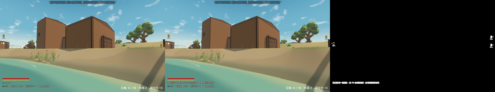
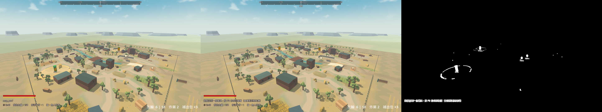
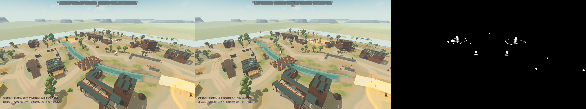
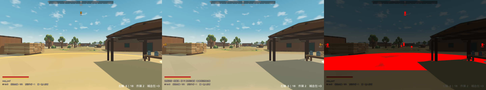
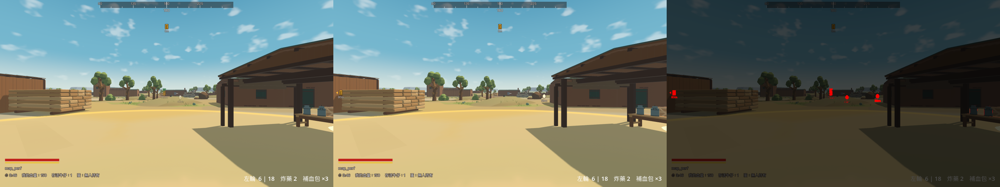
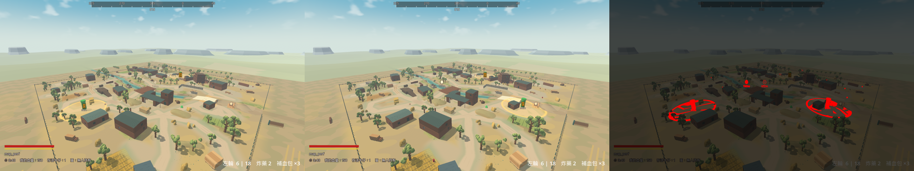
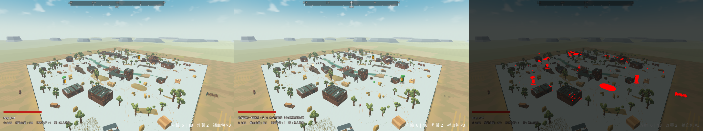

# 農莊效能改善（計畫）

日期：2026-11-26。只是計畫，還沒動遊戲程式。對象：主遊戲用的灌渠農莊 r014（PR #187）。外觀不改：美術素材和畫面風格是農莊作者的，這份只排「程式這邊做、看起來一樣」的事，另外寫一節建議轉給美術。

## 結論

- **重的是畫面，不是主機**。農莊每一幀叫顯示卡畫的次數（繪製指令）是灰盒的 9 倍、影子是 22 倍；主機平常一幀跟灰盒一樣。
- **為什麼畫這麼多次**：場上 1690 個會畫的零件用了 1724 種不同的網格（幾乎每塊都是自己一份），引擎沒辦法把一樣的東西合成一次畫；而且 2191 個都投影子，影子要再畫好幾遍。
- **主機只有一個問題**：有東西被拆、重算尼諾拉的路時會頓一下 50～70 毫秒（Mac）。原因找到了：農莊 4300 個靜態碰撞體一次解析完，沒有分幀也沒有存起來重用。
- **做法**：先修主機的頓（P1，小），再把每棟的影子合成一塊（P2），再把每棟的畫面照材質合起來（P3）。拆到的那一棟當下換回原本的零件，所以零件照樣留在場上、照樣能拆，外觀不變。
- 開發機（M5 Pro）每秒 250 張以上，看不出差別；**過不過關要看隊友的 Windows 筆電有沒有 60 張**，這要真人量（見「過關線」）。

## 量到的數字

工具：`tools/map_perf.gd`（這次新增）和現有的 `tools/team_load.gd`。Mac（M5 Pro）、1920×1080、離線一個牛仔。同一台還開著編輯器，幀時間有雜訊，繪製指令和數量是準的。

```
godot --path . --resolution 1920x1080 --script tools/map_perf.gd                 # 農莊
godot --path . --resolution 1920x1080 --script tools/map_perf.gd -- --greybox    # 灰盒
BLAST=1 godot --headless --path . --script tools/map_perf.gd                     # 加量大量破壞
BOTS=3 ROLE=bots DURATION=30 godot --headless --path . --script tools/team_load.gd [-- --greybox]
```

畫面是站在 16 個地面位置（場地中心往外、八個方向各往內往外看）加一個高處，取平均和最重的一個。

| | 農莊 | 灰盒 | 倍數 |
| :--- | :--- | :--- | :--- |
| 畫面繪製指令（平均／最重） | 1143／2374 | 133／239 | 8.6 |
| 影子繪製指令（平均／最重） | 1236／1759 | 57／106 | 22 |
| 畫面三角形（平均／最重） | 92 萬／182 萬 | 16 萬／25 萬 | 5.8 |
| 影子三角形（平均／最重） | 125 萬／184 萬 | 18 萬／20 萬 | 6.8 |
| 一幀（Mac，平均／最重） | 3.2／4.3 毫秒 | 2.3／2.8 | 1.4 |
| 會畫的節點 | 2223 | 234 | |
| 不同的網格／不同的材質 | 1724／143 | 30／46 | |
| 投影子的節點 | 2191 | 30 | |
| 場上全部節點 | 22799 | 12725 | |
| 靜態碰撞體／啟用的碰撞形狀 | 4302／11109 | 209／11842 | |
| 可破壞 | 5053 個單位 | 194 棟 12242 塊 | |
| 物理一步（沒人動） | 0.46～0.68 毫秒 | 0.59～0.65 | 一樣 |
| 一次炸 25 處：呼叫本身／下一幀 | 106～123／118～131 毫秒 | 31～38／沒超過 50 | |
| 炸完 8 秒內物理一步（平均／最慢） | 2.0／6.7 毫秒 | 1.0～1.3／3.5 | |
| 炸完都停了，物理一步 | 0.48～0.67 毫秒 | 0.46 | 一樣 |
| 專用伺服器一幀，電腦 3＋尼諾拉（平均／最慢 1%／最慢 0.1%） | 2.07／4.00／**52** | 1.96／3.81／9.4 | |
| 專用伺服器一幀，電腦 9＋尼諾拉（平均／最慢 1%／最慢 0.1%） | 2.80／7.13／21 | 2.99／5.04／16 | |
| 載入到第 3 幀（有畫面／沒畫面） | 1.9／1.0 秒 | 0.7／0.6 秒 | |
| 記憶體（一般／顯示卡） | 515／413 MB | 337／286 MB | |
| 匯出的資源包（.pck） | 73.4 MB | 36.1 MB（11-23 的包，農莊之前） | 2.0 |

補充：

- 舊牧場第 84 版（[效能](效能.md)）第一人稱是畫面 493、影子 825。農莊地面視角平均已經是它的 2.3 倍和 1.5 倍。
- 「一次炸 25 處」是故意壓到極限（力道 2、半徑 8 公尺、同一幀），真的玩不會這樣；一次拆出 1386 塊碎塊、多 2000 個靜態碰撞體。碎塊都停下來以後物理回到原本的數字，所以「落地後不再被推」這個設計是對的，不用動。
- 主機的 52 毫秒：用暫時的計時查過，每次都對到「重算尼諾拉的路」解析完的那一幀（`main.gd` 的 `_parse_arena` 最後一行，把不是積木的靜態碰撞體一次解析）。灰盒那一堆只有幾個，農莊有 4300 個。5 秒最多一次。
- 會畫的零件 1690 個裡，1476 個屬於可破壞單位，分在 113 群（一棟房子、一個場站算一群）。最長邊不到 2 公尺還投影子的有 685 個。
- 碎塊的「家」168 個、2.4 萬塊，平常是藏起來的、沒有碰撞，不佔畫面也不佔物理。

## 瓶頸排序

1. **影子的繪製指令**（客戶端）：平均 1236，是畫面本身還多。每個零件各投各的影子，太陽影子分 4 層、85 公尺。
2. **畫面的繪製指令**（客戶端）：平均 1143、高處 2374。每個零件一份網格＋143 種材質，合不起來。
3. **主機重算路的那一頓**（主機、開房的人）：Mac 上 50～70 毫秒，慢的主機照以前的換算會到幾百毫秒，每次有東西被拆、5 秒內最多一次。
4. 大量破壞那一下（兩邊）：極限測試才到 120 毫秒；一般一次拆一面牆多久**還沒量**。
5. 資源包變兩倍（下載時間）。

不是瓶頸、不用做：靜態碰撞的數量（沒人動的物理跟灰盒一樣）、載入時間（1.9 秒）、主機平常的一幀（跟灰盒一樣）。

## 過關線

- **主機**：沿用[伺服器效能改善](伺服器效能改善.md)的線（換算後平均 ≤ 6、最慢 1% ≤ 16 毫秒）。這次加一條：Mac 上電腦 3＋尼諾拉 30 秒，**最慢 0.1% ≤ 16 毫秒、開場之後記錄裡沒有「主機停頓」**。
- **客戶端**：隊友的 Windows 筆電 1920×1080 不低於每秒 60 張。開發機量不出來，先用繪製指令當代替：**地面視角平均 畫面 ≤ 500、影子 ≤ 500，最重的一個各 ≤ 800**（大約是舊牧場第 84 版的水準，那版隊友跑得動）。做完 P2、P3 請一位隊友實機看張數，才算真的過。

## 知識庫說了什麼

`~/ObsidianVault/知識庫/` 裡沒有專講 Godot 繪製效能的筆記，用得上的只有這些：

| 筆記 | 說了什麼 | 用在哪 |
| :--- | :--- | :--- |
| `Godot/Blender 程式建模到 Godot 的資產管線.md` | 大量重複的東西用 MultiMesh，模型控制在幾十個三角形 | 給美術的建議：重複的零件共用同一份網格 |
| `建模與動畫/一人一天跑通 AI 3D 資產生產線…（NoMagic）.md` | 遇到毛病先問「玩家看得到嗎」再決定修或繞開；gltfpack 壓 GLB | 影子合併、遮擋都是「玩家看不到差別」的做法；資源包瘦身 |
| `程序化世界/程序化山林大升級…（Rune）.md` | 遠的東西用粗的版本，成本不隨視野增加 | 給美術的建議：烘進場景檔的網格要有簡化版 |
| 本專案 [效能](效能.md) | 影子最花；手動把**同一種網格**合成 MultiMesh 反而更糟（引擎本來就會合） | 農莊的情況相反：網格幾乎都不一樣，引擎合不了，所以要合的是「一棟裡不同的零件」，不是改 MultiMesh |

## 我們做的（程式）

每步一個 PR。都不改 `.glb`、`.blend`、貼圖和場景檔的外觀。

### P0 量測工具（這個 PR）

`tools/map_perf.gd`。之後每一步都用它前後各跑一次。

### P1 主機重算路不再頓

- **改**：`main.gd` 的 `_parse_arena`。農莊的靜態碰撞體照群（一棟一群）解析、存起來，跟積木的 `_toy_nav` 同一個做法；`levels/farm_destruction/registry.gd` 有零件被拆時告訴它哪一群要重解析。解析也要算進每幀 3 毫秒的額度。
- **預期**：那一頓 50～70 → 5 毫秒以內（Mac）。
- **驗收**：上面主機那條新的線；重算前後導航網格的多邊形數一樣（改前後各印一次）；`tests/` 全過。
- **畫面、玩法**：不變。
- **可以和 P2 同時做**（不同檔）。

### P2 每棟的影子合成一塊

- **改**：新檔（例如 `farm_batch.gd`），`main.gd` 在農莊裝好後呼叫。每一群把所有投影子的零件合成一個「只投影子、自己不畫」的網格，原本的零件改成不投影子。那一群有零件被拆：當下整群換回各投各的，安靜幾秒後重合（一幀最多合一群）。有鏤空貼圖的（樹葉）不合。`registry.gd` 加一個「哪些零件變了」的通知。
- **預期**：影子繪製指令平均 1236 → 500 以下。估的，要量：不知道 504 個 MultiMesh（田、樹）佔了多少，佔很多的話另外處理。
- **驗收**：`map_perf.gd` 影子的數字；同一個角度改前改後截圖疊圖，影子一樣；拆一面牆，影子當下跟著少一塊。
- **畫面、玩法**：不變。合起來的是同樣的三角形。
- **先做這步再做 P3**（共用分群、合併、重合的程式）。
- **做到哪（2026-11-27）**：做好了，`levels/farm_destruction/farm_batch.gd`，`registry.gd` 的 `finish_environment` 最後呼叫（`FARM_SHADOW_BATCH=0` 關掉，量改前用）。和上面計畫不一樣的地方：
  - **不是整群換回原零件，而是把拆掉那塊在合併網格裡的頂點縮成一點**（`surface_update_vertex_region`）；立回來就寫回原本的頂點。同一幀生效、只動那一塊，不用「安靜幾秒後重合」，換局還原也自動對。原零件一直不投影子，影子永遠只畫一次。
  - **分群照位置分格（48 公尺一格）**，不照建築：不用維護哪棟是哪群，農莊外圍的靜態零件也一起合。24 公尺一格是影子 573／三角形 134 萬，48 公尺是 540／147 萬，取 48。
  - 「哪些零件變了」不用 registry 通知：每個合了的零件接自己的 `visibility_changed`（藏上層也會發），所以任何藏法（拆、破玻璃、整棟退場、晚加入收狀態）都接得到。
  - 不合的：會動的（門、門扇、積木、物理體）、半透明、會改頂點或挖洞的著色器（只讀頂點的牆、地面著色器會合）、MultiMesh、比一格大的（地面）。
- **量到的**（Mac，`map_perf.gd`，17 個角度）：

| | 改前 | 改後 |
| :--- | :--- | :--- |
| 影子繪製指令（平均／最重） | 1236／1759 | **540／815** |
| 影子三角形（平均／最重） | 125 萬／184 萬 | 147 萬／223 萬 |
| 畫面繪製指令（平均／最重） | 1143／2374 | 1143／2375（不變） |
| 投影子的節點 | 2191 | 651（1602 個零件合成 62 塊） |
| 載入時多花 | | 約 0.6～0.9 秒（讀網格資料，一次） |

  - **還差一點沒到 500**：剩下的大多是 492 個投影子的 MultiMesh（貨垛、堆料、屋頂料 400 個左右，積木樹 94 個）。它們在遊戲中會被改（`registry._set_present`、`farm_stock_groups` 搬格子、`farm_yard_loads`），要合就要在這幾處各加通知，範圍變大，這次沒做。
  - 截圖（左改前、中改後、右是差異 >10% 的像素；差異只有隨機擺的桶子、標記、介面字）：
    
    
  - 藏起三分之一的零件，不合併和合併比（影子一樣少掉同樣的那些）；再立回來和一開始比，差 0.004% 的像素：
    

### P3 每棟的畫面照材質合起來

- **改**：同一個檔。每一群裡同材質的零件合成一個網格，原本的零件藏起來（**只是不畫，節點和碰撞都在**）；那一群被拆到就整群換回原本的零件、把壞掉的照現在的做法處理，安靜後把沒壞的重合。參數一模一樣的材質先當成同一個。
- **先量再決定做不做**：先印「每群有幾種材質」。113 群 × 平均材質數就是合完的繪製指令；如果一群平均超過 8 種，合完還有 900 多，不划算，改請美術收斂材質（見下節）再做。
- **預期**：畫面繪製指令平均 1143 → 500 上下（看上面那個數）。
- **代價**：合起來的網格是整棟一起判斷在不在畫面裡、也沒有遠處的簡化版，三角形會變多一些。三角形增加超過三成就用程式幫合起來的網格產生簡化版（`ImporterMesh.generate_lods`）。
- **驗收**：`map_perf.gd` 畫面的數字；截圖疊圖一樣；`masonry_check.gd` 和 `tests/` 全過（受擊、掉件、換局還原）；連線時晚加入的人看到的破壞狀態一樣。
- **畫面、玩法**：不變。風險比 P2 高（碰到破壞、換局還原、晚加入）。
- **先量的結果（2026-11-27）**：48 公尺一格、能合的零件 1620 個（1960 段），合完 **每格平均 4.7 種材質**（最多 27 種），參數一樣的材質當同一種後是 236 段 → 划算，做了。
- **做到哪（2026-11-27）**：做好了，同一個檔 `farm_batch.gd`（`FARM_DRAW_BATCH=0` 只合影子，量改前用）。和上面計畫不一樣的地方：
  - **不整群換回原零件**，和 P2 同一招：拆掉那塊把它在每一段裡的頂點縮成一點，立回來寫回原本的；原零件一直不畫（`layers` 設 0，節點、碰撞、顯示狀態照舊，遊戲還是照舊藏它、顯示它）。不會畫兩次、換局和晚加入自動對。
  - 影子和畫面**共用同一次讀出的網格資料**：合併從 0.74 秒變 0.91 秒（多 0.17 秒，不是多一倍）。
  - 每格一個畫面網格，裡面「同材質＋同頂點格式」一段；法線、切線照零件的轉向換過去，鏡像的零件繞向和切線方向反過來。
  - **只合影子、不合畫面的**：著色器用到物件自己座標的（物件空間頂點、物件位置、每個零件的參數；只用 `MODEL_MATRIX * vec4(VERTEX, 1.0)` 世界座標的可以合）、物件空間三面投影的材質、頂點有自訂欄位的、本來就只投影子的，和**地面**（有地面貼花那層的：田路、車轍、岸腳）。地面那條是實測出來的：田路和大地面疊在同一個高度，誰蓋誰是看畫的順序，合了順序變了，270° 那張整片田路不見（下圖左改前、中合了地面、右差異）。
    
- **量到的**（Mac，`map_perf.gd`，17 個角度；改前是 P2 做完的樣子）：

| | 改前（P2） | 改後 |
| :--- | :--- | :--- |
| 畫面繪製指令，16 個地面角度（平均／最重） | 1067／1713 | **487／730** |
| 畫面繪製指令，含高處（平均／最重） | 1144／2375 | 515／961（最重是高處看全場） |
| 畫面三角形（平均／最重） | 92.2 萬／181.8 萬 | 96.8 萬／182.7 萬（多 5%，沒到要做簡化版的三成） |
| 影子繪製指令（平均／最重） | 541／815 | 542／805（不變） |
| 合併 | 1602 個零件、影子 62 塊 | 1602 個零件、影子 62 塊、畫面 206 段（24 個網格） |
| 合併花的時間（載入時一次） | 0.74 秒 | 0.91 秒 |

  - 地面角度到了「平均 ≤ 500、最重 ≤ 800」；還要請隊友 Windows 筆電實機看張數。
  - 截圖（左改前、中改後、右是差異 >10% 的像素；上面方位條、下面介面字不算）：17 張差 0.07%～0.93%，差的只有隨機擺的撤離圈、桶子、標記。
    
    
  - 藏起三分之一的零件，只合影子和合畫面比（差 0.79%，都是隨機物件）；再立回來比，差 0.92%（同樣是隨機物件）：
    

### P4 被牆擋住的不畫（遮擋剔除）

- **改**：`project.godot` 打開遮擋剔除；用程式拿夠大的牆和屋頂的碰撞方塊（縮小一點）當遮擋物，那塊被拆就拿掉。
- **預期**：不知道，要量。屋裡的家具和存貨（`StockBatches` 一群就 24 萬三角形）在外面看不到，應該有用。**畫面繪製指令少不到兩成就不合併這個 PR**。
- **驗收**：`map_perf.gd`；繞場走一圈沒有東西突然冒出來。
- **畫面、玩法**：不變。
- **可以和 P1 同時做**；數字要在 P2、P3 之後量才準。

### P5 拆東西那一下（先量）

- **先量**：用 `tools/smooth_probe.gd` 的做法，量尼諾拉甩尾拆一面牆、衝過一棟房子時最慢的一幀。超過 8 毫秒（Mac）才往下做。
- **改**（要做的話）：`levels/farm_destruction/fragments.gd` 放碎塊時照 `toy_build.gd` 現成的每步上限排隊（`SPAWN_PER_TICK`），不要一步全生。
- **畫面、玩法**：碎塊照樣全部留在場上，只是分幾步出現（積木本來就這樣）。
- **獨立**，隨時可做。

### P6 資源包瘦身（小）

- **改**：`export_presets.cfg` 的排除清單。`tools/map_study/` 底下的審查圖、製作腳本，和同一間房的幾個版本（`author/`、`rooms/`、`lean/`、`baked/`）裡遊戲沒載入的那些不要打包。先列出遊戲實際載入哪些再排除。
- **預期**：少幾 MB 到十幾 MB，要列了才知道。最大的單檔是 `levels/farm_style_buildings/farm_parts.glb`（12.9 MB），那是美術的。
- **驗收**：匯出後開農莊打一局，記錄裡沒有載入失敗。
- **獨立**。

### 順序

- 主線：P1 → P2 → P3。
- 可以同時做：P1 和 P2；P4、P5、P6 各自獨立。
- P2、P3 做完請隊友實機量張數。

## 看得出差別的做法（預設不做）

這些省得多，但畫面會變，沒有使用者和美術同意不做：

- 小東西（最長邊不到 2 公尺，685 個）不投影子、90 公尺外不畫：舊牧場做過（`arena_map.gd` 的 `_lighten_small`）。地上會少掉小影子。
- 太陽影子 85 → 70 公尺，或分層 4 → 2：遠處影子消失、近處影子邊緣變粗。
- 屋裡的家具離遠了就不畫：從窗戶看進去會是空的。

## 給美術的建議（只是建議，我們不動手）

請使用者轉給農莊作者。照省多少排：

1. **一樣的零件共用同一份網格**。現在 1690 個零件有 1724 種網格，幾乎每塊木板、每個箱子、每袋穀都是自己的一份。同一種東西用同一份網格（位置、大小放在節點上），引擎就會自己合成一次畫，P3 也不用合得那麼辛苦。
2. **材質收斂**。全場 143 種。一棟房子如果能只用 2～3 種（例如一張色盤貼圖或頂點色，共用一個材質），一棟合起來就是 2～3 次繪製。
3. **面數最多的幾群**：`FarmBuildings31` 39 萬、`StockBatches`（存貨）24 萬（151 個零件，平均一個 1560 面）、`FarmBuildings004` 20 萬、`YardLoadSites` 9 萬。存貨是小東西、數量多，最值得減。
4. **烘進場景檔的網格要有遠處的簡化版**。很多網格存在 `baked/*.scn` 裡，不是從 `.glb` 匯入的；`.glb` 匯入時引擎會自動做簡化版，烘進場景檔的有沒有帶著**還沒確認**，請作者看一下。
5. **碰撞**：方塊最省（現在 9985 個方塊，沒問題）。165 個照三角面的碰撞、946 個凸包，能用幾個方塊代替的就換，主機解析和子彈判定都比較快。
6. **小擺設要不要投影子**：由美術決定哪些可以不投（見上一節第一點）。
7. **資源包**：`farm_parts.glb` 12.9 MB 一個檔；同一間房留了幾個版本，不用的可以拿掉。

## 沒做、沒量到的

- 沒有在 Windows 或內顯上量；張數的過關線要真人實機驗。
- 沒量 1＋9 真人連線的農莊（要同時開 10 個 Godot）；流量和地圖無關，主機的一幀已用全電腦的場比過。
- 一般玩法下拆一面牆的那一幀沒量（P5 先量）。
- 農莊每局開場都有一次約 60 毫秒的停頓（灰盒也有，更久），是開場第一次算路，沒有處理。
