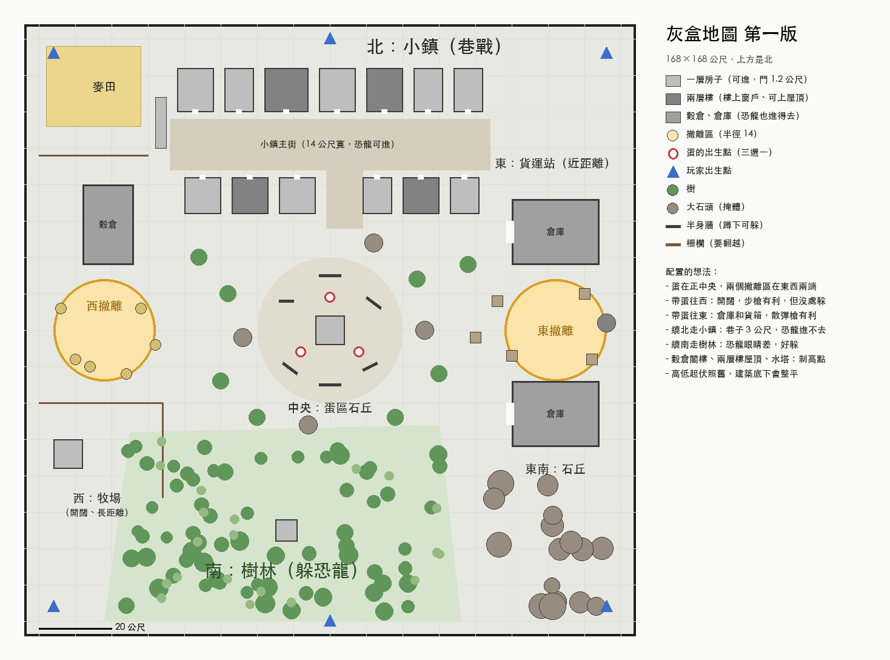

# 灰盒地圖：場景換成素模，專心調玩法

日期：2026-10-19

## 決定了什麼

- **主地圖換成灰盒**（`levels/greybox.tscn`）：建築是灰色方塊加 1 公尺格線，像 Unreal 的素模。四種模式（搶蛋、對抗、死鬥、恐龍決鬥）都在這張玩。
- **舊牧場留著**（`levels/ranch.tscn`），只給測試用（`Main.level_file` 指定）。靶場地圖不動。
- **保留**：地形起伏（同一套產生方式＋整平區）、角色和恐龍原樣、樹／灌木／石頭原樣（提供遮蔽）、撤離區、蛋。
- **灰盒地圖關掉**：草、野花、地面碎物、落葉飛蟲、風滾草、分區調光、地面細節層、像素風（設定裡還能開）。時段固定正午。
- **配置第一版由 Claude 排**（下圖），先不細調，之後在編輯器裡改。

## 配置的想法

- 蛋在正中央，撤離區在東西兩端（位置沒變）。
- 帶蛋往外有四條路，打法各不同：北邊小鎮（巷戰，巷子 3 公尺恐龍進不去）、南邊樹林（躲恐龍）、西邊牧場（開闊、步槍）、東邊貨運站（倉庫、近距離）。
- 中央南北一條（`GREYBOX_LANE`，寬 14 公尺）空著，給沙盒的靶。

## 做法

- `greybox.gd`：兩種東西，遊戲和編輯器預覽共用。
  - **房子**（`gb_house`）：寬 × 每層高 × 深、幾層。一樓前後門 1.4 公尺（恐龍半徑 2.4 擠不進），可以換成 6 × 8.5 公尺的大門（恐龍進得去）。窗台 1 公尺可以翻越。兩層以上貼左牆有 30 度斜坡上樓。平屋頂，上不去。
  - **方塊**（`gb_block`）：半身牆、箱子、矮牆、平台。
  - 一棟合併成一個網格（一次繪製），碰撞每塊一個。牆和地板往地下多埋 1 公尺，蓋在斜坡上不露縫。
- `greybox.gdshader`：世界座標的格線，1 公尺細線、5 公尺粗線。朝上的面比較暗，分得出地板和牆。
- 恐龍的導航網格照碰撞自動烘，所以小門自然擋住恐龍，不用另外設定。
- 物件庫多了 `灰盒_*` 七種，在編輯器裡拖進場景就能用。

## 驗收

- `test_battle.gd` 的 `_case_greybox`：擺設檢查乾淨；正午、像素風關；每棟的前門牛仔過得去；一般門恐龍擠不進、大門進得去；斜坡中段高度對、頭頂沒擋住。
- 其他舊案例照牧場跑，全部通過。
- 截圖：`docs/image/灰盒地圖/`。

## 沒做的

- 屋頂上不去、沒有樓梯以外的爬高點（穀倉閣樓、水塔）。要制高點再加平台或梯子。
- 撤離區、蛋、出生點還是寫在程式裡，不能在編輯器拖。
- 門沒有門板（不能開關）。
- 灰盒的牆打中噴木屑，但子彈穿不過（不在可穿透的木板、鐵皮群組裡）。
- 柵欄用原本的木柵欄（`fence`）：灰盒方塊只有中心貼地，長長一條橫跨山坡會一頭埋一頭浮。
