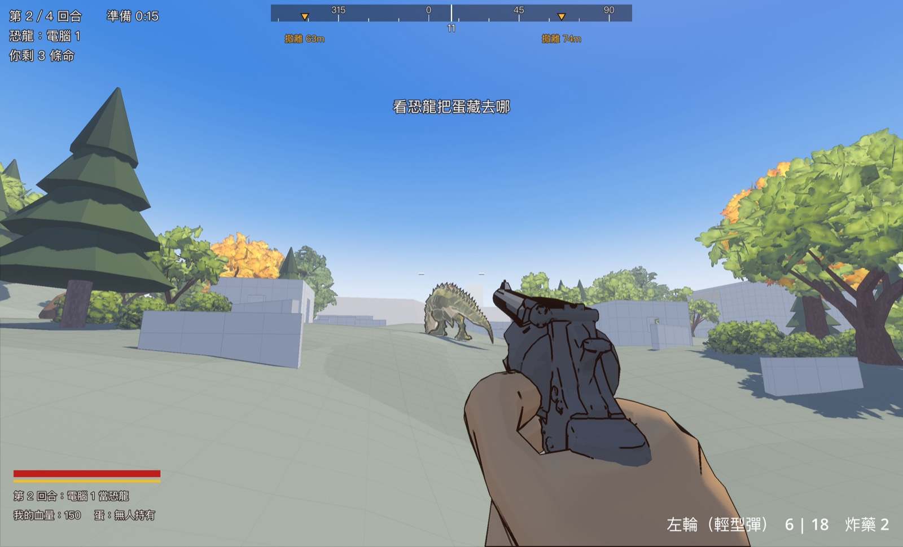
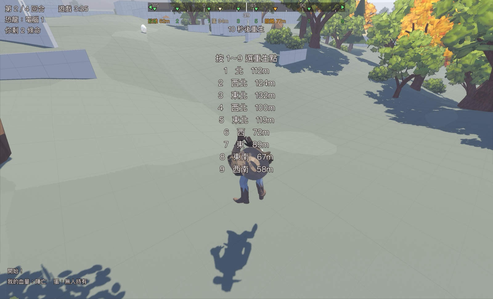
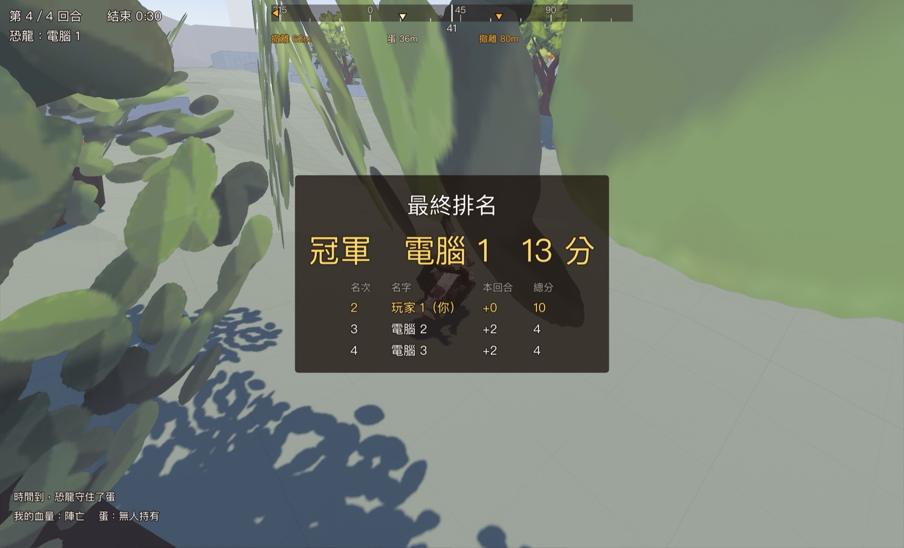

# 派對模式：四個人輪流當恐龍，四回合比總分

日期：2026-10-20

規格：[派對玩法](../企劃/派對玩法.md)（PR #44）。這裡記第一版怎麼做、做到哪。

## 決定了什麼

- **新模式「派對」**（`RULES` 的 `party`），連線開房時選。不到 4 個真人用電腦補。
- **一場 4 回合**，每回合：準備 15 秒 → 遊戲 3 分 30 秒 → 結算 8 秒。四回合結束停 30 秒顯示最終排名，再自動開新的一場。
- **誰當恐龍**：真人照連線編號排、電腦補在後面，第 N 回合第 N 個人當。真人當就是操作尼諾拉（對抗模式那套），電腦當就是 boss 自己跑。中途加入的人頂掉還沒當過恐龍的電腦。
- **計分照規格**：牛仔活到回合結束 2、帶蛋撤離另加 8；恐龍殺一個 1、守住蛋 10。死掉不扣分。
- **生死**：牛仔每回合 3 條命，死後 10 秒重生，死掉時按 1～9 選重生點（不選就隨機）。命用完就觀戰（鏡頭跟著還在場上的牛仔，左鍵換人）。恐龍不會死：打倒趴 15 秒原地起身，起身 3 秒無敵（身體閃爍）。
- **蛋**：恐龍拿不到。準備時間蛋跟著恐龍走、只有恐龍看得到，按 F 放在腳下；15 秒到了沒放就放在恐龍腳下。帶蛋的人死了蛋掉在原地。
- **準備和結算時**：牛仔站著不能動、不能開槍（還能轉頭看恐龍往哪走），誰都不扣血。
- **甩尾拆地形**（只有派對模式）：樹一下倒、灰盒房子兩下塌進地裡、安全屋拆不掉。甩尾冷卻 20 秒（其他模式還是 8 秒）。
- **地圖**（灰盒）：加 2 間安全屋（內部約 4×4 公尺，門窗恐龍擠不進）、9 個牛仔出生／重生點散在四周、恐龍在中央出生；蛋區往外多種樹林草叢。

## 做法

分五塊，各自一個檔案為主，`main.gd` 只接線：

| 哪塊 | 檔案 | 做什麼 |
|---|---|---|
| 規則 | `party.gd`（`Party`） | 回合、計分、命、蛋、重生。主機每個物理幀跑 `step`，算完整包 RPC 給客戶端（變了就送，另外每秒一次給晚加入的人）。客戶端只自己倒數讓畫面順 |
| 恐龍 | `boss.gd` | 派對模式倒地 15 秒、起身無敵 `guard_left`（同步器有送）；甩尾打中的 `destructible` 各呼叫 `tail_hit` |
| 拆地形 | `destructible.gd` | 主機記被打幾下、廣播；倒了拿掉碰撞、重烘恐龍的導航網格。節點照蓋的順序叫 `Wreck0…`，每台一樣。晚加入的人連進來時補送拆過的 |
| 畫面 | `party_hud.gd`（`PartyHud`） | 左上回合／倒數／誰是恐龍／剩幾條命；中間準備提示、選重生點清單；Tab 分數板；結算框、最終排名。只讀 `main.party` |
| 地圖 | `levels/` | 擺設種類 `gb_safe`、`spawn`、`dino_spawn`，編輯器裡拖得動（見[場景編輯](../素材流水線/場景編輯.md)） |

整合時補的縫：

- 舊的命數系統不插手（`party` 的 `lives` 填 -1），命數只在 `Party` 裡。左下的舊 HUD 在派對模式只寫血量和蛋；回合、倒數交給 `PartyHud`。方位條下面的重生倒數改成 10 秒。
- 命用完接原本的觀戰鏡頭（`main._is_out`：派對模式看 `Party.lives`）。
- 方位條：選重生點時標出每個點的編號，選好只標選的那個。
- 準備階段三個牛仔各站一個不同的出生點。
- 恐龍出招時目標剛好被刪掉（換回合清場）會噴錯：`boss._turn_to` 參數不寫型別。

## 驗收

- `test_battle.gd` 五個 `_case_party_*`：恐龍倒地起身無敵、地圖（安全屋牛仔進得去恐龍進不去、出生點）、拆地形、畫面各階段文字、規則（輪流、計分、命、蛋、重生、命用完恐龍贏）。全部通過。
- 離線模擬完整四回合（主機＋3 電腦、時間 8 倍速）：每回合恐龍照順序換人、恐龍在中央出生、牛仔各站不同出生點、準備時牛仔沒動、蛋放好、甩尾拆樹拆房子安全屋不倒、恐龍倒地 15 秒起身無敵 3 秒、死掉選第 4 個點 10 秒後生在那裡、帶蛋撤離結束回合、命用完接觀戰、恐龍分數＝殺的人數（＋守蛋 10）、總分＝各回合加總、四回合後進結算 30 秒後重開。沒有 SCRIPT ERROR。
- 連線：主機（派對模式）＋一個客戶端兩個行程。客戶端收到回合、階段、分數；連上之前甩倒的樹有補送到、連上之後甩倒的房子同步到；下一回合排進名單。
- 截圖：`docs/image/派對模式/`（真實派對局）、`docs/image/派對畫面/`（畫面排版，假資料）。

## 沒做的

- 規格「還沒定的」五點（安全屋怎麼威脅、準備時牛仔怎麼看恐龍、數字合不合理）都等試玩。
- 牛仔出生點有的在麥田裡，準備時間看不到恐龍，要看試玩再挪。
- 數字鍵只能選前 9 個重生點（地圖現在剛好 9 個）。
- 電腦牛仔不懂派對規則（不會特地去搶別人的蛋、不會躲安全屋），照原本搶蛋的 bot 跑。
- 倒掉的東西只是藏起來；bot 找掩體用的擺設清單不會跟著改。
- 中途加入的人這回合先當牛仔，下一回合才排進名單（排進去時分數從 0 算）。
- 方位條上蛋和重生點方向剛好一樣時字會疊在一起（方位條原本就這樣）。
